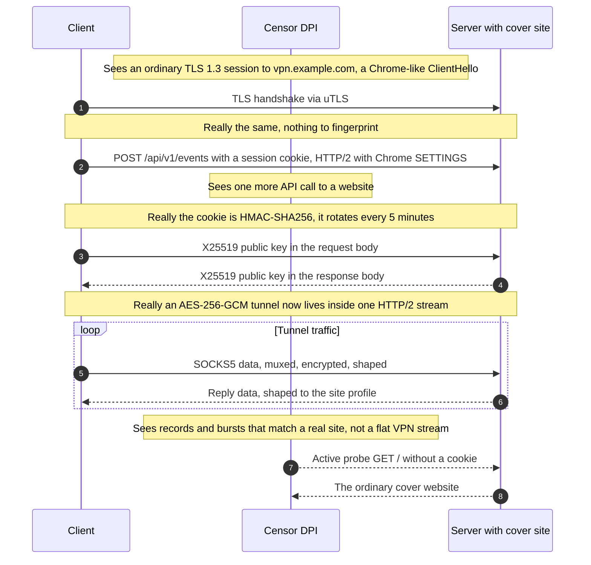
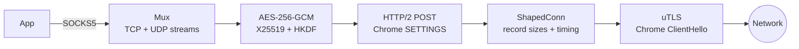

<p align="center"></p>

<h1 align="center">Chamele0nX</h1>

<p align="center"><b>A VPN transport that looks like someone browsing a website.</b><br>
To a DPI box it is plain HTTPS to a real site, right down to record sizes and timing.</p>

<p align="center">
  <a href="LICENSE"></a>
  <a href="go.mod"></a>
  
  <a href="https://github.com/meshoklv/chamele0nx/actions/workflows/ci.yml"></a>
  
</p>

<p align="center">
  <a href="#-quick-start">Quick start</a> ·
  <a href="#-features">Features</a> ·
  <a href="#-how-it-works">How it works</a> ·
  <a href="#-how-it-compares">Comparison</a> ·
  <a href="#-configuration">Configuration</a> ·
  <a href="README.ru.md">Русский</a>
</p>

---

<table>
<tr>
<td width="33%" valign="top">

**🌐 A real website**<br>
Real domain, real certificate. A visitor, or an active prober, with no valid cookie gets the cover site and nothing else.

</td>
<td width="33%" valign="top">

**📈 Shaped like one**<br>
TLS record sizes, bursts and pauses are drawn from a profile measured on real site traffic, not a flat river of 16 KB records.

</td>
<td width="33%" valign="top">

**🦎 Chrome on the wire**<br>
uTLS ClientHello plus Chrome's exact HTTP/2 SETTINGS, window update and header order.

</td>
</tr>
</table>

## 💡 Why

Censors increasingly stop looking *inside* your TLS and look at its **shape**: record sizes, burst
pattern, idle gaps, up/down ratio, session length. A VPN pushing a video stream is a long flat
stream of maximum-size records; a person on a web dashboard is short, uneven bursts with pauses.
A classifier trained on that difference does not care that your payload is encrypted or your SNI
says `microsoft.com`. Protocols that only hide *what* you send keep getting blocked for this reason.

Chamele0nX hides the *shape* too. It carries the tunnel inside an HTTP/2 POST to a site you run,
and reshapes the TLS record stream to match that site's statistics.

## ✨ Features

| | |
|---|---|
| 🕵️ **Probe-resistant** | No valid cookie means the cover site answers. No special port, no special path. |
| 🍪 **Rotating auth** | `HMAC-SHA256(secret, time_bucket ‖ server_id)` in a WordPress, Django or generic session cookie. Rotates every 5 minutes, compared in constant time. |
| 📊 **Profile-based shaping** | Record-size histogram, burst length and pauses from `chamele0nx-profiler`, applied both directions. |
| 🔐 **Forward secrecy** | X25519 key exchange, HKDF-SHA256, AES-256-GCM inside the HTTP/2 stream. |
| 🔀 **Multiplexed** | TCP and UDP streams over a single POST. Local SOCKS5 proxy on the client. |
| 🧪 **Self-testing** | `chamele0nx-validator` runs statistical tests: does our output match the profile? 180 Go tests. |
| 📦 **One small binary each** | Server, client, profiler, validator. Go 1.26, pure Go (CGO off). |

## 🚀 Quick start

You need a server with a domain and a TLS certificate, and Go 1.26 to build.

```bash
git clone https://github.com/meshoklv/chamele0nx && cd chamele0nx
make build            # -> ./bin/chamele0nx-{server,client,profiler,validator}
```

**Server** (put a real static site in `-cover-dir`):

```bash
./bin/chamele0nx-server -addr :443 \
  -cert /etc/letsencrypt/live/vpn.example.com/fullchain.pem \
  -key  /etc/letsencrypt/live/vpn.example.com/privkey.pem \
  -cover-dir /var/www/cover -cookie-format wordpress
# with no -secret it generates one and prints it; that value is the only credential
```

**Client** (opens a local SOCKS5 proxy):

```bash
./bin/chamele0nx-client -server vpn.example.com:443 \
  -secret-file ~/.config/chamele0nx/secret -cookie-format wordpress -port 1080

curl -x socks5h://127.0.0.1:1080 https://example.org/
```

Check the whole path without configuring anything else: add `-check` to the client command.

> [!WARNING]
> The defaults you did not change are what give you away: `-api-path`, `-server-id`,
> `-cookie-format` and the sample cover site are identical on every untouched deployment.
> Change them together, on both sides ([INSTALL.md](docs/en/INSTALL.md), section 6), and capture
> your own traffic profile ([PROFILES.md](docs/en/PROFILES.md)).

<details>
<summary><b>🐳 Docker Compose (server on a VPS, client at home)</b></summary>

```bash
cp .env.example .env && $EDITOR .env           # domain, shared settings
mkdir -p secrets certs && openssl rand -hex 32 > secrets/secret
docker compose --profile tools run --rm certbot && docker compose up -d server   # on the VPS
docker compose --profile client up -d client                                       # at home -> SOCKS5 127.0.0.1:1080
```

> [!NOTE]
> **Tested:** Go build and the full test suite on Linux. **Not yet tested by the author:** the
> Dockerfile and `docker-compose.yml` end to end, macOS builds, the mobile bindings. Expect small
> fixes; PRs welcome. Details: [DOCKER.md](docs/en/DOCKER.md).

</details>

## 🔬 How it works

What the network sees and what is actually going on, on the same connection:





Everything above the shaper is ordinary and testable in isolation. The shaper sits *between* TLS and
the HTTP/2 framer: that one seam is the whole mechanism. Deeper reading:
[ARCHITECTURE.md](docs/en/ARCHITECTURE.md) · [SPEC.md](docs/en/SPEC.md) · [THREAT-MODEL.md](docs/en/THREAT-MODEL.md).

| The observer checks | A typical VPN | Chamele0nX |
|---|---|---|
| Open the address in a browser | Nothing, or an error | An ordinary website |
| Probe with a wrong secret | A different error, or silence | The same website |
| Certificate and SNI | Often borrowed or self-signed | A real certificate for your own domain |
| Record sizes and bursts | Flat river of max-size records | Sized and paced from a real site's profile |
| HTTP/2 and TLS fingerprint | Library defaults | Chrome-like (uTLS plus Chrome H2 settings) |

## 🆚 How it compares

Facts and sources are in [COMPARISON.md](docs/en/COMPARISON.md); this is the short version, and it is
not a ranking. Several of these are older, bigger and better hardened than this project.

| Tool | Hides by | Reported weak spot (with sources in the doc) |
|---|---|---|
| **Shadowsocks 2022** | Fully encrypted stream, no handshake | The "no protocol structure" itself is detected by entropy heuristics (Wu et al., USENIX Security 2023) |
| **VLESS + REALITY** | Handshake borrowed from a real popular site | The data stream after the handshake is not shaped; users report volume-based blocking |
| **Trojan** | Real TLS, falls back to a real website | Blocked at scale in China from October 2022 (address-level) |
| **NaiveProxy** | Runs Chromium's own network stack | Nothing widely reported; needs a real domain and a Chromium dependency |
| **Hysteria 2** | QUIC, looks like HTTP/3 | SNI-based QUIC blocking; networks that drop UDP |
| **Chamele0nX** | Real site **plus** record-size and timing profile | One server address; one profile per server; no independent audit |

> [!NOTE]
> NaiveProxy solves the browser-fingerprint half more thoroughly than we do, by running the real
> thing instead of imitating it. If NaiveProxy or REALITY already work on your network, keep using
> them. Chamele0nX is for when what fails is not the handshake.

## 🔧 Configuration

<details open>
<summary><b>Server flags</b></summary>

| Flag | Default | Meaning |
|---|---|---|
| `-addr` | `:443` | Listen address |
| `-cert`, `-key` | | TLS certificate and key (PEM) |
| `-cover-dir` | | Static site served to everyone without a valid cookie |
| `-cookie-format` | `generic` | `generic`, `wordpress` or `django`; must match the client |
| `-api-path` | `/api/v1/events` | Tunnel endpoint; change it, match the client |
| `-server-id` | `chamele0nx-1` | Mixed into the auth token; change it, match the client |
| `-secret-file` | | Hex secret from a file (preferred over `-secret`, which shows up in `ps`) |
| `-profile` | built-in | Traffic profile JSON from `chamele0nx-profiler` |
| `-idle-timeout` | `5m` | Close relayed streams with no activity |
| `-log-format`, `-log-level` | `json`, `info` | Logging |

</details>

<details>
<summary><b>Client flags</b></summary>

| Flag | Default | Meaning |
|---|---|---|
| `-server` | | `host:port` of the server |
| `-secret-file` | | Hex secret from a file |
| `-port` | `0` (random) | Local SOCKS5 port, bound to 127.0.0.1 |
| `-cookie-format`, `-api-path`, `-server-id` | as server | Must equal the server's |
| `-sni` | host of `-server` | TLS SNI |
| `-profile` | built-in | Traffic profile JSON |
| `-check` | | Connect, print the external IP through the tunnel, exit |

</details>

Full setup (systemd, sysctl, firewall): [INSTALL.md](docs/en/INSTALL.md). Docker variables:
[.env.example](.env.example).

## 🧭 Status and limits

Working and in use on a small scale. It is research software, not a finished product.

| | |
|---|---|
| **Protocol core** | Stable. TCP and UDP both tunnel. 180 tests pass. |
| **Server** | Single host. Sustained operation at scale not evaluated. |
| **Clients** | CLI for Linux and macOS. Go bindings for iOS exist; no mobile app ships here. |
| **Throughput** | About 20 Mbit/s on a long intercontinental route, one measurement by the author. |
| **Independent review** | None yet. |

> [!WARNING]
> It does not make you invisible. The server's IP address can still be identified and blocked, and
> the server's own TLS fingerprint is Go's, not nginx's. Read [THREAT-MODEL.md](docs/en/THREAT-MODEL.md)
> and [DISCLAIMER.md](DISCLAIMER.md) before relying on it, and check the law where you live.

Known gaps, worst first, are in [ROADMAP.md](docs/en/ROADMAP.md): version negotiation, per-user
profile variation, stream flow control, server TLS fingerprint, server discovery.

## 📚 Documentation

| | English | Русский |
|---|---|---|
| Architecture | [ARCHITECTURE.md](docs/en/ARCHITECTURE.md) | [ARCHITECTURE.md](docs/ru/ARCHITECTURE.md) |
| Wire protocol | [SPEC.md](docs/en/SPEC.md) | [SPEC.md](docs/ru/SPEC.md) |
| Threat model | [THREAT-MODEL.md](docs/en/THREAT-MODEL.md) | [THREAT-MODEL.md](docs/ru/THREAT-MODEL.md) |
| Install a server | [INSTALL.md](docs/en/INSTALL.md) | [INSTALL.md](docs/ru/INSTALL.md) |
| Docker | [DOCKER.md](docs/en/DOCKER.md) | [DOCKER.md](docs/ru/DOCKER.md) |
| Operations | [OPERATIONS.md](docs/en/OPERATIONS.md) | [OPERATIONS.md](docs/ru/OPERATIONS.md) |
| Traffic profiles | [PROFILES.md](docs/en/PROFILES.md) | [PROFILES.md](docs/ru/PROFILES.md) |
| Clients | [CLIENTS.md](docs/en/CLIENTS.md) | [CLIENTS.md](docs/ru/CLIENTS.md) |
| Comparison | [COMPARISON.md](docs/en/COMPARISON.md) | [COMPARISON.md](docs/ru/COMPARISON.md) |
| FAQ | [FAQ.md](docs/en/FAQ.md) | [FAQ.md](docs/ru/FAQ.md) |
| Research | [RESEARCH.md](docs/en/RESEARCH.md) | [RESEARCH.md](docs/ru/RESEARCH.md) |

## 🤝 Contributing

Small pull requests, no change that makes traffic more regular, nothing identifying in logs.
See [CONTRIBUTING.md](CONTRIBUTING.md). **Security problems go through a private advisory, never a
public issue**: [SECURITY.md](SECURITY.md).

## 📄 License

[AGPL-3.0-or-later](LICENSE). Run it, modify it, offer it as a service; if you offer a modified
version as a service, publish the modifications. Dependencies: [THIRD_PARTY_NOTICES.md](THIRD_PARTY_NOTICES.md).
Built on [uTLS](https://github.com/refraction-networking/utls) and the published work of the
anti-censorship community ([RESEARCH.md](docs/en/RESEARCH.md)).

---

<p align="center">Made by <a href="https://github.com/meshoklv">@meshoklv</a></p>
