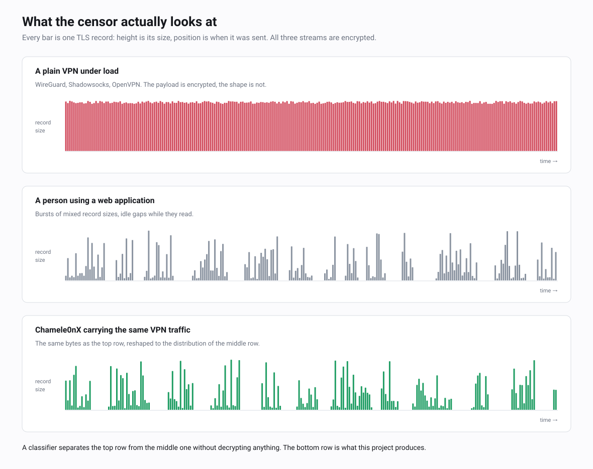
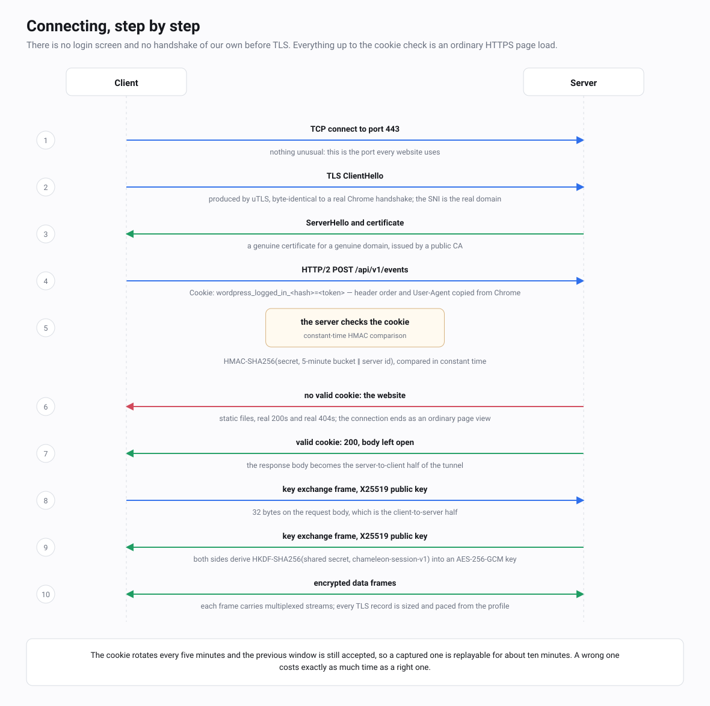

<p align="center"></p>

<div align="center">

<picture>
  <source media="(prefers-color-scheme: dark)" srcset="docs/assets/brand/chameleon-logo-dark.svg">
  
</picture>

# Chamele0nX

**A VPN transport that does not look like a VPN. It is shaped to look like someone using a website.**

</div>

[Русская версия](README.ru.md) · [Protocol specification](docs/en/SPEC.md) · [Threat model](docs/en/THREAT-MODEL.md) · [Install](docs/en/INSTALL.md) · [Docker](docs/en/DOCKER.md)

[](https://github.com/meshoklv/chamele0nx/actions/workflows/ci.yml)
[](LICENSE)
[](go.mod)

---

## The problem

Modern national censorship no longer looks inside your TLS connection. It
does not need to. It looks at the *shape* of the connection: how big the
TLS records are, how they clump into bursts, how long the pauses are, how
much you upload versus download, how long the session lasts.

A VPN carrying a video stream produces a long, flat river of maximum-size
records. A person reading a web dashboard produces short violent bursts
of mixed-size records with idle gaps in between. Those two things look
nothing alike, and a classifier trained on that difference does not care
that your payload is encrypted, that your certificate is real, or that
your SNI says `microsoft.com`.

This is why protocols that hide *what* you send keep getting blocked
anyway. Shadowsocks, VLESS+REALITY and WireGuard all encrypt perfectly
and all still get detected, because none of them was built to control
what the traffic *looks like* from the outside.



## What Chamele0nX does

Chamele0nX carries VPN traffic inside HTTP/2 requests to a real HTTPS
site, and then reshapes the TLS record stream so its statistics match a
real site's traffic profile.

Two things happen at once:

**It is a real website.** The server has a real domain and a real
certificate. If you point it at a cover site with `-cover-dir`, which is
empty by default, opening it in a browser gets you an ordinary web
application. There is no magic port and no special path that answers
differently. An unauthenticated visitor — including an active prober
checking whether this host is a proxy — sees the cover site and nothing
that points at a tunnel. Unknown paths get the cover site's own
`404.html` if the directory ships one — `deploy/cover-site` does. Leave
that file out and the fallback is Go's static file server, whose body is
the literal string `404 page not found`: not what a WordPress or Django
site would say, and enough on its own to tell a prober that the site is
not what its cover story claims. See
[INSTALL.md](docs/en/INSTALL.md) section 10.

**It moves like a real website.** Every TLS record the server emits is
sized and timed from a statistical profile measured on a real site: a
record-size histogram, how many records make up a burst, and how long the
pauses between bursts are. Bulk traffic is chopped and paced to fit that
distribution instead of streaming out flat 16 KB records. The profile
format also records session volumes and an upload-to-download ratio, but
the current shaper does not enforce those; see
[PROFILES.md](docs/en/PROFILES.md).

The result is a tunnel whose *metadata* matches the cover, not just its
contents.


## What an observer sees

| The observer checks | A typical VPN | Chamele0nX |
|---|---|---|
| Open the address in a browser | Nothing, or an error | An ordinary website |
| Probe the server with a wrong secret | A different error, or silence | The same website |
| Certificate and SNI | Often a borrowed or self-signed one | A real certificate for your own domain |
| Record sizes and bursts | A long flat river of max-size records | Sized and paced from a profile of a real site |
| HTTP/2 and TLS fingerprint | Library defaults | Chrome-like (uTLS) |

It does not make you invisible; read the [threat model](docs/en/THREAT-MODEL.md)
for what it does not cover.

## Run it at home in one command

Server on a VPS, client at home, both with Docker Compose
(details and caveats in [docs/en/DOCKER.md](docs/en/DOCKER.md)):

```bash
cp .env.example .env && $EDITOR .env           # domain, shared settings
mkdir -p secrets certs && openssl rand -hex 32 > secrets/secret
docker compose --profile tools run --rm certbot && docker compose up -d server   # on the VPS
docker compose --profile client up -d client                                       # at home -> SOCKS5 127.0.0.1:1080
```

## Status

Working and in use, on a small scale. It is not a finished product.

| | |
|---|---|
| **Protocol core** | Stable. TCP and UDP both tunnel. 122 test functions, all passing. |
| **Server** | Runs on a single host. Sustained operation at scale has not been evaluated. |
| **CLI client** | Linux and macOS, opens a local SOCKS5 proxy. |
| **Mobile** | Go bindings exist and are used by an out-of-tree iOS client. No mobile app ships from this repository. |
| **Measured throughput** | Around 20 Mbit/s on a long-haul intercontinental route. The ceiling was the route, not the protocol. One measurement, by the author, never reproduced. |
| **Independent review** | None yet. Nobody outside the project has audited this. |

Read [THREAT-MODEL.md](docs/en/THREAT-MODEL.md) before you rely on it for
anything that matters. It is explicit about what this does not protect
against.

## Quick start

You need a server with a domain name and a TLS certificate, and Go 1.26
to build. Full walkthrough in [INSTALL.md](docs/en/INSTALL.md).

```bash
git clone https://github.com/meshoklv/chamele0nx
cd chamele0nx
make build
```

**Server** — put a real static site in `-cover-dir`, then:

```bash
./bin/chamele0nx-server \
  -addr :443 \
  -cert /etc/letsencrypt/live/vpn.example.com/fullchain.pem \
  -key  /etc/letsencrypt/live/vpn.example.com/privkey.pem \
  -cover-dir /var/www/cover \
  -cookie-format wordpress
```

With no `-secret` it generates one and prints it. Save it; that value is
the only credential.

The defaults you did not set are the ones that give you away. `-api-path`,
`-server-id`, `-cookie-format` and the sample cover site are identical on
every unchanged deployment, so a scanner that learns one learns them all.
Change them together, to fit your cover story, and give the client the
same values — see [INSTALL.md](docs/en/INSTALL.md) section 6.

With no `-profile` the server uses its built-in shape. Before you put
real traffic through it, capture a profile from the site you are
pretending to be, with `chamele0nx-profiler`, and keep that file to
yourself. The examples in `deploy/profiles` exist so the flag can be
tried; a profile everyone runs is a profile everyone can be recognised
by. See [PROFILES.md](docs/en/PROFILES.md).

**Client** — opens a SOCKS5 proxy on localhost. Put the secret in a file
rather than on the command line: an argument is visible to every user on
the machine through `ps`, and it lands in your shell history.

```bash
./bin/chamele0nx-client \
  -server vpn.example.com:443 \
  -secret-file ~/.config/chamele0nx/secret \
  -cookie-format wordpress \
  -port 1080

curl -x socks5h://127.0.0.1:1080 https://example.org/
```

Check the tunnel end to end without configuring anything:

```bash
./bin/chamele0nx-client -server vpn.example.com:443 \
  -secret-file ~/.config/chamele0nx/secret -check
```

## How authentication works

There is no login. A visitor either presents a valid session cookie or
gets the website.

The cookie carries `HMAC-SHA256(secret, time_bucket || server_id)`, in
whatever cookie format the cover site's framework would use — a
WordPress login cookie, a Django `sessionid`, or a generic `sid`. It
rotates every five minutes, and the server accepts the current and the
previous window, so a captured cookie is replayable for at most about ten
minutes. It is compared in constant time, so a wrong secret takes exactly
as long to reject as a right one takes to accept.

Everything else — the API path, the request shape, the headers, the User
Agent — is what the cover site would produce anyway.



## What is in this repository

```
transport/chamele0nx/   the protocol: handshake, mux, shaping, cover, UDP
internal/chcrypto/     AES-256-GCM helpers and key zeroing
mobile/                gomobile bindings for iOS clients
cmd/chamele0nx-server/  the server
cmd/chamele0nx-client/  CLI client with a local SOCKS5 proxy
cmd/chamele0nx-profiler/  captures a traffic profile from a real site
cmd/chamele0nx-validator/ statistical tests: does our output match a profile
deploy/                systemd unit, TCP tuning, example profiles, cover site
docs/en/, docs/ru/     documentation in English and Russian
```

## Documentation

| | English | Русский |
|---|---|---|
| How it works, in depth | [ARCHITECTURE.md](docs/en/ARCHITECTURE.md) | [ARCHITECTURE.md](docs/ru/ARCHITECTURE.md) |
| Wire protocol specification | [SPEC.md](docs/en/SPEC.md) | [SPEC.md](docs/ru/SPEC.md) |
| What it protects against, and what it does not | [THREAT-MODEL.md](docs/en/THREAT-MODEL.md) | [THREAT-MODEL.md](docs/ru/THREAT-MODEL.md) |
| Installing a server | [INSTALL.md](docs/en/INSTALL.md) | [INSTALL.md](docs/ru/INSTALL.md) |
| Docker: server + home client | [DOCKER.md](docs/en/DOCKER.md) | [DOCKER.md](docs/ru/DOCKER.md) |
| Running one safely | [OPERATIONS.md](docs/en/OPERATIONS.md) | [OPERATIONS.md](docs/ru/OPERATIONS.md) |
| Traffic profiles | [PROFILES.md](docs/en/PROFILES.md) | [PROFILES.md](docs/ru/PROFILES.md) |
| Clients, including mobile | [CLIENTS.md](docs/en/CLIENTS.md) | [CLIENTS.md](docs/ru/CLIENTS.md) |
| How it compares to other tools | [COMPARISON.md](docs/en/COMPARISON.md) | [COMPARISON.md](docs/ru/COMPARISON.md) |
| Frequent questions | [FAQ.md](docs/en/FAQ.md) | [FAQ.md](docs/ru/FAQ.md) |
| Where this is going | [ROADMAP.md](docs/en/ROADMAP.md) | [ROADMAP.md](docs/ru/ROADMAP.md) |
| Research this design draws on | [RESEARCH.md](docs/en/RESEARCH.md) | [RESEARCH.md](docs/ru/RESEARCH.md) |

## Contributing

Read [CONTRIBUTING.md](CONTRIBUTING.md). The short version: small pull
requests, no change that makes the traffic more regular, nothing
identifying in logs, and **security problems go through a private
advisory, never a public issue** — see [SECURITY.md](SECURITY.md).

## Legal notice

Rules covering network transports of this kind differ substantially
between countries and change over time. In some places running or using
software like this is unremarkable; in others it carries consequences for
the person doing it. Working out which applies to you is your
responsibility, and this project cannot advise you on it.

This is research software, published so its design can be examined. It is
not offered as a service, and nobody operates infrastructure for anyone
here. Read [DISCLAIMER.md](DISCLAIMER.md) before you rely on any of it.

## Licence

Copyright (C) 2026 Chamele0nX contributors.

AGPL-3.0-or-later. See [LICENSE](LICENSE). Third-party dependencies: [THIRD_PARTY_NOTICES.md](THIRD_PARTY_NOTICES.md).

You may run this, modify it, and offer it as a service. If you offer a
modified version as a service, the AGPL requires you to publish those
modifications. That is the point: in this field, unauditable forks are
the problem, not the solution.

## Acknowledgements

This work stands on [uTLS](https://github.com/refraction-networking/utls)
for browser-accurate TLS fingerprints, and on the published research and
practice of the anti-censorship community — Tor's pluggable transports,
obfs4, meek, Snowflake, NaiveProxy, Xray/REALITY and Hysteria. See
[RESEARCH.md](docs/en/RESEARCH.md) for the papers this design draws on.
