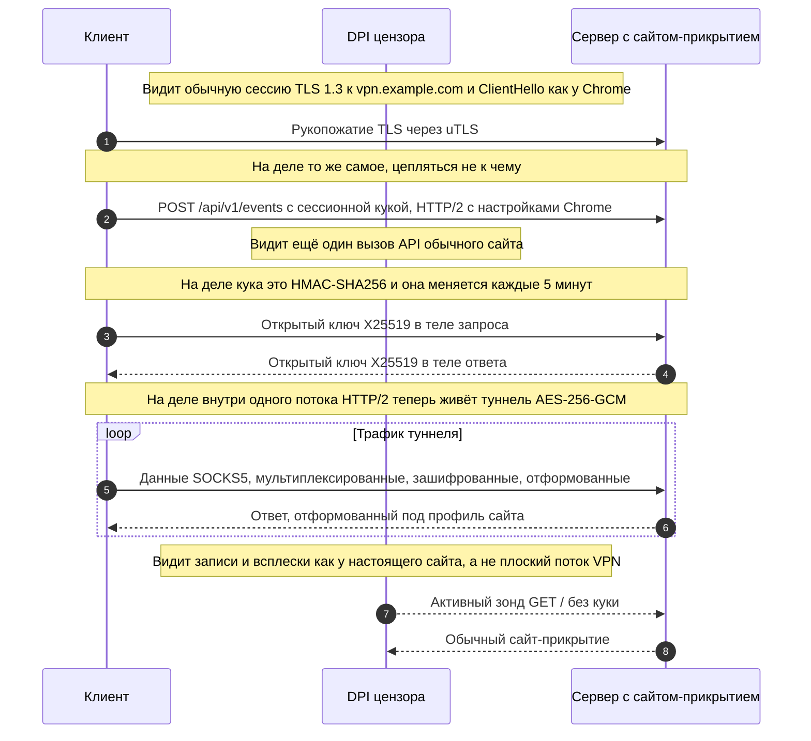
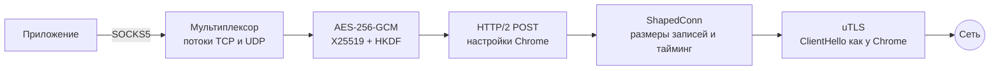

<p align="center"></p>

<h1 align="center">Chamele0nX</h1>

<p align="center"><b>VPN-транспорт, который выглядит как человек на сайте.</b><br>
Для DPI это обычный HTTPS к настоящему сайту, вплоть до размеров записей и пауз.</p>

<p align="center">
  <a href="LICENSE"></a>
  <a href="go.mod"></a>
  
  <a href="https://github.com/meshoklv/chamele0nx/actions/workflows/ci.yml"></a>
  
</p>

<p align="center">
  <a href="#-быстрый-старт">Быстрый старт</a> ·
  <a href="#-возможности">Возможности</a> ·
  <a href="#-как-это-работает">Как работает</a> ·
  <a href="#-сравнение-с-аналогами">Сравнение</a> ·
  <a href="#-настройка">Настройка</a> ·
  <a href="README.md">English</a>
</p>

---

<table>
<tr>
<td width="33%" valign="top">

**🌐 Настоящий сайт**<br>
Свой домен, настоящий сертификат. Посетитель или активный зонд без валидной куки получает сайт-прикрытие и больше ничего.

</td>
<td width="33%" valign="top">

**📈 И ведёт себя как сайт**<br>
Размеры TLS-записей, всплески и паузы берутся из профиля, снятого с живого сайта, а не плоским потоком записей по 16 КБ.

</td>
<td width="33%" valign="top">

**🦎 На проводе — Chrome**<br>
ClientHello через uTLS и точные HTTP/2-настройки Chrome: SETTINGS, окно, порядок заголовков.

</td>
</tr>
</table>

## 💡 Зачем

Цензоры всё чаще смотрят не внутрь TLS, а на его **форму**: размеры записей, всплески, паузы,
соотношение загрузки и выдачи, длительность сессии. VPN с потоковым видео — длинный ровный поток
записей максимального размера; человек в веб-панели — короткие неровные всплески с паузами.
Классификатору, обученному на этой разнице, всё равно, что полезная нагрузка зашифрована, а SNI
говорит `microsoft.com`. Протоколы, которые прячут только *что* ты шлёшь, из-за этого и блокируют.

Chamele0nX прячет и *форму*. Туннель идёт внутри HTTP/2 POST к твоему сайту, а поток TLS-записей
перекраивается под статистику этого сайта.

## ✨ Возможности

| | |
|---|---|
| 🕵️ **Устойчив к зондам** | Нет валидной куки — отвечает сайт-прикрытие. Ни особого порта, ни особого пути. |
| 🍪 **Вращающаяся авторизация** | `HMAC-SHA256(secret, time_bucket ‖ server_id)` в куке WordPress, Django или обычной сессионной. Меняется каждые 5 минут, сравнивается за постоянное время. |
| 📊 **Формовка по профилю** | Гистограмма размеров записей, длина всплесков и паузы из `chamele0nx-profiler`, в обе стороны. |
| 🔐 **Прямая секретность** | Обмен X25519, HKDF-SHA256, AES-256-GCM внутри потока HTTP/2. |
| 🔀 **Мультиплексирование** | TCP и UDP в одном POST. Локальный SOCKS5-прокси на клиенте. |
| 🧪 **Самопроверка** | `chamele0nx-validator` гоняет статтесты: совпадает ли наш вывод с профилем. 180 тестов на Go. |
| 📦 **Небольшие бинари** | Сервер, клиент, профайлер, валидатор. Go 1.26, чистый Go (CGO выключен). |

## 🚀 Быстрый старт

Нужны сервер с доменом и TLS-сертификатом и Go 1.26 для сборки.

```bash
git clone https://github.com/meshoklv/chamele0nx && cd chamele0nx
make build            # -> ./bin/chamele0nx-{server,client,profiler,validator}
```

**Сервер** (положи настоящий статический сайт в `-cover-dir`):

```bash
./bin/chamele0nx-server -addr :443 \
  -cert /etc/letsencrypt/live/vpn.example.com/fullchain.pem \
  -key  /etc/letsencrypt/live/vpn.example.com/privkey.pem \
  -cover-dir /var/www/cover -cookie-format wordpress
# без -secret сервер сам сгенерирует секрет и напечатает его; это единственный пароль
```

**Клиент** (поднимает локальный SOCKS5-прокси):

```bash
./bin/chamele0nx-client -server vpn.example.com:443 \
  -secret-file ~/.config/chamele0nx/secret -cookie-format wordpress -port 1080

curl -x socks5h://127.0.0.1:1080 https://example.org/
```

Проверить весь путь, ничего больше не настраивая: добавь к команде клиента `-check`.

> [!WARNING]
> Выдают тебя именно значения по умолчанию: `-api-path`, `-server-id`, `-cookie-format` и пример
> сайта-прикрытия одинаковы на каждой нетронутой установке. Меняй их вместе и с обеих сторон
> ([INSTALL.md](docs/ru/INSTALL.md), раздел 6) и сними собственный профиль трафика
> ([PROFILES.md](docs/ru/PROFILES.md)).

<details>
<summary><b>🐳 Docker Compose (сервер на VPS, клиент дома)</b></summary>

```bash
cp .env.example .env && $EDITOR .env           # домен, общие настройки
mkdir -p secrets certs && openssl rand -hex 32 > secrets/secret
docker compose --profile tools run --rm certbot && docker compose up -d server   # на VPS
docker compose --profile client up -d client                                       # дома -> SOCKS5 127.0.0.1:1080
```

> [!NOTE]
> **Проверено:** сборка Go и весь набор тестов на Linux. **Автором ещё не проверено:** Dockerfile и
> `docker-compose.yml` от начала до конца, сборка под macOS, мобильные биндинги. Ждите мелких
> правок, PR приветствуются. Подробнее: [DOCKER.md](docs/ru/DOCKER.md).

</details>

## 🔬 Как это работает

Что видит сеть и что происходит на самом деле, на одном и том же соединении:





Всё выше формовщика обычное и проверяется отдельно. Формовщик стоит *между* TLS и упаковщиком
кадров HTTP/2: этот единственный шов и есть весь механизм. Подробнее:
[ARCHITECTURE.md](docs/ru/ARCHITECTURE.md) · [SPEC.md](docs/ru/SPEC.md) · [THREAT-MODEL.md](docs/ru/THREAT-MODEL.md).

| Что проверяет наблюдатель | Обычный VPN | Chamele0nX |
|---|---|---|
| Открыть адрес в браузере | Ничего или ошибка | Обычный сайт |
| Постучаться с неверным секретом | Другая ошибка или тишина | Тот же сайт |
| Сертификат и SNI | Часто чужой или самоподписанный | Настоящий сертификат на твой домен |
| Размеры записей и всплески | Ровный поток записей максимального размера | Размеры и темп из профиля настоящего сайта |
| Отпечаток HTTP/2 и TLS | Умолчания библиотеки | Как у Chrome (uTLS и настройки H2 Chrome) |

## 🆚 Сравнение с аналогами

Факты и источники — в [COMPARISON.md](docs/ru/COMPARISON.md); здесь короткая версия, и это не
рейтинг. Многие из них старше, популярнее и лучше отлажены, чем этот проект.

| Инструмент | Чем прячется | Известное слабое место (источники — в документе) |
|---|---|---|
| **Shadowsocks 2022** | Полностью зашифрованный поток без рукопожатия | Само «отсутствие структуры» ловится эвристикой по энтропии (Wu и др., USENIX Security 2023) |
| **VLESS + REALITY** | Рукопожатие, заимствованное у популярного сайта | Поток данных после рукопожатия не формуется; пользователи сообщают о блокировках по объёму |
| **Trojan** | Настоящий TLS, откат на настоящий сайт | С октября 2022 блокировался в Китае массово, на уровне адресов |
| **NaiveProxy** | Использует сетевой стек самого Chromium | Широко не сообщалось; нужен настоящий домен и зависимость от Chromium |
| **Hysteria 2** | QUIC, похож на HTTP/3 | Блокировка QUIC по SNI; сети, режущие UDP |
| **Chamele0nX** | Настоящий сайт **плюс** профиль размеров и тайминга | Один адрес сервера; один профиль на сервер; нет независимого аудита |

> [!NOTE]
> NaiveProxy решает половину про отпечаток браузера основательнее нас: он запускает настоящий
> браузерный стек, а не подражает ему. Если NaiveProxy или REALITY у тебя уже работают, продолжай
> ими пользоваться. Chamele0nX нужен, когда ломается не рукопожатие.

## 🔧 Настройка

<details open>
<summary><b>Флаги сервера</b></summary>

| Флаг | По умолчанию | Смысл |
|---|---|---|
| `-addr` | `:443` | Адрес прослушивания |
| `-cert`, `-key` | | Сертификат и ключ TLS (PEM) |
| `-cover-dir` | | Статический сайт для всех без валидной куки |
| `-cookie-format` | `generic` | `generic`, `wordpress` или `django`; должен совпадать с клиентом |
| `-api-path` | `/api/v1/events` | Адрес туннеля; смени и согласуй с клиентом |
| `-server-id` | `chamele0nx-1` | Входит в токен авторизации; смени и согласуй с клиентом |
| `-secret-file` | | Hex-секрет из файла (лучше `-secret`, который виден в `ps`) |
| `-profile` | встроенный | JSON-профиль трафика от `chamele0nx-profiler` |
| `-idle-timeout` | `5m` | Закрывать потоки без активности |
| `-log-format`, `-log-level` | `json`, `info` | Логирование |

</details>

<details>
<summary><b>Флаги клиента</b></summary>

| Флаг | По умолчанию | Смысл |
|---|---|---|
| `-server` | | `host:port` сервера |
| `-secret-file` | | Hex-секрет из файла |
| `-port` | `0` (случайный) | Локальный порт SOCKS5, слушает только 127.0.0.1 |
| `-cookie-format`, `-api-path`, `-server-id` | как у сервера | Должны совпадать с серверными |
| `-sni` | хост из `-server` | TLS SNI |
| `-profile` | встроенный | JSON-профиль трафика |
| `-check` | | Подключиться, показать внешний IP через туннель и выйти |

</details>

Полная установка (systemd, sysctl, файрвол): [INSTALL.md](docs/ru/INSTALL.md). Переменные Docker:
[.env.example](.env.example).

## 🧭 Состояние и ограничения

Работает и используется в малом масштабе. Это исследовательский софт, а не готовый продукт.

| | |
|---|---|
| **Ядро протокола** | Стабильно. Туннелируются и TCP, и UDP. 180 тестов проходят. |
| **Сервер** | Один хост. Длительная работа в масштабе не оценивалась. |
| **Клиенты** | CLI для Linux и macOS. Есть Go-биндинги для iOS; мобильного приложения здесь нет. |
| **Скорость** | Около 20 Мбит/с на длинном межконтинентальном маршруте, одно измерение автора. |
| **Независимый аудит** | Пока нет. |

> [!WARNING]
> Это не делает тебя невидимым. IP сервера всё равно могут вычислить и заблокировать, а собственный
> TLS-отпечаток сервера — Go, а не nginx. Прочитай [THREAT-MODEL.md](docs/ru/THREAT-MODEL.md) и
> [DISCLAIMER.ru.md](DISCLAIMER.ru.md), прежде чем на это полагаться, и проверь закон своей страны.

Известные пробелы, от худших к лучшим, — в [ROADMAP.md](docs/ru/ROADMAP.md): согласование версий,
вариации профиля по пользователям, управление потоком, TLS-отпечаток сервера, поиск сервера.

## 📚 Документация

| | Русский | English |
|---|---|---|
| Архитектура | [ARCHITECTURE.md](docs/ru/ARCHITECTURE.md) | [ARCHITECTURE.md](docs/en/ARCHITECTURE.md) |
| Протокол | [SPEC.md](docs/ru/SPEC.md) | [SPEC.md](docs/en/SPEC.md) |
| Модель угроз | [THREAT-MODEL.md](docs/ru/THREAT-MODEL.md) | [THREAT-MODEL.md](docs/en/THREAT-MODEL.md) |
| Установка сервера | [INSTALL.md](docs/ru/INSTALL.md) | [INSTALL.md](docs/en/INSTALL.md) |
| Docker | [DOCKER.md](docs/ru/DOCKER.md) | [DOCKER.md](docs/en/DOCKER.md) |
| Эксплуатация | [OPERATIONS.md](docs/ru/OPERATIONS.md) | [OPERATIONS.md](docs/en/OPERATIONS.md) |
| Профили трафика | [PROFILES.md](docs/ru/PROFILES.md) | [PROFILES.md](docs/en/PROFILES.md) |
| Клиенты | [CLIENTS.md](docs/ru/CLIENTS.md) | [CLIENTS.md](docs/en/CLIENTS.md) |
| Сравнение | [COMPARISON.md](docs/ru/COMPARISON.md) | [COMPARISON.md](docs/en/COMPARISON.md) |
| FAQ | [FAQ.md](docs/ru/FAQ.md) | [FAQ.md](docs/en/FAQ.md) |
| Исследования | [RESEARCH.md](docs/ru/RESEARCH.md) | [RESEARCH.md](docs/en/RESEARCH.md) |

## 🤝 Участие

Небольшие pull request'ы, никаких правок, делающих трафик более регулярным, ничего опознающего в
логах. См. [CONTRIBUTING.ru.md](CONTRIBUTING.ru.md). **Проблемы безопасности — через приватный
advisory, а не публичный issue**: [SECURITY.ru.md](SECURITY.ru.md).

## 📄 Лицензия

[AGPL-3.0-or-later](LICENSE). Запускай, меняй, предлагай как сервис; если предлагаешь изменённую
версию как сервис, публикуй изменения. Зависимости: [THIRD_PARTY_NOTICES.md](THIRD_PARTY_NOTICES.md).
Построено на [uTLS](https://github.com/refraction-networking/utls) и опубликованных работах
сообщества по обходу цензуры ([RESEARCH.md](docs/ru/RESEARCH.md)).

---

<p align="center">Сделал <a href="https://github.com/meshoklv">@meshoklv</a></p>
