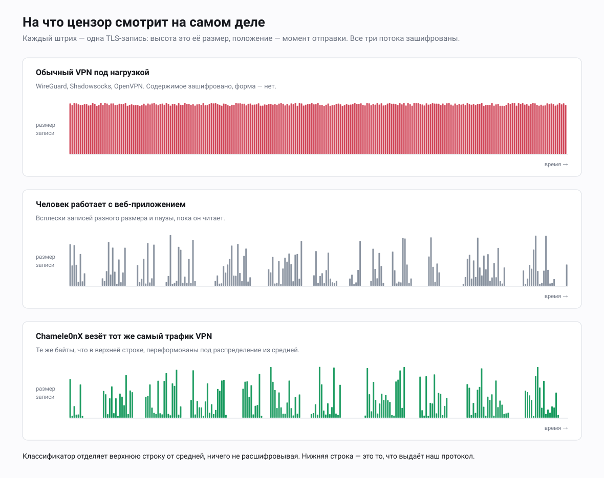
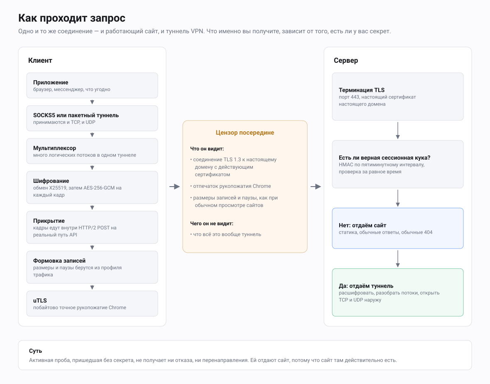
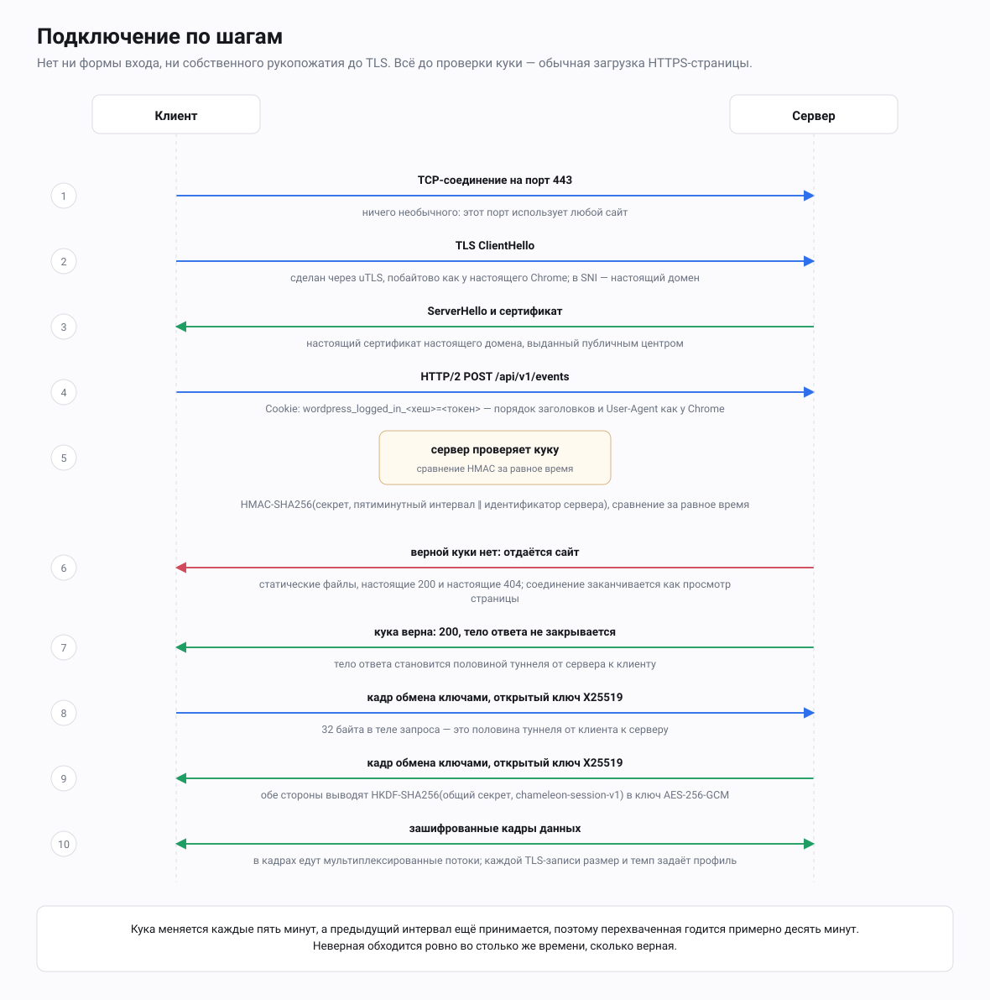

<p align="center"></p>

<div align="center">

<picture>
  <source media="(prefers-color-scheme: dark)" srcset="docs/assets/brand/chameleon-logo-dark.svg">
  
</picture>

# Chamele0nX

**VPN-транспорт, который не похож на VPN. Он сформован так, чтобы выглядеть как человек, сидящий на сайте.**

</div>

[English version](README.md) · [Спецификация протокола](docs/ru/SPEC.md) · [Модель угроз](docs/ru/THREAT-MODEL.md) · [Установка](docs/ru/INSTALL.md) · [Docker](docs/ru/DOCKER.md)

[](https://github.com/meshoklv/chamele0nx/actions/workflows/ci.yml)
[](LICENSE)
[](go.mod)

---

## Задача

Современная государственная цензура больше не заглядывает внутрь TLS-соединения.
Ей это не нужно. Она смотрит на *форму* соединения: какого размера TLS-записи,
как они собираются во всплески, какой длины паузы, сколько отдаётся вверх
против того, сколько скачивается, сколько живёт сессия.

VPN, который тянет видео, даёт длинную ровную реку записей максимального размера.
Человек, читающий веб-панель, даёт короткие резкие всплески записей разного
размера с паузами между ними. Эти две картины не похожи ничем, и классификатору,
обученному на этой разнице, всё равно, что содержимое зашифровано, сертификат
настоящий, а в SNI написано `microsoft.com`.

Поэтому протоколы, которые прячут *что* вы передаёте, всё равно блокируются.
Shadowsocks, VLESS+REALITY и WireGuard шифруют безупречно и всё равно
детектируются: ни один из них не проектировался, чтобы управлять тем, как трафик
*выглядит снаружи*.



## Что делает Chamele0nX

Chamele0nX переносит VPN-трафик внутри HTTP/2-запросов к настоящему HTTPS-сайту,
а затем переформовывает поток TLS-записей так, чтобы его статистика совпадала с
профилем трафика реального сайта.

Одновременно происходят две вещи.

**Это настоящий сайт.** У сервера настоящий домен и настоящий сертификат. Если
указать ему сайт-прикрытие через `-cover-dir`, который по умолчанию пуст, то,
открыв его в браузере, вы увидите обычное веб-приложение. Нет ни особого порта,
ни специального пути, который отвечает иначе. Неавторизованный посетитель —
включая активную пробу, проверяющую, не прокси ли этот хост, — видит
сайт-прикрытие и ничего, что указывало бы на туннель. На неизвестные пути
уходит собственная страница `404.html` сайта-прикрытия, если она есть в
каталоге, — в `deploy/cover-site` она есть. Не положить её — и ответит
файловый сервер Go, а его тело ответа — буквальная строка
`404 page not found`: так не сказал бы сайт на WordPress или Django, и одного
этого хватает, чтобы проба поняла: сайт не тот, за который себя выдаёт.
См. раздел 10 в [INSTALL.md](docs/ru/INSTALL.md).

**Он и движется как настоящий сайт.** Каждая TLS-запись, которую отдаёт сервер,
получает размер и время из статистического профиля, снятого с настоящего сайта:
гистограмма размеров записей, сколько записей составляют всплеск и какой длины
паузы между всплесками. Объёмный трафик режется и выдаётся порциями по этому
распределению, а не льётся ровными записями по 16 КБ. В формате профиля есть
ещё объёмы за сессию и соотношение отдачи к приёму, но нынешний формовщик их не
применяет — об этом сказано в [PROFILES.md](docs/ru/PROFILES.md).

В итоге у туннеля совпадают с прикрытием *метаданные*, а не только содержимое.



## Что видит наблюдатель

| Что проверяет наблюдатель | Обычный VPN | Chamele0nX |
|---|---|---|
| Открыть адрес в браузере | Пусто или ошибка | Обычный сайт |
| Постучаться с неверным секретом | Другая ошибка или тишина | Тот же сайт |
| Сертификат и SNI | Часто чужой или самоподписанный | Настоящий сертификат на ваш домен |
| Размеры записей и всплески | Длинная ровная река записей максимального размера | Размеры и паузы по профилю реального сайта |
| Отпечаток HTTP/2 и TLS | Умолчания библиотеки | Как у Chrome (uTLS) |

Невидимым это не делает; что не покрыто — в [модели угроз](docs/ru/THREAT-MODEL.md).

## Развернуть дома одной командой

Сервер на VPS, клиент дома, оба через Docker Compose
(подробности и оговорки — [docs/ru/DOCKER.md](docs/ru/DOCKER.md)):

```bash
cp .env.example .env && $EDITOR .env           # домен, общие настройки
mkdir -p secrets certs && openssl rand -hex 32 > secrets/secret
docker compose --profile tools run --rm certbot && docker compose up -d server   # на VPS
docker compose --profile client up -d client                                       # дома -> SOCKS5 127.0.0.1:1080
```

## Состояние

Работает и используется, но в небольшом масштабе. Это не законченный продукт.

| | |
|---|---|
| **Ядро протокола** | Стабильно. Туннелируются и TCP, и UDP. 122 тестовых функций, все проходят. |
| **Сервер** | Работает на одном хосте. Длительная работа под нагрузкой не оценивалась. |
| **Клиент из командной строки** | Linux и macOS, поднимает локальный SOCKS5-прокси. |
| **Мобильные** | Есть Go-биндинги, их использует iOS-клиент из отдельного репозитория. Здесь мобильного приложения нет. |
| **Измеренная скорость** | Около 20 Мбит/с на дальнем межконтинентальном маршруте. Потолок задавал маршрут, а не протокол. Один замер, автором, никем не воспроизведён. |
| **Независимый аудит** | Не проводился. Никто снаружи проекта это не проверял. |

Прежде чем полагаться на это в чём-то важном, прочитайте
[THREAT-MODEL.md](docs/ru/THREAT-MODEL.md) — там прямо сказано, от чего защиты нет.

## Быстрый старт

Нужен сервер с доменным именем и TLS-сертификатом и Go 1.26 для сборки.
Подробно — в [INSTALL.md](docs/ru/INSTALL.md).

```bash
git clone https://github.com/meshoklv/chamele0nx
cd chamele0nx
make build
```

**Сервер** — положите настоящий статический сайт в `-cover-dir` и запускайте:

```bash
./bin/chamele0nx-server \
  -addr :443 \
  -cert /etc/letsencrypt/live/vpn.example.com/fullchain.pem \
  -key  /etc/letsencrypt/live/vpn.example.com/privkey.pem \
  -cover-dir /var/www/cover \
  -cookie-format wordpress
```

Без `-secret` он сам сгенерирует секрет и напечатает его. Сохраните: это
единственный ключ доступа.

Выдают вас те умолчания, которые вы не тронули. `-api-path`, `-server-id`,
`-cookie-format` и образцовый сайт-прикрытие одинаковы на каждой
неизменённой установке, так что сканер, разобравший одну, знает их все.
Меняйте их вместе, под свою легенду, и передайте клиенту те же значения —
см. раздел 6 в [INSTALL.md](docs/ru/INSTALL.md).

Без `-profile` сервер берёт встроенную форму. Прежде чем пускать через него
настоящий трафик, снимите профиль с того сайта, за который выдаёте себя, с
помощью `chamele0nx-profiler`, и держите этот файл при себе. Примеры в
`deploy/profiles` нужны, чтобы попробовать флаг: профиль, который запускают
все, — это профиль, по которому всех и опознают. Подробнее в
[PROFILES.md](docs/ru/PROFILES.md).

**Клиент** — поднимает SOCKS5-прокси на локальной машине. Секрет кладите в файл,
а не в командную строку: аргумент виден всем пользователям машины через `ps` и
остаётся в истории команд оболочки.

```bash
./bin/chamele0nx-client \
  -server vpn.example.com:443 \
  -secret-file ~/.config/chamele0nx/secret \
  -cookie-format wordpress \
  -port 1080

curl -x socks5h://127.0.0.1:1080 https://example.org/
```

Проверить туннель целиком, ничего не настраивая:

```bash
./bin/chamele0nx-client -server vpn.example.com:443 \
  -secret-file ~/.config/chamele0nx/secret -check
```

## Как устроен вход

Логина нет. Посетитель либо предъявляет верную сессионную куку, либо получает сайт.

В куке лежит `HMAC-SHA256(секрет, интервал_времени || идентификатор_сервера)`,
оформленный так, как это сделал бы движок сайта-прикрытия: кука входа WordPress,
`sessionid` Django или общий `sid`. Значение меняется каждые пять минут, а сервер принимает
текущий и предыдущий интервал, поэтому перехваченную куку можно повторно
использовать не дольше примерно десяти минут. Сравнение идёт за равное время:
неверный секрет отвергается ровно за столько же, за сколько принимается верный.

Всё остальное — путь запроса, его форма, заголовки, User-Agent — такое же, какое
выдал бы сам сайт-прикрытие.



## Что лежит в репозитории

```
transport/chamele0nx/   протокол: рукопожатие, мультиплексор, формовка, прикрытие, UDP
internal/chcrypto/     AES-256-GCM и затирание ключей в памяти
mobile/                gomobile-биндинги для клиентов iOS
cmd/chamele0nx-server/  сервер
cmd/chamele0nx-client/  клиент с локальным SOCKS5-прокси
cmd/chamele0nx-profiler/  снимает профиль трафика с реального сайта
cmd/chamele0nx-validator/ статистические тесты: совпадает ли наш поток с профилем
deploy/                systemd-юнит, тюнинг TCP, примеры профилей, сайт-прикрытие
docs/en/, docs/ru/     документация на английском и русском
```

## Документация

| | Русский | English |
|---|---|---|
| Как это работает, подробно | [ARCHITECTURE.md](docs/ru/ARCHITECTURE.md) | [ARCHITECTURE.md](docs/en/ARCHITECTURE.md) |
| Спецификация формата на проводе | [SPEC.md](docs/ru/SPEC.md) | [SPEC.md](docs/en/SPEC.md) |
| От чего защищает и от чего нет | [THREAT-MODEL.md](docs/ru/THREAT-MODEL.md) | [THREAT-MODEL.md](docs/en/THREAT-MODEL.md) |
| Установка сервера | [INSTALL.md](docs/ru/INSTALL.md) | [INSTALL.md](docs/en/INSTALL.md) |
| Docker: сервер + клиент дома | [DOCKER.md](docs/ru/DOCKER.md) | [DOCKER.md](docs/en/DOCKER.md) |
| Безопасная эксплуатация | [OPERATIONS.md](docs/ru/OPERATIONS.md) | [OPERATIONS.md](docs/en/OPERATIONS.md) |
| Профили трафика | [PROFILES.md](docs/ru/PROFILES.md) | [PROFILES.md](docs/en/PROFILES.md) |
| Клиенты, включая мобильные | [CLIENTS.md](docs/ru/CLIENTS.md) | [CLIENTS.md](docs/en/CLIENTS.md) |
| Сравнение с другими решениями | [COMPARISON.md](docs/ru/COMPARISON.md) | [COMPARISON.md](docs/en/COMPARISON.md) |
| Частые вопросы | [FAQ.md](docs/ru/FAQ.md) | [FAQ.md](docs/en/FAQ.md) |
| Куда это движется | [ROADMAP.md](docs/ru/ROADMAP.md) | [ROADMAP.md](docs/en/ROADMAP.md) |
| Работы, на которые опирается схема | [RESEARCH.md](docs/ru/RESEARCH.md) | [RESEARCH.md](docs/en/RESEARCH.md) |

## Участие в разработке

Читайте [CONTRIBUTING.ru.md](CONTRIBUTING.ru.md). Коротко: небольшие правки,
никаких изменений, которые делают трафик ровнее, ничего опознающего в журналах, а
**про уязвимости пишут в закрытое сообщение, а не в публичный issue** — см.
[SECURITY.ru.md](SECURITY.ru.md).

## Правовое уведомление

Правила, под которые попадают такие сетевые транспорты, сильно различаются от
страны к стране и со временем меняются. Где-то запуск и использование подобной
программы ничем не примечательны, где-то влекут последствия для того, кто это
делает. Разобраться, что применимо к вам, — ваша задача, и проект не может вас
по этому вопросу консультировать.

Это исследовательское программное обеспечение, опубликованное, чтобы его
устройство можно было изучать. Оно не предлагается как услуга, и никто здесь не
эксплуатирует инфраструктуру в чьих-либо интересах. Прежде чем на что-то из
этого полагаться, прочитайте [DISCLAIMER.ru.md](DISCLAIMER.ru.md).

## Лицензия

Copyright (C) 2026 Chamele0nX contributors.

AGPL-3.0-or-later, текст в файле [LICENSE](LICENSE). Сторонние зависимости: [THIRD_PARTY_NOTICES.md](THIRD_PARTY_NOTICES.md).

Вы можете это запускать, изменять и предлагать как услугу. Если вы предлагаете как
услугу изменённую версию, AGPL требует опубликовать ваши изменения. В этом и
смысл: в этой области непроверяемые форки — часть проблемы, а не решение.

## Благодарности

Работа опирается на [uTLS](https://github.com/refraction-networking/utls) —
точные браузерные TLS-отпечатки, и на опубликованные исследования и практику
сообщества по обходу цензуры: подключаемые транспорты Tor, obfs4, meek,
Snowflake, NaiveProxy, Xray/REALITY, Hysteria. Список работ, на которые опирается
дизайн, — в [RESEARCH.md](docs/ru/RESEARCH.md).
