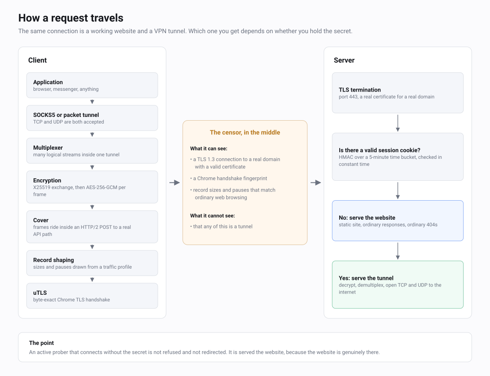
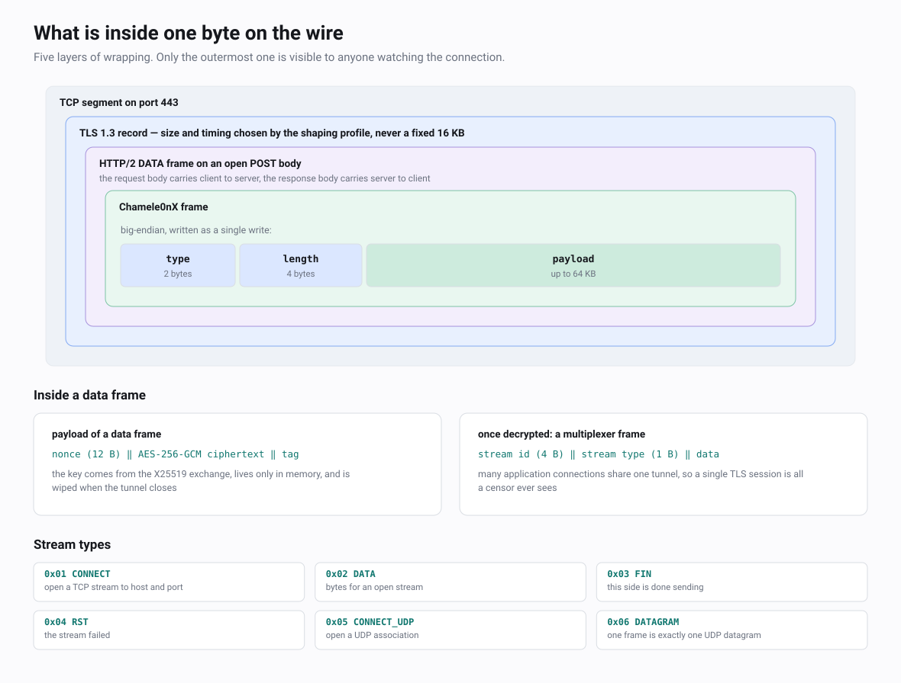

# Architecture

How Chamele0nX is put together, and why it is put together that way.

This document is for someone who can read Go and is opening this
repository for the first time. It explains the shape of the system and
the reasoning behind it. It is not the wire specification — byte layouts,
frame types and the handshake sequence live in [SPEC.md](SPEC.md).

---

## The idea in one page

Encryption hides what you send. It does not hide that you sent it, how
much of it there was, or in what rhythm it arrived. Those three facts are
metadata, they survive any cipher, and they are what a modern national
censor actually classifies on.

This matters because the metadata of a VPN is structurally different from
the metadata of browsing. A tunnel carrying a video call or a large
download produces a long, even stream of maximum-size TLS records with
almost no gaps. A person reading a dashboard produces short violent
bursts of mixed-size records separated by idle seconds. A classifier
trained on that difference does not need to decrypt anything. It does not
care that your cipher is AES-256-GCM, that your certificate is real, or
that your SNI is a household name.

So "encrypt harder" is the wrong axis. Every additional bit of cipher
strength defends a flank that was never under attack. The flank under
attack is the shape of the flow, and defending it means giving up
control over when and how much you write — deliberately writing less
efficiently than you could, because efficiency is itself the tell.

Chamele0nX therefore does two things at once, and neither is worth much
without the other:

- **It is a real website.** One process serves a genuine static site on
  port 443 with a genuine certificate. A visitor who does not hold the
  secret is not refused. They are served the site, because the site is
  actually there.
- **It moves like a real website.** Every TLS record the tunnel emits has
  its size drawn from a measured distribution, and bursts are separated
  by measured pauses. Bulk traffic is chopped and paced to fit that
  distribution instead of streaming out flat 16 KB records.

---

## Design constraints

Four requirements were fixed before any code, and each one closed off
designs that would otherwise have been simpler.

**The server must be a real site, not a site-shaped response.** Serving a
convincing page only to probers that look like probers is a losing game,
because you have to guess what a prober looks like. Instead the cover
site is an ordinary `http.FileServer` rooted at `-cover-dir`, handling
every request that is not an authenticated tunnel POST. There is no
special port and no path that behaves differently for strangers. The cost
is that the operator has to actually host something plausible; see
`deploy/cover-site/README.md`.

**Refusal must look like the real application's refusal, not like a
decoy.** An unauthenticated request to the tunnel path is answered by
`Server.apiDecoy` in `server.go` the way a real cookie-protected API
endpoint answers: a GET or POST without valid credentials gets `401` with
a small, constant JSON error body, identical on both methods; any other
method gets `405` with an `Allow: GET, POST` header. An earlier revision
instead returned `200 OK` with an invented events body to any caller — the
opposite of what a protected endpoint does, handing a prober data returned
to an anonymous caller. The constant bodies are faithful, not a tell: a
real API's 401 and 405 bodies are constant too. Only the `X-Request-Id`
header varies per call, as a real request-tracing middleware emits it.

**Clients update rarely, so the wire format is frozen.** A mobile client
installed once may run for a year. Anything that appears on the wire —
the 6-byte frame header, the 5-byte multiplexer header, the stream type
numbers, the cookie and token derivation — cannot change without breaking
those installs. Traffic profiles were deliberately kept out of that set:
a profile is data loaded at runtime, carrying its own `version` field, so
an operator can recapture and redeploy shaping without touching a single
client.

**One process, one TLS seam.** No sidecar proxy, no separate obfuscation
daemon, no local relay chain. The whole client is one binary, and the
point where TLS records are formed is a `net.Conn` that Chamele0nX owns.
That seam is the entire mechanism: `ShapedConn` has to sit between the
TLS layer and the HTTP/2 framer, and a library that owns both ends of
that boundary is unusable no matter how good it is. The honest cost is
visible in `go.mod`: the client pulls `refraction-networking/utls` for
the handshake and `bogdanfinn/fhttp` for HTTP/2 framing, and the latter
carries its own uTLS fork. Only the first performs a handshake; the
second never sees a `Config`. That is two forks in the module graph to
keep one seam under our control, and it was judged the cheaper trade.

---

## The layers

Six layers stack between an application socket and the wire. Each solves
one problem and hands a `net.Conn`-shaped thing to the next.

### uTLS — the handshake must be a browser's

**Problem.** Go's `crypto/tls` produces a ClientHello that no browser
produces. Extension order, cipher list, supported groups and GREASE
placement together form a fingerprint (JA3 and its successors) that
separates Go programs from Chrome at the first packet, before a single
byte of payload exists.

**Where.** `transport/chamele0nx/chamele0nx.go`: `Transport.newUTLSConfig`,
`Transport.dialUTLSWith`, `chamele0nxConnAdapter`. Supporting pools in
`sni_pool.go` (`pickSubstituteSNI`) and `useragent.go` (`pickUserAgent`).

The dialer emits `utls.HelloChrome_Auto` and refuses to proceed if ALPN
did not negotiate `h2`. Three details in `newUTLSConfig` are load-bearing
and are guarded by a unit test:

- `DynamicRecordSizingDisabled: true`. Without it, TLS ramps record sizes
  from 512 bytes up to 16 KB over roughly the first 128 KB of a
  connection. The shaper cannot compensate, because that fragmentation
  happens *underneath* it — and those first few seconds are exactly the
  window a DPI box uses to classify.
- `ClientSessionCache`, shared across every reconnect on the `Transport`
  and keyed by server name. Real Chrome presents a session ticket when it
  reconnects to an origin. A tunnel that always performs a full handshake
  is advertising a Chrome User-Agent and Chrome SETTINGS alongside a
  session history no Chrome would have.
- `ServerName`, which is not always the real one. See below.

**Trade-offs.** The fingerprint is only as current as the uTLS release:
`HelloChrome_Auto` tracks whatever Chrome that version models, so
upgrading the dependency silently changes what we look like, in both
directions. The User-Agent pool must be refreshed as browser majors roll,
or it becomes its own fingerprint.

The SNI substitution path is a larger trade. Some national DPI deployments
pass a flow based on the ClientHello name alone. Presenting an
substitute name buys the connection a clean start, but it means the
certificate will not match the name we asked for, so ordinary name
verification has to be turned off. Chamele0nX only allows this when the
endpoint supplies `chameleon_pubkey_pin`: a 32-byte SHA-256 of the
server's DER SubjectPublicKeyInfo, compared constant-time in a
`VerifyPeerCertificate` callback. Without a pin there is no substitution,
because disabling name checks with nothing in their place would make the
client trivially interceptable. `chameleon_spoof=off` is the hard
opt-out.

### Cover — HTTP/2 to an API that exists

**Problem.** Having a browser handshake is not enough if what follows is
not browser traffic. The tunnel needs a carrier that a real site would
plausibly produce, in both directions, indefinitely.

**Where.** Client: the body of `Transport.connect` in `chamele0nx.go`.
Server: `Server.handleRequest`, `Server.authenticateClient`,
`Server.apiDecoy`, `Server.handleTunnel` in `server.go`; token and cookie
derivation in `auth.go`. Registry types in `cover.go` and
`cover_saas_http2.go`.

The carrier is a single long-lived HTTP/2 `POST` to a normal-looking API
path (`/api/v1/events` by default). The request body carries client to
server, the response body carries server to client, and both stay open
for the life of the tunnel. Authentication is one cookie:
`HMAC-SHA256(secret, time_bucket || server_id)` over a five-minute
bucket, formatted as whatever the cover framework would set — a
WordPress login cookie, a Django `sessionid`, or a generic `sid`. The
server accepts the current and previous bucket to absorb clock skew, and
iterates every configured secret without early return, so the time taken
does not reveal which one matched.

The HTTP/2 SETTINGS are hand-pinned to Chrome's: exactly four settings in
Chrome's order, an initial `WINDOW_UPDATE` of 15663105, and the
pseudo-header order `:method :authority :scheme :path`. Standard library
HTTP/2 sends `:method :scheme :authority :path`, and detectors of the
Akamai family fingerprint on that single difference. Getting at those
knobs is why the client uses `bogdanfinn/fhttp` rather than
`golang.org/x/net/http2`.

**Trade-offs.** One POST for the whole tunnel means one HTTP/2 stream,
so everything the multiplexer carries is serialized behind one flow
control window. That is a real throughput ceiling, accepted because
several concurrent streams from one client would be a shape of its own.
The Chrome SETTINGS are a hand-maintained constant and will drift out of
date. And `apiDecoy` only defends the tunnel path; the rest of the
surface is only as convincing as the operator's cover site.

### Shaping — the part that is actually the point

**Problem.** Everything above makes the connection look like a browser
talking to a website. Shaping makes the *traffic* look like it, which is
the thing the classifier reads.

**Where.** `shaped_conn.go`: `ShapedConn`. Profile data and sampling in
`profile.go`: `SiteProfile`, `SizeBucket`, `BurstPattern`,
`SiteProfile.PersonalizeFor`, `sampleRecordSize`. Lower-level helpers in
`shaper.go`: `RandomizeSize` and the TLS record constants.

`ShapedConn` wraps the TLS connection and sits directly beneath the
HTTP/2 framer. Because dynamic record sizing is off, one `Write` of N
bytes produces exactly one TLS record with an N-byte payload — so
choosing split points chooses record sizes. On every large write the
shaper draws a target size from the profile's weighted histogram, applies
±25% per-record jitter derived from the connection seed, and writes that
many bytes. After every `RecordsPerBurst` records it sleeps for a sampled
`InterBurstPause`, minus whatever idle time already elapsed naturally.

Writes below 512 bytes pass through untouched and do not advance the
burst counter. Those are HTTP/2 control frames, and they belong at their
natural sizes.

Per-connection personalization matters more than it looks.
`PersonalizeFor(seed)` jitters the envelope itself — bucket weights ±20%,
records per burst ±30%, inter-burst pause ±50% — deterministically from
the connection seed. Without it every user of a given preset shares one
identical envelope, and while individual records differ, the users remain
mutually correlatable. With it, two clients on the same preset look like
two people on slightly different sites.

**Trade-offs.** This is where the honest costs are.

The pause is an inline `time.Sleep` holding `writeMu`, which blocks every
HTTP/2 stream on the connection for its duration. A profile asking for a
30-second human reading pause would stall every concurrent SOCKS5 stream
for 30 seconds. So pauses are clamped at 250 ms unless a profile sets
`bypass_pause_cap`, and the built-in presets were retuned to sit under
the cap. Only the stealth preset opts out, where multi-hundred-millisecond
stalls are the feature.

Server-side shaping caused a measured regression: in April 2026 shaping
the downstream with the SaaS profile took a test handset from 9.4 Mbit/s
to 0.6–2.3 Mbit/s over a real link. The fix was a separate downstream
profile with larger bursts and shorter pauses, plus
`DisableDownstreamShaping` as an operator kill-switch. Setting it is a
strictly weaker defense — the downstream becomes a continuous stream
again — and it exists because a tunnel nobody can use protects nobody.

The read path is not shaped at all; `ShapedConn.Read` delegates straight
through. Incoming record sizes are the peer's business, and the peer is
also shaping.

Finally, the production write path never pads. It chooses split points
and pauses, and that is all. An earlier revision carried writers that
padded short records out to a target size; nothing but their own tests
ever called them, and they are gone.

### Crypto — small, boring, and not ours

**Problem.** The cover's own TLS exists for the masquerade. It terminates
where the cover terminates, and it is not a payload guarantee.

**Where.** `internal/chcrypto/encrypt.go` (`Encrypt`, `Decrypt`) and
`zeroize.go` (`Zeroize`). Key agreement and derivation in `chamele0nx.go`:
`deriveSessionKey`. Authentication in `auth.go`.

The whole of it: X25519 via `crypto/ecdh`, HKDF-SHA256 with the context
string `chameleon-session-v1`, AES-256-GCM with a fresh 12-byte random
nonce per frame, HMAC-SHA256 for auth tokens. Fresh ephemeral keys per
connection, so a compromised long-term secret does not decrypt captured
sessions. The session key is wiped on close and the user secret is wiped
as soon as the token is derived.

**Trade-offs.** There is no sequence number and no replay window at the
Chamele0nX frame layer; ordering and replay protection are inherited from
the TLS record layer underneath, which means the guarantee is only as
good as that assumption. Nonces are random rather than counter-based,
which is fine at these volumes and would not be at extreme ones. There is
no rekeying: a tunnel uses one session key for its whole life, and
reconnection is what rotates it.

### Mux — many connections, one flow

**Problem.** A device that opens one TLS connection per application
socket produces a fan of connections that no single-page session would.
Everything has to fit in one flow.

**Where.** `mux.go`: `Mux`, `Stream`, `StreamFrame`, plus the encoders
`EncodeStreamFrame` and `EncodeConnect`.

Inside each encrypted data frame is a 5-byte multiplexer header: a 32-bit
stream ID and a one-byte type. `CONNECT` opens a TCP stream to a host and
port, `DATA` carries bytes, `FIN` and `RST` end it. `CONNECT_UDP` and
`DATAGRAM` are the UDP pair, where one frame is exactly one datagram so
boundaries survive.

**Trade-offs.** There is no per-stream flow control. Backpressure comes
from the HTTP/2 window below and from bounded buffers: 256 frames in the
multiplexer's inbound queue, then a per-stream receive queue measured in
bytes — 1 MiB for one stream, 32 MiB across the tunnel, 512 streams at
once. Delivery into those queues never blocks. A reader that stops
consuming fills its own budget and gets its own stream reset, which is
what a real TCP peer produces; its neighbours keep moving. Bounding by
bytes rather than by frame count is deliberate — 256 datagrams and 256
full-size records are three orders of magnitude apart in memory.
`FIN` is a full close rather than a half-close, so the half-open TCP
pattern is not expressible. Frames for
an unknown stream ID are dropped silently, which is right for a racing
teardown and unhelpful when debugging.

### SOCKS5 and UDP — the local edge

**Problem.** Applications need somewhere ordinary to point.

**Where.** `chamele0nx.go`: `Tunnel.startSOCKS5`,
`handleSOCKS5`. The production path is `persistent.go`:
`PersistentClient.acceptLoop`, `handleSOCKS5`, `waitForTunnel`. UDP in
`udp_client.go`: `handleUDPAssociate`, `parseUDPHeader`. Server exits in
`server.go`: `handleStreamConnect`, `handleStreamConnectUDP`.

The client binds a SOCKS5 listener on loopback. `CONNECT` opens a
multiplexer stream and relays. `UDP ASSOCIATE` binds a loopback relay
socket, and each distinct source-destination pair becomes one UDP stream
through the same tunnel, capped at 256 flows per association. Nothing
plaintext leaves the machine; UDP rides the existing encrypted HTTP/2
mux, which is what makes QUIC work on mobile.

**Trade-offs.** The local listener has no SOCKS5 authentication, which is
why it binds to `127.0.0.1` only. IPv6 targets are rejected outright
rather than routed, because the tunnel carries IPv4 and letting them
through would leak the flow outside it. `BIND` answers with success and
then closes, so applications fall back cleanly instead of retry-looping.
On the server, outbound targets pass an SSRF gate before and after the
dial, and UDP flows use a much shorter 45-second idle timeout than TCP's
five minutes, because there is no FIN to tear down a forgotten one.

One inaccuracy worth knowing: `Transport.Info()` still reports
`SupportsUDP: false`. That static metadata predates the UDP path and has
not been updated; UDP does work through the multiplexer.

---

## Where the code lives

| Package | Responsibility | Main types |
|---|---|---|
| `transport` | The plugin interface Chamele0nX implements. Endpoint description and registry. | `Transport`, `Tunnel`, `Endpoint`, `Info`, `Registry` |
| `transport/chamele0nx` | The protocol: handshake, cover, shaping, mux, UDP, server, reconnection. | see rows below |
| `internal/chcrypto` | AES-256-GCM envelope and key zeroing. Nothing protocol-aware. | `Encrypt`, `Decrypt`, `Zeroize` |
| `mobile` | gomobile facade. Hides maps, contexts and tuples behind JSON strings and one opaque handle. | `Client`, `NewClient`, `logRingBuffer` |
| `cmd/chamele0nx-server` | Server binary: flags, secret resolution, logging, signal handling. | — |
| `cmd/chamele0nx-client` | Client binary: flags, persistent client, `-check` mode. | — |
| `cmd/chamele0nx-profiler` | Captures a traffic profile from a real site. | `tlsInterceptor`, `capturedRecord` |
| `cmd/chamele0nx-validator` | Statistical tests of shaped output against a profile. | `ksTest`, `chiSquaredTest` |

Inside `transport/chamele0nx`:

| File | Responsibility | Main types |
|---|---|---|
| `chamele0nx.go` | Client dial path end to end: params, uTLS, HTTP/2 POST, key exchange, tunnel object, SOCKS5. | `Transport`, `Tunnel`, `chamele0nxConnAdapter` |
| `server.go` | Server: cover site, auth, decoy, tunnel handler, outbound relays, shutdown. | `Server`, `ServerConfig` |
| `persistent.go` | Stable SOCKS5 listener plus reconnect loop and error classification. | `PersistentClient`, `errClass` |
| `shaped_conn.go` | The write-path shaper: record splitting and burst pauses. | `ShapedConn` |
| `profile.go` | Profile schema, validation, built-in presets, per-client personalization, sampled bursts. | `SiteProfile`, `SizeBucket`, `BurstPattern`, `SessionProfile`, `Burst` |
| `shaper.go` | Record size jitter and the TLS record constants. | `RandomizeSize` |
| `mux.go` | Stream multiplexing inside the encrypted tunnel. | `Mux`, `Stream`, `StreamFrame` |
| `proto.go` | Outer frame encoding. | `Frame`, `WriteFrame`, `ReadFrame` |
| `auth.go` | Time-bucketed HMAC tokens and cookie formatting. | `GenerateAuthToken`, `ValidateAuthToken`, `FormatCookie` |
| `cover.go`, `cover_saas_http2.go` | Cover profile contract and registry. | `CoverProfile`, `OpenOptions`, `saasHTTP2Cover` |
| `udp_client.go` | SOCKS5 UDP ASSOCIATE and per-flow relay. | `handleUDPAssociate`, `parseUDPHeader` |
| `decoy.go` | Background fetches to third-party domains, outside the tunnel. | `DecoyDriver`, `DecoyConfig` |
| `sni_pool.go` | SNI values for the substitution path. | `pickSubstituteSNI` |
| `useragent.go` | Seed-stable User-Agent selection. | `pickUserAgent` |

---

## Concurrency model

Per client tunnel, once established:

| Goroutine | Started by | Owns | Ends when |
|---|---|---|---|
| `Tunnel.readLoop` | `Transport.connect` | The response body reader and the session key on the read side | Read error, close frame, or tunnel close |
| `Mux.dispatchLoop` | `NewMux` | Routing from the inbound queue to streams | `Mux.Close` |
| `PersistentClient.reconnectLoop` | `Start` | The current tunnel pointer | Root context cancelled, or a fatal error class |
| `PersistentClient.acceptLoop` | `Start` | The SOCKS5 listener | Listener closed |
| `handleSOCKS5` | `acceptLoop`, one per client connection | One client socket and one stream | Either relay direction ends |
| two relay goroutines | `handleSOCKS5` | One direction each | Read or write error |
| HTTP/2 internals | `fhttp/http2` | Framing and flow control | Connection teardown |

Per server tunnel:

| Goroutine | Started by | Owns | Ends when |
|---|---|---|---|
| accept loop | `ListenAndServeTLS` | The TLS listener | Listener closed by `Shutdown` |
| per-connection handler | accept loop | TLS handshake, `ShapedConn` wrap, `http2.ServeConn` | Connection closes |
| `handleTunnel` / `relayTunnel` | HTTP/2 handler | The request body reader and the session key | Read error or close frame |
| `Mux.dispatchLoop` | `NewMux` | Routing to streams | Handler returns |
| `handleStreamConnect` | `relayTunnel`, one per CONNECT | One outbound socket | Either direction ends |
| two relay goroutines | the above | One direction each | Read error or idle deadline |

Ownership follows a simple rule: exactly one goroutine reads from the
tunnel, and everything else receives through channels. Writes are the
opposite — many goroutines write, so writes are serialized by locks.

The locks worth knowing:

| Lock | Guards | Note |
|---|---|---|
| `ShapedConn.writeMu` | Inner writes, burst counters, and the burst sleep | Held across `time.Sleep`, which is why pauses are capped |
| `writeMu` in `connect` and `handleTunnel` | One frame written to the pipe at a time | `WriteFrame` is a single `Write` for atomicity |
| `Stream.readMu` | The partial-read buffer | Only `Read`; `ReadDatagram` does not use it |
| `Transport.mu` | Lazy profile resolution | Held only during first connect |
| `Mux.streams` (`sync.Map`) | Stream registry | Lock-free reads on the dispatch path |
| `Server.acceptedConns` (`sync.Map`) | Live connections, so shutdown can force-close them | — |

Atomics carry the rest: `PersistentClient.current` is an
`atomic.Pointer`, tunnel liveness is a `done` channel closed once through
`sync.Once`, and counters are `atomic.Uint64`.

---

## Reconnection

`PersistentClient` in `persistent.go` is what a long-running client
actually uses. `Transport.Connect` exists, binds a random port and does
not reconnect; it is for tests and one-shot use.

The loop is: connect, publish the tunnel, wait for its `Done` channel,
back off, repeat. Each attempt has a 60-second timeout.

Backoff depends on how the failure is classified by
`classifyConnectErr`:

| Class | Trigger | Initial | Cap |
|---|---|---|---|
| `fatal` | Invalid endpoint or missing parameter | — | loop exits, no retry |
| `auth` | Non-200 status, or a cover-site body where a key exchange was expected | 10 s | 5 min |
| `network` | Everything else: refused, TLS failure, HTTP/2 error, timeout | 1 s | 60 s |

Each wait is jittered ±50% so that clients which lost a server in the
same second do not return in the same second. The exponential growth
itself stays deterministic, so the cap still bounds the worst case. After
a tunnel that died naturally, a 500 ms flap guard runs before the next
attempt. Classification is substring matching on error text, which is
fragile and is documented as such in the code.

**Survives a reconnect:** the SOCKS5 listener and its address; the
`Transport` TLS session cache, so the new handshake presents a ticket
like a returning browser; the handshake and connect counters.

**Does not survive:** the session key, since a fresh X25519 exchange runs
every time; every open stream and every SOCKS5 connection riding them;
the per-connection seed, and with it the personalized profile, the
User-Agent choice and the substituted SNI choice.

The SOCKS5 listener is deliberately never reopened. Its address is what
applications, browsers and packet-tunnel configurations hold, sometimes
in files written once at install time. Rebinding it would turn a
recoverable network blip into a configuration break. So the listener
outlives every tunnel, and a connection arriving during a gap waits in
`waitForTunnel` for up to five seconds, polling every 50 ms, before
answering SOCKS5 "host unreachable". Short reconnects are invisible to
the application; long ones fail cleanly rather than hanging.

---

## Extension points

One seam exists for future work. It is described honestly here, because
it is further along in intent than in fact.

**The cover profile registry.** `cover.go` defines `CoverProfile` —
`ID`, `Describe`, `Open` — with a process-global registry populated from
`init()`, plus `RegisterCover`, `ResolveCover` and `RegisteredCoverIDs`.
The design goal is a shared core (mux, crypto, auth, framing) under a
swappable mask, so that adding a second masquerade costs one file rather
than a second product.

As shipped, exactly one cover is registered: `saas-http2`. Its `Open`
method returns an error. The real dial still lives inline in
`Transport.connect`, roughly 400 lines of uTLS, HTTP/2 and POST wiring
that has not been carved out. What the registry does today is real but
narrow: `validateChamele0nXParams` rejects an endpoint naming a cover this
build does not have, with an error listing what is available, instead of
silently falling through to the default. `cover_saas_http2.go` is
therefore a reservation and a skeleton, not an implementation.

A second seam used to sit beside it: a taxonomy of censorship
environments with a map from class to preferred cover. It has been
removed. Nothing in the codebase measured a live network, so the class
always had to be supplied from outside, and with one cover registered
every class resolved to the same entry. See
[ROADMAP.md](ROADMAP.md) for what building it properly would take.

---

## What this deliberately does not do

**No custom cryptography.** Every primitive comes from the standard
library or `golang.org/x/crypto`. There is no bespoke cipher, no novel
key schedule, no invented handshake. This is a metadata project; the
cryptography is meant to be unremarkable, and unremarkable means
reviewable.

**No packet-level obfuscation.** Chamele0nX shapes TLS records. It does
not pad or fragment IP packets, does not manipulate TCP timing below the
TLS layer, and adds no per-packet obfuscation of the obfs4 kind. The
production write path never inserts padding bytes at all — it chooses
where to split and when to pause. Anything a censor can see below the TLS
record layer, it sees plainly.

**No UDP on the outside.** The cover is TCP port 443 with HTTP/2, and
nothing else. UDP works *through* the tunnel — `CONNECT_UDP` and
`DATAGRAM` frames, with the server holding the outbound socket — but no
UDP transport carries the tunnel itself. That rules out the QUIC-shaped
covers that would help on networks where TCP is the problem, and it is
why a fully blocked network leaves a client with nothing to do but wait.

**No server discovery.** There is no rendezvous, no domain fronting
broker, no bootstrap list, no peer exchange. A client is given an
endpoint out of band and connects to it. Distributing addresses to users
without also distributing them to the censor is a genuinely hard problem,
and pretending to solve it in passing would be worse than leaving it
open.

---

## Further reading

| Document | Covers |
|---|---|
| [SPEC.md](SPEC.md) | The wire format, byte for byte |
| [THREAT-MODEL.md](THREAT-MODEL.md) | What this defends against, and what it does not |
| [PROFILES.md](PROFILES.md) | Capturing, validating and tuning traffic profiles |
| [OPERATIONS.md](OPERATIONS.md) | Running a server without giving it away |
