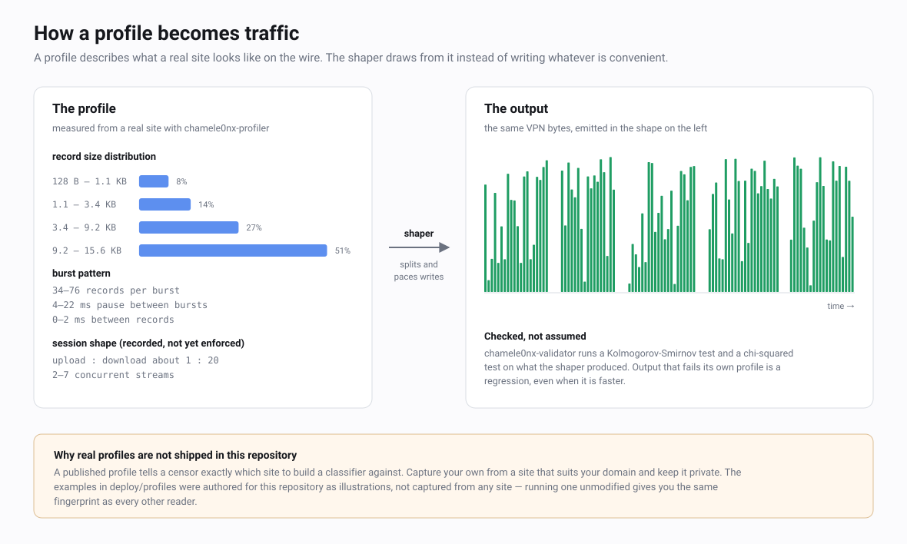

# Traffic profiles

A profile is the description of what a real website looks like on the
wire. It is the most operator-facing part of this project: the code is
the same everywhere, but the profile is yours, and a bad one undoes
everything above it.

---

## What a profile is

A censor watching a TLS connection cannot read it. What it can measure is
the shape: how large each record is, how records clump into bursts, how
long the gaps are, how much goes up versus down. Those measurements are
enough to separate a tunnel from browsing without decrypting anything.

A profile is a statistical description of that shape, captured from a
site that really behaves that way. The shaper then draws from it instead
of writing whatever is convenient. Where an unshaped tunnel emits a flat
river of 16 KB records, a shaped one emits sizes sampled from a
histogram, in bursts of a sampled length, separated by sampled pauses.

The content is identical either way. Only the form changes, and the form
is what is being read.



Profiles are data, not code. They are loaded at runtime from JSON, carry
a `version` field, and can be replaced without touching a single deployed
client. That is deliberate: the wire format is frozen because clients
update rarely, but the shape is expected to change as the cover site
changes and as detection improves.

---

## Anatomy of a profile file

The schema is `SiteProfile` in `transport/chamele0nx/profile.go`. Every
field below is validated on load; a file that fails validation is
rejected outright rather than partially applied.

### Top level

| Field | Type | Units | What it does | Sensible range |
|---|---|---|---|---|
| `name` | string | — | Human label, shown in logs and validator output. | any |
| `version` | int | — | Schema version. **Must be exactly 1**; anything else is rejected. | `1` |
| `record_size_distribution` | array | — | The histogram the shaper draws record sizes from. See below. | 4–8 buckets |
| `burst_pattern` | object | — | Burst length and timing. See below. | — |
| `session_profile` | object | — | Session-level volumes and duration. Declarative only. | — |
| `upload_download_ratio` | float | ratio | Bytes up per byte down. Must be in `(0, 1]`. | `0.05`–`0.2` |
| `concurrent_streams` | object | count | Typical simultaneous HTTP/2 streams. Declarative only. | `{1, 8}` |
| `bypass_pause_cap` | bool | — | Opts out of the 250 ms inline pause cap. Optional, defaults false. | `false` |

### `record_size_distribution[]`

| Field | Type | Units | What it does | Sensible range |
|---|---|---|---|---|
| `min_size` | int | bytes | Lower bound of the bucket. Must be ≥ 64. | 64–16384 |
| `max_size` | int | bytes | Upper bound. Must be ≥ `min_size` and ≤ 16384. | 64–16384 |
| `weight` | float | probability | How often this bucket is drawn. Must not be negative. | 0.0–1.0 |

**The weights must sum to 1.0.** Validation allows ±0.01 of slack and
rejects anything outside it. This is the single most common reason a
hand-edited profile fails to load. The bounds 64 and 16384 are the
minimum useful TLS record payload and the RFC 8446 maximum; a bucket
outside them is rejected.

### `burst_pattern`

| Field | Type | Units | What it does | Sensible range |
|---|---|---|---|---|
| `records_per_burst` | `{min, max}` | count | How many records the shaper emits before pausing. `min` must be > 0. | 5–90 |
| `burst_duration` | `{min_ms, max_ms}` | milliseconds | How long a burst takes. Declarative only. | 100–2000 |
| `inter_burst_pause` | `{min_ms, max_ms}` | milliseconds | The pause between bursts. Sampled and slept on. | 3–900 |
| `inter_record_delay` | `{min_ms, max_ms}` | milliseconds | Gap between records inside a burst. Used by burst generation, not by the live shaper. | 0–12 |

### `session_profile`

| Field | Type | Units | What it does |
|---|---|---|---|
| `duration` | `{min_ms, max_ms}` | milliseconds | Expected session length. Declarative only. |
| `bursts_per_session` | `{min, max}` | count | Expected bursts per session. Declarative only. |
| `total_bytes_per_session` | `{min, max}` | bytes | Expected volume per session. Declarative only. |

### Two things to know before editing by hand

**Durations are milliseconds, always.** Every duration in the file is an
object with `min_ms` and `max_ms`, both integers. There is no unit
suffix, no seconds, no Go duration string. The custom marshaller in
`profile.go` reads and writes only this form, so `"inter_burst_pause":
"250ms"` is not a slow value — it is a parse failure.

**Not every field reaches the shaper.** `ShapedConn`, which does the live
work, reads exactly four things: `record_size_distribution`,
`burst_pattern.records_per_burst`, `burst_pattern.inter_burst_pause`, and
`bypass_pause_cap`. The rest — `burst_duration`, `session_profile`,
`upload_download_ratio`, `concurrent_streams` — is validated, carried,
printed and honoured by nothing at runtime. `inter_record_delay` is read
only by burst generation, which is what the validator's generate mode
uses; on a live connection nothing waits between records.

That is worth stating plainly because it changes where tuning effort pays
off. Changing `upload_download_ratio` will not change a single byte on
the wire today. Changing the histogram or the burst pattern changes
everything.

### A minimal valid profile

```json
{
  "name": "example-dashboard",
  "version": 1,
  "record_size_distribution": [
    { "min_size": 64,    "max_size": 800,   "weight": 0.20 },
    { "min_size": 800,   "max_size": 5000,  "weight": 0.40 },
    { "min_size": 5000,  "max_size": 16384, "weight": 0.40 }
  ],
  "burst_pattern": {
    "records_per_burst":  { "min": 10,     "max": 30 },
    "burst_duration":     { "min_ms": 100, "max_ms": 600 },
    "inter_burst_pause":  { "min_ms": 20,  "max_ms": 120 },
    "inter_record_delay": { "min_ms": 0,   "max_ms": 5 }
  },
  "session_profile": {
    "duration":                { "min_ms": 180000, "max_ms": 1200000 },
    "bursts_per_session":      { "min": 30,        "max": 150 },
    "total_bytes_per_session": { "min": 1000000,   "max": 30000000 }
  },
  "upload_download_ratio": 0.08,
  "concurrent_streams": { "min": 1, "max": 6 }
}
```

---

## Capturing your own

`chamele0nx-profiler` measures a real site and writes a profile from what
it saw.

### What it does

It opens a fresh TLS connection to the target, wrapping the TCP socket in
an interceptor that parses TLS record headers on both directions before
handing bytes to the TLS layer. Handshake records are discarded once the
handshake completes; only application data records are kept, each with
its size, direction and timestamp. It then makes one HTTP request, reads
the body to completion, closes, and repeats.

Each request is one burst. The histogram is built from received records
only, into seven fixed buckets with boundaries at 64, 200, 800, 2000,
5000, 10000 and 16384 bytes; empty buckets are dropped and the remaining
weights are normalised to sum to 1. Ranges are taken as the 5th and 95th
percentile of what was observed, so a single outlier does not widen the
envelope. The upload-to-download ratio is measured and clamped into
`[0.01, 1]`. The result is validated before it is written, so the tool
cannot emit a file the server would reject.

### Flags

| Flag | Default | Meaning |
|---|---|---|
| `-target` | — | Target URL, required. For example `https://app.example.com` |
| `-pages` | `10` | Number of request rounds to make |
| `-out` | `profile.json` | Output path |
| `-name` | `profile-<host>` | Profile name written into the file |

### Running it

```bash
make build

./bin/chamele0nx-profiler \
  -target https://app.example.com \
  -pages 30 \
  -name my-dashboard-v1 \
  -out /etc/chamele0nx/my-dashboard-v1.json
```

The tool logs each round as it goes and prints a summary with the
histogram drawn as bars, the burst pattern, and the measured ratio. That
summary is the thing to read before deploying: if one bucket holds 95% of
the weight, you have captured a single asset type, not a site.

### How many rounds

Thirty is a reasonable default. The histogram has at most seven buckets
and is built from received records only, so what matters is having enough
records that the small buckets are not noise — aim for at least a hundred
records in every bucket you intend to keep. A page that returns 50 records
gets you there in twenty rounds; a small JSON endpoint that returns three
will not get there at all, which is itself useful information about
whether that endpoint is a plausible cover.

Rounds are not free in time: the tool sleeps 2 to 6 seconds between them,
so thirty rounds takes a couple of minutes.

### Three caveats worth understanding

These are properties of the current implementation, not of profiles in
general. Read the generated file before trusting it.

**It requests the same URL every time.** `-pages 30` means thirty rounds
of one URL, not a walk over thirty different pages. So the histogram
describes one response, repeated. If the cover site's realism depends on
a mixture of HTML, assets and API calls, capture each separately and
merge the buckets by hand, weighting them by how often a real session
would hit each.

**The captured `inter_burst_pause` is the profiler's own sleep.** The gap
between bursts is measured from the last record of one round to the first
of the next, and between rounds the tool deliberately sleeps 2 to 6
seconds to imitate a reading pause. So the value it writes will land
somewhere around 2000–6000 ms — which describes the profiler, not the
site. Left alone, the shaper will clamp it to 250 ms anyway, giving you a
pause you did not choose. **Edit this field by hand after capture.** The
example profiles in `deploy/profiles` show the range that actually makes
sense.

**`session_profile` is not measured.** Those three values are written as
fixed constants: 3–15 minutes, 5–30 bursts, 500 KB–10 MB. Nothing reads
them at runtime, so this is harmless today, but do not read the generated
file as if those numbers came from the site. Nor is `bypass_pause_cap`
ever set by the tool; add it yourself if you need it.

---

## Choosing a cover site

The profile is only as good as what you measured. Four criteria, in
descending order of how much damage getting them wrong does.

**It must be plausible for your domain.** The profile and the cover site
have to tell the same story. A domain that serves a small brochure site
and produces the traffic shape of a video platform is more suspicious
than either would be alone. Start from what you are actually willing to
host at `-cover-dir`, then find a real site of that kind to measure.

**It should be heavy inbound and light outbound.** Browsing is
asymmetric, typically somewhere between 1:10 and 1:50 up to down, and the
built-in presets sit between 1:5 and 1:20. A cover whose real traffic is
upload-heavy — a file-sync service, a backup client — gives you an
envelope that a tunnel carrying ordinary browsing will not fill
convincingly, and one carrying uploads will overshoot.

**It must not be blocked where your users are.** This is the failure that
looks like a protocol bug. If the site you imitate is itself unreachable
from the censored network, then your traffic looks exactly like traffic
to something the censor already decided to stop, and you have made
yourself easier to classify, not harder. Check reachability from the
network you actually care about, not from your own machine.

**It should be ordinary.** The value of a cover is that it disappears
into background noise. A niche service whose traffic a censor sees ten
times a day is a distinctive shape, and a distinctive shape is a
fingerprint whether or not anyone knows what it means. Prefer the kind of
site a great many people have open all day.

---

## Validating

`chamele0nx-validator` answers one question: does a set of record sizes
look like it came from this profile?

It runs two tests. A one-sample Kolmogorov-Smirnov test compares the
empirical distribution of the samples against the profile's, treating
each bucket as uniform internally, and reports the largest gap between
the two curves. A chi-squared goodness-of-fit test compares observed
counts per bucket against expected counts, with `k-1` degrees of freedom
and buckets whose expected count is below 1 skipped. Both p-values are
compared against `-alpha`; both must exceed it to pass.

### Flags

| Flag | Default | Meaning |
|---|---|---|
| `-profile` | — | Path to the profile JSON, required |
| `-samples` | — | Path to a JSON array of integer record sizes |
| `-generate` | `0` | Instead of reading samples, generate this many synthetic bursts from the profile and test those |
| `-alpha` | `0.05` compare, `1e-4` self-test | Significance level. Both tests must produce p above it |

Exactly one of `-samples` and `-generate` is needed.

### Compare mode

This is the real check. Capture the sizes of the TLS records your server
actually emitted, write them as a JSON array of integers, and test them.

```bash
./bin/chamele0nx-validator \
  -profile /etc/chamele0nx/my-dashboard-v1.json \
  -samples /tmp/observed-sizes.json
```

The samples file is nothing more than this:

```json
[1204, 8871, 15903, 412, 16011, 704, 9982]
```

### Generate mode

```bash
./bin/chamele0nx-validator -profile deploy/profiles/saas-fast.example.json -generate 1000
```

This draws a thousand bursts from the profile's own sampler and tests
them against the profile. Be clear about what that proves: it is a
self-consistency check. It catches a broken sampler, a malformed
histogram, or weights that do not describe what you think they describe.
It is not evidence that your live traffic matches, because output can be
reshaped by anything downstream.

Both modes test against the same reference, and it is not the profile's
bucket histogram. A record is produced in three steps — pick a bucket by
weight, pick a size uniformly inside it, then jitter that size by up to
±25% and clamp it to a legal TLS record payload — and the histogram
describes only the first two. The histogram is what the profile *asks
for*; the reference is what a peer *emits*, which is what an observer
sees. The difference is large enough to matter: a bucket whose top
reaches toward the 16 KB record ceiling has much of its upward jitter
folded back onto that one size, leaving an atom around four percent tall
on `saas-fast` — and nearly nine on `saas-max` — that no histogram of
ranges can express.

Testing the emitted sizes against the histogram instead is what this tool
used to do, and it reported FAIL for every profile ever shipped —
`saas-fast` at D ≈ 0.083, `saas-stealth` at D ≈ 0.015, unmoved from three
thousand samples to three hundred thousand, the signature of a systematic
offset rather than an unlucky draw. That is fixed, and `saas-fast` now
self-tests at D ≈ 0.0008. `-generate` also refuses to judge fewer than 200
samples rather than passing them, because a verdict on a handful of
records says only that too little was looked at.

The two modes run at different significance levels, and the reason is
worth knowing before you read a verdict. In generate mode the null
hypothesis is true by construction — the samples come from the profile's
own sampler — so the p-value is uniform on [0, 1], and at α = 0.05 a
perfectly correct model fails about one run in twenty. That is not a
defect in the model; it is what 0.05 means. It was measured rather than
assumed: twenty runs of `saas-stealth` produced p-values spread evenly
across the interval, with exactly one below 0.05. A gate that cries wolf
one run in twenty stops being read, so generate mode defaults to
**α = 1e-4** — it asks whether the model is broken, not whether this
particular draw was unlikely. Compare mode keeps the ordinary **α = 0.05**,
because there the null hypothesis is a real question — has this profile
drifted from what the server emits — and a five percent false-alarm rate
is the usual price of noticing a real drift. Passing `-alpha` overrides
whichever default applies.

### Reading the result

```
=== Kolmogorov-Smirnov Test ===
  D-statistic: 0.0214
  p-value:     0.7391
  Result:      PASS

=== Chi-Squared Test ===
  χ²-statistic: 4.8102
  p-value:      0.4394
  Result:       PASS

OVERALL: PASS — traffic matches profile
```

Exit code is 0 on pass and 1 on fail, so this belongs in a deployment
check — either mode will do, each at its own default level. A high
D-statistic with a low p-value means the sizes are drawn
from a visibly different distribution — usually because the profile was
edited without renormalising the weights, or because the samples came
from a build with shaping disabled. A chi-squared failure with a passing
KS test usually means one bucket is badly over- or under-represented
while the overall curve is close.

**Both tests only look at record sizes.** Neither measures timing. A
profile whose pauses are wrong will pass both cleanly. Output that fails
its own profile is a regression even when it is faster; output that
passes is a floor, not a guarantee.

---

## Tuning for speed versus disguise

There is a real trade here and no way around it. Large records with short
pauses move data quickly, and a stream of large records with short pauses
is exactly what a tunnel looks like. Small mixed records with long pauses
look like a person, and a person is slow.

Two of the example profiles in `deploy/profiles` mark the ends of the
sensible range. A third, `saas-max`, sits past the fast end and is
described after them.

| | `saas-fast` | `saas-stealth` |
|---|---|---|
| Weight in the top bucket | 51% (9.2–15.6 KB) | 11% (5.2–11 KB) |
| Weight in the bottom bucket | 8% (128–1100 B) | 34% (96–512 B) |
| Largest record | 15600 B | 11000 B |
| Records per burst | 34–76 | 5–19 |
| Pause between bursts | 4–22 ms | 140–1050 ms |
| Delay between records | 0–2 ms | 2–17 ms |
| Bytes per session | 80–420 MB | 4–72 MB |
| `bypass_pause_cap` | not set | `true` |

`saas-fast` puts half its weight in the top bucket and pauses for tens of
milliseconds at most. The resulting flow is close to continuous
large-record output — which is to say, close to what an unshaped tunnel
looks like. It is for operators whose users need throughput and whose
network is not running behaviour-based classification, or is not running
it aggressively enough for the difference to matter.

`saas-stealth` inverts that. Nothing above 11 KB, a third of records
under 512 bytes, bursts a quarter the size, and pauses past a second —
well past the 250 ms inline cap, which is why it sets
`bypass_pause_cap`. Those pauses are held under the write lock, so they
block every stream on the connection. That is the intended behaviour: it
is the difference between "downloading" and "reading". Interactive
latency will be visibly worse, and that is the price being paid on
purpose.

`saas-max` goes further in the same direction as `saas-fast`, and gives
up more to get there. Nothing under 2600 bytes, two thirds of the weight
in 11.2–15.8 KB, 75–210 records per burst, and 2–9 ms between bursts.
That is very close to continuous large-record
output — which is to say, very close to an unshaped tunnel with the
serial numbers filed off. It is the throughput option, not a disguise
option: reach for it only when speed is the binding constraint and the
network is known not to classify on behaviour, and prefer `saas-fast`
otherwise.

All three ship as `.example.json` under `deploy/profiles`, and all three
are also resolvable by name: a client that receives `saas-fast`,
`saas-stealth` or `saas-max` in a share link (the name the server was
configured with) gets the matching built-in without needing the JSON file
on disk. The recognised names are `saas-fast` (alias `saas_fast`),
`saas-stealth` (alias `saas_stealth`) and `saas-max` (alias `saas_max`),
alongside the other presets — `balanced`, `stealth`, `aggressive`,
`wordpress`, `lowpower`, `server-downstream`. The built-ins mirror the
shipped JSON field for field, so a link keeps working whether or not the
file travels with it. All three remain illustrations authored for this
repository — not captured from any site, not measured from real traffic.
Every reader of this repository has the same three shapes, so a censor
needs one classifier to cover all of them: capture your own with
`chamele0nx-profiler` before you rely on any of them in production.

Between them:

- **Move weight between the top and bottom buckets first.** It is the
  single biggest lever on both speed and appearance, and it is the thing
  the validator measures.
- **Change `inter_burst_pause` second, and remember the cap.** Anything
  above 250 ms is clamped silently unless `bypass_pause_cap` is set, so a
  profile asking for 2000 ms without that flag is not a stealthy profile.
  It is a 250 ms profile with a misleading file.
- **Raise `records_per_burst` for throughput.** More records per pause
  means fewer pauses per megabyte. This is the cheapest speed gain,
  because it does not change the size distribution the validator checks.
- **Do not tune the declarative fields expecting an effect.**
  `upload_download_ratio`, `concurrent_streams`, `session_profile` and
  `burst_duration` change nothing at runtime today.

If the server is too slow after a profile change, the ordered remedies
are: retune the profile, then switch the server to the built-in
downstream profile, then — last — set `-disable-downstream-shaping`. That
flag turns off server-side shaping entirely, leaving only the client
pacing its own uploads. The downstream becomes a continuous stream again,
which is the exact signal all of this exists to suppress. It is an escape
hatch for a live outage, not a setting.

---

## Operational rules

**Do not commit a profile to a public repository.** A published profile
tells a censor precisely which site to build a classifier against, and
does it with the measurements already taken. `.gitignore` blocks
`/profiles/` and `*.profile.json`, and permits only
`deploy/profiles/*.example.json`. The three examples there were authored
for this repository as illustrations — they were not captured from any
site and not measured from real traffic. That also means running one of
them unmodified gives you the same fingerprint as every other reader of
this repository, so they are a starting point to read and edit, never a
deployment. Keep your own profiles beside your certificates, not beside
your code.

**Give different servers different profiles.** Two servers running an
identical profile produce two identically-shaped flows, and identical
shape is a correlator: it groups your users together even when nothing
else does. Per-connection personalisation already jitters the envelope
±20% to ±50% within one server, but it cannot make two deployments of the
same file look like two different sites. Capture separately per server,
or at minimum per cover site.

**Recapture when the cover changes.** A profile is a measurement with a
date on it. Recapture when the cover site is redesigned or its assets
change materially; when you point `-cover-dir` at something new; when the
real site you measured has visibly changed; and periodically regardless,
because sites drift. A profile describing a version of a site that no
longer exists is worse than no profile, because it is confidently wrong.

**Verify before deploying, not after.** Run the validator against the
profile in generate mode as a syntax and sanity gate, read the profiler's
printed summary rather than trusting the file, and check that
`inter_burst_pause` is a value you chose rather than one the profiler's
own sleep produced.

---

## See also

| Document | Covers |
|---|---|
| [ARCHITECTURE.md](ARCHITECTURE.md) | Where shaping sits in the stack and why it is capped |
| [SPEC.md](SPEC.md) | The wire format, which profiles do not affect |
| [OPERATIONS.md](OPERATIONS.md) | Running a server, including the cover site |
| [THREAT-MODEL.md](THREAT-MODEL.md) | What shaping does and does not defend against |
