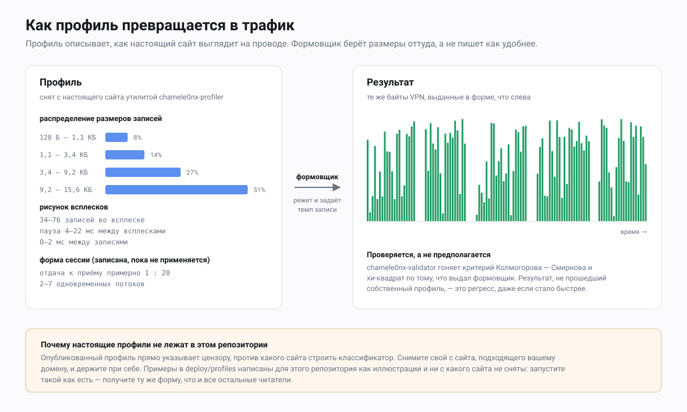

# Профили трафика

Профиль — это описание того, как настоящий сайт выглядит на проводе. Это
самая «операторская» часть проекта: код везде одинаковый, а профиль — ваш,
и плохой профиль перечёркивает всё, что над ним.

---

## Что такое профиль

Цензор, наблюдающий за TLS-соединением, прочитать его не может. Измерить
он может форму: насколько велика каждая запись, как записи сбиваются во
всплески, какой длины разрывы, сколько уходит вверх против того, сколько
приходит вниз. Этих измерений хватает, чтобы отделить туннель от
веб-сёрфинга, ничего не расшифровывая.

Профиль — это статистическое описание такой формы, снятое с сайта,
который действительно так себя ведёт. Формовщик затем тянет значения из
него, а не пишет как придётся. Там, где неформованный туннель выпускает
ровную реку 16-килобайтных записей, формованный выпускает размеры,
выбранные из гистограммы, всплесками выбранной длины, разделёнными
выбранными паузами.

Содержимое в обоих случаях одинаковое. Меняется только форма, а читают
именно её.



Профили — это данные, а не код. Они загружаются во время работы из JSON,
несут поле `version` и заменяются без единого прикосновения к развёрнутым
клиентам. Так задумано: формат на проводе заморожен, потому что клиенты
обновляются редко, а вот форма как раз должна меняться — по мере того,
как меняется сайт-прикрытие и совершенствуется обнаружение.

---

## Из чего состоит файл профиля

Схема — это `SiteProfile` в `transport/chamele0nx/profile.go`. Каждое поле
ниже проверяется при загрузке; файл, не прошедший проверку, отвергается
целиком, а не применяется частично.

### Верхний уровень

| Поле | Тип | Единицы | Что делает | Разумный диапазон |
|---|---|---|---|---|
| `name` | строка | — | Человеческая метка, видна в логах и в выводе валидатора. | любое |
| `version` | int | — | Версия схемы. **Обязано быть ровно 1**; всё прочее отвергается. | `1` |
| `record_size_distribution` | массив | — | Гистограмма, из которой формовщик тянет размеры записей. См. ниже. | 4–8 корзин |
| `burst_pattern` | объект | — | Длина всплеска и его тайминги. См. ниже. | — |
| `session_profile` | объект | — | Объёмы и длительность на уровне сессии. Только декларативно. | — |
| `upload_download_ratio` | float | отношение | Сколько байтов вверх на байт вниз. Обязано лежать в `(0, 1]`. | `0.05`–`0.2` |
| `concurrent_streams` | объект | штуки | Типичное число одновременных потоков HTTP/2. Только декларативно. | `{1, 8}` |
| `bypass_pause_cap` | bool | — | Отказ от потолка встроенной паузы в 250 мс. Необязательное, по умолчанию false. | `false` |

### `record_size_distribution[]`

| Поле | Тип | Единицы | Что делает | Разумный диапазон |
|---|---|---|---|---|
| `min_size` | int | байты | Нижняя граница корзины. Обязана быть ≥ 64. | 64–16384 |
| `max_size` | int | байты | Верхняя граница. Обязана быть ≥ `min_size` и ≤ 16384. | 64–16384 |
| `weight` | float | вероятность | Как часто выпадает эта корзина. Отрицательным быть не должно. | 0.0–1.0 |

**Веса обязаны давать в сумме 1.0.** Проверка допускает люфт ±0.01 и
отвергает всё, что за его пределами. Это самая частая причина, по которой
профиль, отредактированный руками, не загружается. Границы 64 и 16384 —
это минимальная осмысленная полезная нагрузка TLS-записи и максимум по
RFC 8446; корзина за их пределами отвергается.

### `burst_pattern`

| Поле | Тип | Единицы | Что делает | Разумный диапазон |
|---|---|---|---|---|
| `records_per_burst` | `{min, max}` | штуки | Сколько записей формовщик выпускает до паузы. `min` обязан быть > 0. | 5–90 |
| `burst_duration` | `{min_ms, max_ms}` | миллисекунды | Сколько длится всплеск. Только декларативно. | 100–2000 |
| `inter_burst_pause` | `{min_ms, max_ms}` | миллисекунды | Пауза между всплесками. Выбирается и отсыпается сном. | 3–900 |
| `inter_record_delay` | `{min_ms, max_ms}` | миллисекунды | Разрыв между записями внутри всплеска. Используется генерацией всплесков, а не живым формовщиком. | 0–12 |

### `session_profile`

| Поле | Тип | Единицы | Что делает |
|---|---|---|---|
| `duration` | `{min_ms, max_ms}` | миллисекунды | Ожидаемая длительность сессии. Только декларативно. |
| `bursts_per_session` | `{min, max}` | штуки | Ожидаемое число всплесков за сессию. Только декларативно. |
| `total_bytes_per_session` | `{min, max}` | байты | Ожидаемый объём за сессию. Только декларативно. |

### Две вещи, которые надо знать до ручной правки

**Длительности — всегда в миллисекундах.** Каждая длительность в файле —
это объект с `min_ms` и `max_ms`, оба целые. Нет ни суффикса единиц, ни
секунд, ни Go'шной строки длительности. Собственный маршаллер в
`profile.go` читает и пишет только эту форму, так что
`"inter_burst_pause": "250ms"` — это не «медленное значение», это сбой
разбора.

**Не каждое поле доходит до формовщика.** `ShapedConn`, который и делает
живую работу, читает ровно четыре вещи: `record_size_distribution`,
`burst_pattern.records_per_burst`, `burst_pattern.inter_burst_pause` и
`bypass_pause_cap`. Остальное — `burst_duration`, `session_profile`,
`upload_download_ratio`, `concurrent_streams` — проверяется, переносится,
печатается и не соблюдается во время работы никем. `inter_record_delay`
читает только генерация всплесков, которой пользуется режим генерации в
валидаторе; на живом соединении между записями никто не ждёт.

Об этом стоит сказать прямо, потому что от этого зависит, где усилия по
настройке окупаются. Правка `upload_download_ratio` сегодня не изменит на
проводе ни единого байта. Правка гистограммы или рисунка всплесков меняет
всё.

### Минимальный валидный профиль

```json
{
  "name": "example-dashboard",
  "version": 1,
  "record_size_distribution": [
    { "min_size": 64,    "max_size": 800,   "weight": 0.20 },
    { "min_size": 800,   "max_size": 5000,  "weight": 0.40 },
    { "min_size": 5000,  "max_size": 16384, "weight": 0.40 }
  ],
  "burst_pattern": {
    "records_per_burst":  { "min": 10,     "max": 30 },
    "burst_duration":     { "min_ms": 100, "max_ms": 600 },
    "inter_burst_pause":  { "min_ms": 20,  "max_ms": 120 },
    "inter_record_delay": { "min_ms": 0,   "max_ms": 5 }
  },
  "session_profile": {
    "duration":                { "min_ms": 180000, "max_ms": 1200000 },
    "bursts_per_session":      { "min": 30,        "max": 150 },
    "total_bytes_per_session": { "min": 1000000,   "max": 30000000 }
  },
  "upload_download_ratio": 0.08,
  "concurrent_streams": { "min": 1, "max": 6 }
}
```

---

## Как снять свой

`chamele0nx-profiler` измеряет настоящий сайт и пишет профиль по тому, что
увидел.

### Что он делает

Он открывает свежее TLS-соединение к цели, оборачивая TCP-сокет
перехватчиком, который разбирает заголовки TLS-записей в обе стороны до
того, как байты уйдут в слой TLS. Записи рукопожатия выбрасываются, как
только рукопожатие завершилось; остаются только записи прикладных данных,
каждая со своим размером, направлением и меткой времени. Затем он делает
один HTTP-запрос, дочитывает тело до конца, закрывает соединение и
повторяет.

Каждый запрос — один всплеск. Гистограмма строится только по полученным
записям, по семи фиксированным корзинам с границами 64, 200, 800, 2000,
5000, 10000 и 16384 байта; пустые корзины выбрасываются, а оставшиеся веса
нормируются к сумме 1. Диапазоны берутся как 5-й и 95-й процентиль
наблюдённого, чтобы одиночный выброс не расширил огибающую. Отношение
отдачи к приёму измеряется и зажимается в `[0.01, 1]`. Результат
проверяется до записи, так что инструмент не может выдать файл, который
сервер отвергнет.

### Флаги

| Флаг | По умолчанию | Смысл |
|---|---|---|
| `-target` | — | URL цели, обязателен. Например, `https://app.example.com` |
| `-pages` | `10` | Сколько раундов запросов сделать |
| `-out` | `profile.json` | Куда писать |
| `-name` | `profile-<host>` | Имя профиля, записываемое в файл |

### Как запустить

```bash
make build

./bin/chamele0nx-profiler \
  -target https://app.example.com \
  -pages 30 \
  -name my-dashboard-v1 \
  -out /etc/chamele0nx/my-dashboard-v1.json
```

Инструмент по ходу пишет в лог каждый раунд, а в конце печатает сводку с
гистограммой в виде полосок, рисунком всплесков и измеренным отношением.
Эту сводку и надо прочитать перед развёртыванием: если одна корзина
держит 95% веса, вы сняли один тип ресурса, а не сайт.

### Сколько раундов

Тридцать — разумное значение по умолчанию. В гистограмме не больше семи
корзин, и строится она только по полученным записям, поэтому важно, чтобы
записей хватило и мелкие корзины не оказались шумом: цельтесь минимум в
сотню записей в каждой корзине, которую собираетесь оставить. Страница,
возвращающая 50 записей, даст это за двадцать раундов; маленькая точка
API, возвращающая три, не даст никогда — и это само по себе полезная
информация о том, годится ли такая точка в прикрытие.

Раунды не бесплатны по времени: между ними инструмент спит от 2 до 6
секунд, так что тридцать раундов займут пару минут.

### Три оговорки, которые стоит понимать

Это свойства текущей реализации, а не профилей вообще. Прочитайте
сгенерированный файл, прежде чем ему доверять.

**Он запрашивает один и тот же URL каждый раз.** `-pages 30` означает
тридцать раундов по одному URL, а не обход тридцати разных страниц.
Поэтому гистограмма описывает один ответ, повторённый много раз. Если
правдоподобие сайта-прикрытия держится на смеси HTML, ресурсов и вызовов
API — снимайте каждое отдельно и сводите корзины руками, взвешивая их по
тому, как часто настоящая сессия попадает в каждое.

**Снятая `inter_burst_pause` — это собственный сон профилировщика.**
Разрыв между всплесками меряется от последней записи одного раунда до
первой записи следующего, а между раундами инструмент намеренно спит от 2
до 6 секунд, изображая паузу на чтение. Значит, записанное значение
окажется где-то в районе 2000–6000 мс — а это описывает профилировщик, а
не сайт. Если оставить как есть, формовщик всё равно обрежет его до 250
мс, и вы получите паузу, которую не выбирали. **Правьте это поле руками
после съёма.** Примеры профилей в `deploy/profiles` показывают диапазон,
который действительно осмыслен.

**`session_profile` не измеряется.** Эти три значения пишутся
фиксированными константами: 3–15 минут, 5–30 всплесков, 500 КБ – 10 МБ.
Во время работы их никто не читает, так что сегодня это безвредно, но не
читайте сгенерированный файл так, будто эти числа пришли с сайта. И
`bypass_pause_cap` инструмент никогда не выставляет — добавьте сами, если
нужно.

---

## Как выбрать сайт-прикрытие

Профиль хорош ровно настолько, насколько хорошо то, что вы измерили.
Четыре критерия, в порядке убывания ущерба от ошибки.

**Он обязан быть правдоподобным для вашего домена.** Профиль и
сайт-прикрытие должны рассказывать одну и ту же историю. Домен, который
отдаёт небольшой сайт-визитку, а даёт форму трафика видеоплатформы,
подозрительнее, чем каждое из этих двух по отдельности. Отталкивайтесь от
того, что вы реально готовы разместить в `-cover-dir`, а потом найдите
настоящий сайт такого рода и измерьте его.

**У него должно быть много входящего и мало исходящего.** Веб-сёрфинг
асимметричен, обычно где-то между 1:10 и 1:50 вверх к вниз, а встроенные
пресеты лежат между 1:5 и 1:20. Прикрытие, чей настоящий трафик тяжёл на
отдачу — файловая синхронизация, клиент резервного копирования, — даёт
огибающую, которую туннель с обычным веб-сёрфингом убедительно не
заполнит, а туннель с отдачей файлов перехлестнёт.

**Он не должен быть заблокирован там, где ваши пользователи.** Это тот
сбой, который выглядит как ошибка протокола. Если сайт, которому вы
подражаете, сам недостижим из цензурируемой сети, то ваш трафик выглядит в
точности как трафик к чему-то, что цензор уже решил останавливать, — и вы
сделали себя проще для классификации, а не сложнее. Проверяйте
достижимость из той сети, которая вас на самом деле волнует, а не со своей
машины.

**Он должен быть обыденным.** Ценность прикрытия в том, что оно
растворяется в фоновом шуме. Нишевый сервис, трафик которого цензор видит
десять раз в день, — это отличительная форма, а отличительная форма — это
отпечаток, независимо от того, понимает ли кто-нибудь его смысл.
Предпочитайте сайты того рода, что у множества людей открыты весь день.

---

## Проверка

`chamele0nx-validator` отвечает на один вопрос: похоже ли, что этот набор
размеров записей пришёл из этого профиля?

Он гоняет две проверки. Одновыборочный тест Колмогорова — Смирнова
сравнивает эмпирическое распределение выборки с распределением профиля,
считая каждую корзину внутри себя равномерной, и сообщает наибольший
разрыв между двумя кривыми. Тест хи-квадрат на согласие сравнивает
наблюдённые количества по корзинам с ожидаемыми, при `k-1` степенях
свободы и с пропуском корзин, чьё ожидаемое количество меньше 1. Оба
p-значения сравниваются с `-alpha`; для прохождения оба обязаны его
превысить.

### Флаги

| Флаг | По умолчанию | Смысл |
|---|---|---|
| `-profile` | — | Путь к JSON профиля, обязателен |
| `-samples` | — | Путь к JSON-массиву целых размеров записей |
| `-generate` | `0` | Вместо чтения выборки сгенерировать столько синтетических всплесков из профиля и проверить их |
| `-alpha` | `0.05` для сравнения, `1e-4` для самопроверки | Уровень значимости. Обе проверки обязаны дать p выше него |

Нужен ровно один из `-samples` и `-generate`.

### Режим сравнения

Вот это и есть настоящая проверка. Снимите размеры TLS-записей, которые
ваш сервер действительно выпустил, запишите их JSON-массивом целых чисел и
проверьте.

```bash
./bin/chamele0nx-validator \
  -profile /etc/chamele0nx/my-dashboard-v1.json \
  -samples /tmp/observed-sizes.json
```

Файл выборки — не более чем вот это:

```json
[1204, 8871, 15903, 412, 16011, 704, 9982]
```

### Режим генерации

```bash
./bin/chamele0nx-validator -profile deploy/profiles/saas-fast.example.json -generate 1000
```

Это вытянет тысячу всплесков из собственного сэмплера профиля и проверит
их против этого же профиля. Отдавайте себе отчёт, что это доказывает: это
проверка на самосогласованность. Она ловит сломанный сэмплер,
искалеченную гистограмму или веса, описывающие не то, что вы думаете. Это
не доказательство того, что ваш живой трафик соответствует профилю: вывод
может переформовать что угодно ниже по течению.

Оба режима проверяют против одного и того же эталона, и это **не**
гистограмма корзин профиля. Запись рождается в три шага: выбрать корзину
по весу, выбрать размер равномерно внутри неё, затем разболтать этот
размер на ±25% и подрезать до допустимой полезной нагрузки TLS-записи, —
а гистограмма описывает только первые два. Гистограмма — то, что профиль
*просит*; эталон — то, что узел *выдаёт*, и именно это видит наблюдатель.
Разница велика настолько, что её нельзя списать: у корзины, чей верх
тянется к потолку записи в 16 КБ, значительная часть джиттера вверх
подрезается обратно на этот единственный размер, и там встаёт «атом»:
около четырёх процентов на `saas-fast` и почти девять на `saas-max`.
Гистограммой диапазонов это не выразить никак.

Проверять выданные размеры против гистограммы — это то, что инструмент
делал раньше, и он писал FAIL для всех профилей, которые когда-либо
поставлялись: `saas-fast` на D ≈ 0,083, `saas-stealth` на D ≈ 0,015, и от
трёх тысяч выборок до трёхсот тысяч эти числа не двигались — подпись
систематического смещения, а не неудачного броска. Это исправлено, и
`saas-fast` теперь самопроверяется на D ≈ 0,0008. Заодно `-generate`
отказывается судить по выборке меньше 200 записей, а не пропускает её:
вердикт на горстке записей говорит только о том, что посмотрели слишком
мало.

Два режима работают на разных уровнях значимости, и прежде чем читать
вердикт, стоит понять почему. В режиме генерации нулевая гипотеза верна
по построению — выборка приходит из собственного сэмплера профиля, — а
значит p-значение равномерно на [0, 1], и при α = 0,05 совершенно
правильная модель проваливается примерно один прогон из двадцати. Это не
дефект модели, это ровно то, что означает 0,05. Проверено измерением, а
не принято на веру: двадцать прогонов `saas-stealth` дали p-значения,
равномерно разбросанные по интервалу, и ровно одно оказалось ниже 0,05.
Гейт, который кричит «волки» раз в двадцать прогонов, перестают читать,
поэтому режим генерации по умолчанию берёт **α = 1e-4** — он спрашивает,
сломана ли модель, а не был ли маловероятен именно этот бросок. Режим
сравнения оставляет обычные **α = 0,05**: там нулевая гипотеза —
настоящий вопрос, разошёлся ли профиль с тем, что выдаёт сервер, и пять
процентов ложных тревог — обычная цена за способность заметить реальный
уход. Явно переданный `-alpha` перекрывает любое из этих значений.

### Как читать результат

```
=== Kolmogorov-Smirnov Test ===
  D-statistic: 0.0214
  p-value:     0.7391
  Result:      PASS

=== Chi-Squared Test ===
  χ²-statistic: 4.8102
  p-value:      0.4394
  Result:       PASS

OVERALL: PASS — traffic matches profile
```

Код возврата — 0 при успехе и 1 при провале, так что этому место в
проверке при развёртывании — годится любой режим, каждый со своим
уровнем по умолчанию. Высокая D-статистика с низким p-значением
означает, что размеры взяты из заметно другого распределения — обычно
потому, что профиль правили, не перенормировав веса, или потому, что
выборка пришла со сборки с выключенной формовкой. Провал хи-квадрат при
пройденном тесте Колмогорова — Смирнова обычно означает, что одна корзина
сильно пере- или недопредставлена, тогда как кривая в целом близка.

**Обе проверки смотрят только на размеры записей.** Ни одна не меряет
тайминги. Профиль с неверными паузами пройдёт обе начисто. Вывод, не
проходящий собственный профиль, — это регрессия, даже если он быстрее;
вывод, который проходит, — это нижняя планка, а не гарантия.

---

## Настройка: скорость против маскировки

Тут настоящий размен, и обойти его нельзя. Крупные записи с короткими
паузами двигают данные быстро, а поток крупных записей с короткими
паузами — это ровно то, как выглядит туннель. Мелкие записи вперемешку с
длинными паузами выглядят как человек, а человек медленный.

Два примера профилей в `deploy/profiles` отмечают края разумного
диапазона. Третий, `saas-max`, стоит за быстрым краем — про него ниже.

| | `saas-fast` | `saas-stealth` |
|---|---|---|
| Вес в верхней корзине | 51% (9,2–15,6 КБ) | 11% (5,2–11 КБ) |
| Вес в нижней корзине | 8% (128–1100 Б) | 34% (96–512 Б) |
| Самая крупная запись | 15600 Б | 11000 Б |
| Записей во всплеске | 34–76 | 5–19 |
| Пауза между всплесками | 4–22 мс | 140–1050 мс |
| Задержка между записями | 0–2 мс | 2–17 мс |
| Байтов за сессию | 80–420 МБ | 4–72 МБ |
| `bypass_pause_cap` | не задан | `true` |

`saas-fast` кладёт половину веса в верхнюю корзину и паузит от силы на
пару десятков миллисекунд. Получающийся поток близок к непрерывной выдаче крупных
записей — то есть близок к тому, как выглядит неформованный туннель. Он
для операторов, чьим пользователям нужна скорость и чья сеть не гоняет
поведенческую классификацию — или гоняет недостаточно въедливо, чтобы
разница имела значение.

`saas-stealth` переворачивает всё наоборот. Ничего крупнее 11 КБ, треть
записей меньше 512 байт, всплески вчетверо короче, паузы за секунду —
далеко за 250-миллисекундным потолком встроенной паузы, из-за чего он и
выставляет `bypass_pause_cap`. Эти паузы удерживаются под блокировкой
записи, так что они блокируют каждый поток в соединении. Это и есть
задуманное поведение: в этом разница между «скачиванием» и «чтением».
Интерактивные задержки станут заметно хуже, и это цена, которую платят
намеренно.

`saas-max` идёт в ту же сторону, что и `saas-fast`, только дальше — и
платит за это больше. Ничего мельче 2600 байт, две трети веса в
11,2–15,8 КБ, 75–210 записей на всплеск и 2–9 мс между всплесками. Это
уже почти непрерывный поток крупных
записей, то есть почти то же самое, что незамаскированный туннель. Это
вариант ради скорости, а не ради маскировки: берите его, только когда
упираетесь именно в скорость и точно знаете, что сеть не разбирает
поведение трафика. В остальных случаях лучше `saas-fast`.

Все три лежат как `.example.json` в `deploy/profiles`, и все три к тому
же разрешаются по имени. Если клиент получает в ссылке-приглашении имя
`saas-fast`, `saas-stealth` или `saas-max` (то, с которым настроен
сервер), он берёт встроенную копию и без JSON-файла на диске.
Распознаются имена `saas-fast` (синоним `saas_fast`), `saas-stealth`
(синоним `saas_stealth`) и `saas-max` (синоним `saas_max`) — рядом с
остальными заготовками: `balanced`, `stealth`, `aggressive`,
`wordpress`, `lowpower`, `server-downstream`. Встроенные копии повторяют
поставляемый JSON поле в поле, поэтому ссылка работает, едет с ней файл
или нет. При этом все три — иллюстрации, написанные для этого
репозитория: они ни с какого сайта не сняты и ни по какому настоящему
трафику не измерены. Эти же три формы есть у каждого, кто читает
репозиторий, — значит, цензору хватит одного классификатора на всех.
Снимите свою через `chamele0nx-profiler`, прежде чем полагаться на любую
из них в бою.

Между этими краями:

- **Сначала перекладывайте вес между верхней и нижней корзинами.** Это
  самый мощный рычаг и для скорости, и для внешнего вида, и именно его
  меряет валидатор.
- **`inter_burst_pause` меняйте вторым — и помните про потолок.** Всё
  выше 250 мс молча обрезается, если не выставлен `bypass_pause_cap`, так
  что профиль, просящий 2000 мс без этого флага, — не скрытный профиль.
  Это 250-миллисекундный профиль с вводящим в заблуждение файлом.
- **Поднимайте `records_per_burst` ради скорости.** Больше записей на
  паузу — меньше пауз на мегабайт. Это самый дешёвый прирост скорости,
  потому что он не меняет распределение размеров, которое проверяет
  валидатор.
- **Не настраивайте декларативные поля, ожидая эффекта.**
  `upload_download_ratio`, `concurrent_streams`, `session_profile` и
  `burst_duration` сегодня не меняют во время работы ничего.

Если после смены профиля сервер стал слишком медленным, средства в
порядке применения такие: перенастроить профиль, потом переключить сервер
на встроенный профиль для потока от сервера, и уже потом — последним —
выставить `-disable-downstream-shaping`. Этот флаг полностью выключает
формовку на стороне сервера, оставляя только клиента, который сам
распределяет во времени свою отдачу. Поток от сервера снова становится
непрерывным, а это ровно тот сигнал, ради подавления которого всё это и
существует. Это аварийный люк на время живой аварии, а не настройка.

---

## Правила эксплуатации

**Не коммитьте профиль в публичный репозиторий.** Опубликованный профиль
точно сообщает цензору, против какого сайта строить классификатор, и
делает это уже с готовыми измерениями. `.gitignore` блокирует
`/profiles/` и `*.profile.json` и разрешает только
`deploy/profiles/*.example.json`. Три примера, которые там лежат,
написаны для этого репозитория как иллюстрации: они не сняты ни с
одного сайта и не измерены по настоящему трафику. Отсюда же следует, что
любой из них, запущенный как есть, даёт вам ту же форму, что и у всех
остальных читателей репозитория, — это заготовка, чтобы прочитать и
переделать под себя, а не то, с чем выходят в бой. Держите свои профили
рядом с сертификатами, а не рядом с кодом.

**Давайте разным серверам разные профили.** Два сервера с одинаковым
профилем дают два потока одинаковой формы, а одинаковая форма — это
коррелятор: она группирует ваших пользователей вместе даже тогда, когда
ничто другое их не связывает. Персонализация на соединение уже
встряхивает огибающую на ±20%…±50% внутри одного сервера, но она не может
сделать так, чтобы два развёртывания одного файла выглядели как два
разных сайта. Снимайте отдельно на каждый сервер или, как минимум, на
каждый сайт-прикрытие.

**Переснимайте, когда меняется прикрытие.** Профиль — это измерение с
датой. Переснимайте, когда сайт-прикрытие переделали или его ресурсы
существенно изменились; когда вы направили `-cover-dir` на что-то новое;
когда заметно изменился настоящий сайт, который вы измеряли; и просто
периодически, потому что сайты дрейфуют. Профиль, описывающий версию
сайта, которой больше нет, хуже, чем отсутствие профиля, потому что он
уверенно неверен.

**Проверяйте до развёртывания, а не после.** Прогоните валидатор по
профилю в режиме генерации как проверку синтаксиса и здравого смысла,
читайте печатную сводку профилировщика, а не верьте файлу, и убедитесь,
что `inter_burst_pause` — это значение, которое выбрали вы, а не то,
которое породил собственный сон профилировщика.

---

## Смотрите также

| Документ | О чём |
|---|---|
| [ARCHITECTURE.md](ARCHITECTURE.md) | Где формовка стоит в стеке и почему у неё есть потолок |
| [SPEC.md](SPEC.md) | Формат на проводе, на который профили не влияют |
| [OPERATIONS.md](OPERATIONS.md) | Как держать сервер, включая сайт-прикрытие |
| [THREAT-MODEL.md](THREAT-MODEL.md) | От чего формовка защищает, а от чего нет |
