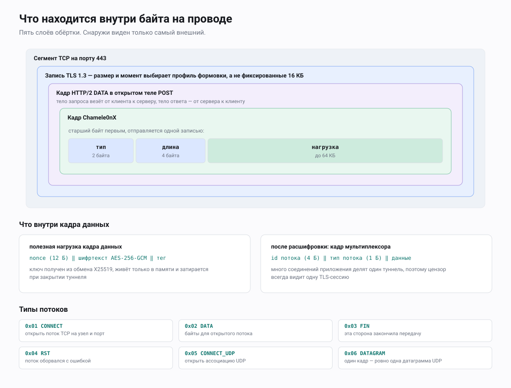

# Спецификация протокола Chamele0nX

Статус: описательный. Документ описывает протокол **в том виде, в каком он
реализован** в `transport/chamele0nx` и `internal/chcrypto` этого репозитория.
Это не проектный документ: если код и старая проектная записка расходятся,
верен код, а спецификация следует за кодом.

---

## 1. Рамки и соглашения

### 1.1 Рамки

Документ задаёт:

* последовательность установления транспорта (TCP → TLS → HTTP/2 → туннель);
* токен доступа и его кодировки в куках;
* обмен ключами и конверт защиты записей;
* уровень кадров и уровень потоков (мультиплексирование);
* передачу UDP по туннелю;
* формат профиля трафика и алгоритм формовки;
* поведение сервера при неаутентифицированных запросах;
* числовые константы, о которых обе стороны обязаны договориться.

Вне рамок этого документа: сборка и развёртывание (`docs/ru/INSTALL.md`),
модель нарушителя и то, от чего протокол **не** защищает
(`docs/ru/THREAT-MODEL.md`), а также политика переподключения и выдержки между
попытками у `PersistentClient` — это стратегия клиентской реализации, а не
часть контракта на проводе.

### 1.2 Уровни требований

Ключевые слова MUST, MUST NOT, SHOULD, SHOULD NOT и MAY трактуются так, как
описано в RFC 2119: обязан/обязательно (MUST), запрещено (MUST NOT), следует
(SHOULD), не следует (SHOULD NOT), допускается (MAY). Требование, записанное
здесь, отражает то, что эталонная реализация делает или проверяет; там, где
эталонная реализация допускает вольность, но от поведения зависит
совместимость, это отмечено явно.

### 1.3 Порядок байтов и кодировки

* Все многобайтовые целые в собственном обрамлении Chamele0nX — **big-endian**
  (`encoding/binary.BigEndian` везде в `proto.go` и `mux.go`).
* Токены доступа — **base64url без выравнивания**
  (`base64.RawURLEncoding`).
* Параметр точки подключения `user_secret` — **hex в нижнем или верхнем
  регистре**; hex взят потому, что значение переживает круг через JSON в
  мобильных обвязках и в блобах приглашений.
* Привязка к открытому ключу (`chameleon_pubkey_pin`) — **hex**, декодируется
  ровно в 32 байта.
* Длительности в JSON профиля — целые числа в **миллисекундах**
  (`DurationRange.MarshalJSON` / `UnmarshalJSON`).

### 1.4 Версионирование этого документа

Документ идёт вместе с тем деревом исходников, в котором лежит. **Номера версии
протокола на проводе нет** (см. §12); единственный версионируемый артефакт —
профиль трафика (`SiteProfile.Version`, сейчас `1`). Поэтому авторитетная
версия спецификации — та ревизия репозитория, которая её содержит: документ
описывает код на момент того коммита, в котором он поставляется.

---

## 2. Модель уровней



Снаружи внутрь один сеанс Chamele0nX выглядит так:

```
  TCP  :443
   └── TLS 1.3  (uTLS, Chrome ClientHello; ALPN "h2")
        │        размер и тайминг записей формуются (ShapedConn, §9)
        └── HTTP/2  (единственный POST, тело запроса = к серверу, тело ответа = от сервера)
             └── кадры Chamele0nX           [type:2][length:4][payload:N]   (§6)
                  ├── KEY_EXCHANGE  — открытые ключи X25519, открытым текстом  (§5)
                  └── DATA          — AES-256-GCM(nonce ‖ ct ‖ tag)           (§5)
                       └── кадр потока  [stream_id:4][stream_type:1][data:N]  (§7)
                            ├── CONNECT / CONNECT_UDP  [host_len:1][host][port:2]
                            ├── DATA      — фрагмент байтового потока TCP
                            ├── DATAGRAM  — ровно одна UDP-датаграмма
                            └── FIN / RST — закрытие потока
```

Клиент отдаёт туннель приложениям как **SOCKS5**-прокси на локальной петле;
сервер завершает каждый поток исходящим TCP- или UDP-сокетом.

Обязанности уровней строго разделены:

| Уровень | Даёт | Не даёт |
|---|---|---|
| TLS (uTLS) | маскировку, транспортную защиту прикрытия | конфиденциальность полезной нагрузки туннеля (её Chamele0nX обеспечивает сам) |
| ShapedConn | размеры записей, тайминг всплесков | никакого обрамления и целостности |
| HTTP/2 | долгоживущую двустороннюю байтовую трубу поверх одного POST | разделение потоков между туннелируемыми соединениями |
| Уровень кадров | разграничение, разбор по типам | шифрование |
| Защита записей | конфиденциальность и целостность кадров потока | защиту от повтора между кадрами |
| Уровень потоков | мультиплексирование, жизненный цикл соединения | управление перегрузкой, контроль потока по каждому потоку |

---

## 3. Установление транспорта

Вся последовательность ниже реализована прямо в `Transport.connect`
(`chamele0nx.go`). См. замечание в §10.3 про `CoverProfile.Open`.

### 3.1 Параметры точки подключения

| Параметр | Обязателен | По умолчанию | Смысл |
|---|---|---|---|
| `chameleon_addr` | да | — | `host:port` сервера |
| `user_secret` | да | — | hex, обязан декодироваться в ≥ 16 байт (`minUserSecretBytes`) |
| `chameleon_sni` | нет | часть host из `chameleon_addr` | настоящий SNI |
| `chameleon_path` | нет | `/api/v1/events` | путь HTTP/2-запроса |
| `chameleon_cookie` | нет | `generic` | формат куки: `generic`, `wordpress`, `django` |
| `chameleon_profile` | нет | `DefaultSaaSProfile` | имя встроенной заготовки либо путь к файлу профиля JSON |
| `server_id` | нет | `endpoint.ID` | идентификатор сервера, вшиваемый в токен доступа |
| `chameleon_pubkey_pin` | нет | — | hex, ровно 32 байта; включает подмену SNI |
| `chameleon_spoof` | нет | — | `off` жёстко выключает подмену SNI |
| `chameleon_spoof_sni` | нет | выбор из пула | имя, объявляемое в режиме подмены; требует `chameleon_pubkey_pin` |
| `cover` | нет | `saas-http2` | идентификатор профиля прикрытия; проверяется на этапе разбора параметров |

`validateChamele0nXParams` отвергает отсутствующий адрес, отсутствующий или
не-hex `user_secret`, `user_secret` короче 16 байт и незарегистрированный
идентификатор `cover`. Кривой `chameleon_pubkey_pin` отвергается уже внутри
`connect`.

### 3.2 Зерно на соединение

`connect` берёт 64-битное `clientSeed` из `crypto/rand`
(`generateClientSeed`; при отказе системного генератора случайных чисел он
паникует). Это единственное зерно управляет всеми выборами в рамках
соединения: выбором подменного SNI, выбором User-Agent, персонализацией
профиля и разбросом размеров отдельных записей. Одно зерно взято намеренно —
сеанс показывает единую связную синтетическую личность, а не независимые
случайные выборы по каждой оси.

### 3.3 TLS

Рукопожатие TLS идёт через `github.com/refraction-networking/utls` с
заготовкой ClientHello **`utls.HelloChrome_Auto`** (`dialUTLSWith`). Таймаут
TCP-соединения — 15 с.

`newUTLSConfig` задаёт ровно три поля, и все три несут нагрузку:

| Поле | Значение | Зачем |
|---|---|---|
| `ServerName` | объявляемый SNI (настоящий или подменный) | то, что несёт ClientHello |
| `ClientSessionCache` | LRU, 32 записи, общий на `Transport` | настоящий Chrome при переподключении предъявляет билет сессии TLS 1.3; без кэша каждое переподключение — полное рукопожатие, а это само по себе расходится с отпечатком Chrome, который выдаёт остальной стек |
| `DynamicRecordSizingDisabled` | `true` | обязано быть true. Иначе уровень TLS сам разгоняет размер записей с 512 Б до 16 КБ на первых ~128 КБ, под формовщиком, и тот ничего не может с этим сделать |

После рукопожатия клиент проверяет, что согласованный протокол ALPN — это
`h2`, иначе закрывает соединение. Удачные рукопожатия считаются с разбивкой по
`state.DidResume` и доступны через `Transport.HandshakeStats`.

Сервер (`ListenAndServeTLS`) слушает с `MinVersion: TLS 1.2`,
`NextProtos: ["h2", "http/1.1"]` и `DynamicRecordSizingDisabled: true`, и даёт
каждому принятому соединению 15 с на завершение рукопожатия, после чего рвёт
его. Оба протокола предлагаются потому, что настоящий сайт почти всегда
соглашается на HTTP/1.1 — и объявлять один только `h2` значит выдать себя:
пробник, предлагающий только http/1.1, получит от h2-сервера
`no_application_protocol`, тогда как настоящий сайт ответит. `h2` остаётся
первым, поэтому клиент туннеля (он предлагает оба, `h2` предпочтительнее)
по-прежнему попадает на `h2`; по пути http/1.1 всегда идёт только трафик
сайта-прикрытия, но никогда — туннель.

### 3.4 SNI и режим подмены

Два режима, выбор — в `connect`:

**Обычный.** Объявляемый SNI и `:authority` в HTTP/2 равны настоящему SNI.
Проверка сертификата стандартная.

**Подмена с привязкой.** Включается, только когда задан
`chameleon_pubkey_pin`, а `chameleon_spoof` не равен `off`. Тогда:

1. SNI — это `chameleon_spoof_sni`, если оператор его задал, иначе
   `pickSubstituteSNI(identity)`: выбор из `substituteSNIPool`
   (`sni_pool.go`, 31 запись) по `user_secret` и `chameleon_addr`;
2. `:authority` в HTTP/2 и `Request.Host` выставляются в **то же самое**
   подменное имя, чтобы уровни внутри TLS не разошлись с ClientHello;
3. включается `InsecureSkipVerify`, и проверка имени хоста тем самым
   пропускается;
4. обратный вызов `VerifyPeerCertificate` разбирает первый сертификат
   собеседника, приводит его открытый ключ к DER `SubjectPublicKeyInfo`, берёт
   SHA-256 и сравнивает с привязкой через `crypto/subtle.ConstantTimeCompare`.
   Несовпадение, пустая цепочка или ошибка разбора обрывают рукопожатие.

Выбранный SNI обязан быть неизменным — и не только на время одного соединения:
он выводится из собственной личности клиента, поэтому остаётся тем же при
каждом переподключении, пока не меняются учётные данные и адрес сервера. Два
пользователя одного сервера получают разные имена, так что парк клиентов
по-прежнему распределяется по пулу.

Прежняя редакция брала имя из зерна соединения, и оно менялось на каждый дозвон.
Это было хуже фиксированного выбора сразу по двум причинам. Кэш TLS-сессий
ключуется по имени сервера, поэтому при 31 имени билет возобновления подходил
примерно один раз из 31, и почти каждое соединение оказывалось полным
рукопожатием без билета — ровно тем отсутствием, которое транспорт в других
местах старательно закрывает. И один адрес, отзывающийся на два десятка
известных брендов за короткий срок, выглядит страннее адреса, который упорно
называется одним именем. Ни один сопоставимый транспорт не ротирует: REALITY,
Trojan и NaiveProxy закрепляют одно имя на всю жизнь развёртывания.

Оператору, у которого есть своё имя — то, что резолвится в него, или то, что
терминирует его собственный фронт, — следует задать `chameleon_spoof_sni`. Это
строго лучше любой записи из пула, потому что имена пула резолвятся в чужую
инфраструктуру.

Привязка при подмене обязательна: без неё проверка имени остаётся включённой и
рукопожатие упало бы на несовпадении SAN. Подмена без привязки не предлагается
вовсе, потому что выключить проверку имени и не поставить ничего взамен — это
сделать клиента тривиально перехватываемым.

### 3.5 HTTP/2

Клиент использует `github.com/imroc/req/v3` (MIT), а не стандартную
библиотеку, чтобы выдавать HTTP/2-отпечаток Chrome. Настройки ниже — точные
значения из `newChromeH2Transport`:

| Настройка | Значение |
|---|---|
| `SETTINGS_HEADER_TABLE_SIZE` | 65536 |
| `SETTINGS_ENABLE_PUSH` | 0 |
| `SETTINGS_INITIAL_WINDOW_SIZE` | 6291456 |
| `SETTINGS_MAX_HEADER_LIST_SIZE` | 262144 |

Четыре настройки, ровно в этом порядке (`SetHTTP2SettingsFrame` принимает упорядоченный список).
`SETTINGS_MAX_CONCURRENT_STREAMS` и `SETTINGS_MAX_FRAME_SIZE` намеренно
**отсутствуют** — Chrome их не объявляет.

| Поле Transport | Значение |
|---|---|
| `ConnectionFlow` | 15663105 (начальная дельта `WINDOW_UPDATE`, которую Chrome шлёт после SETTINGS) |
| `InitialWindowSize` | 6291456 |
| `HeaderTableSize` | 65536 |
| `AllowHTTP` | false |
| `DisableCompression` | true |
| `ReadIdleTimeout` | 15 с |
| `PingTimeout` | 5 с |

**Порядок псевдозаголовков** (`PseudoHeaderOrder`, и `PHeaderOrderKey` на
запросе):

```
:method  :authority  :scheme  :path
```

Он отличается от порядка в стандартной библиотеке (`:method :scheme :authority
:path`) и несёт больше всего нагрузки из всего списка — это широко известный
признак для снятия отпечатка.

**Порядок обычных заголовков** (`HeaderOrderKey`):

```
cookie  content-type  accept  user-agent
```

**Запрос:**

| Поле | Значение |
|---|---|
| Метод | `POST` |
| Схема | `https` |
| Путь | `chameleon_path` (по умолчанию `/api/v1/events`) |
| `:authority` / `Host` | подменный SNI в режиме подмены, иначе настоящий |
| `Cookie` | `FormatCookie(token, cookieFormat)` — §4 |
| `Content-Type` | `application/json` |
| `Accept` | `application/json` |
| `User-Agent` | `pickUserAgent(clientSeed)` — набор из 5 строк, только Chromium (`useragent.go`) |

В наборе User-Agent только строки на движке Chromium (Chrome под
Windows/macOS/Linux/Android, Edge под Windows), потому что UA от Firefox или
Safari вместе с HTTP/2-настройками Chrome — это внутреннее противоречие, видное
любому активному зондировщику, у которого есть валидный токен. Набор привязан к
версиям, и его обязательно обновлять по мере смены мажорных версий Chrome;
протухший набор сам становится отпечатком.

**Тела.** Единственный POST — это и есть весь туннель:

* **тело запроса** — клиент → сервер, наполняется через писателя `io.Pipe`;
* **тело ответа** — сервер → клиент, читается потоком.

Клиент требует HTTP-статус **200**; любой другой статус обрывает подключение.
Сервер ставит `Content-Type: application/json`, пишет `200` и сбрасывает буфер
до обмена ключами, чтобы тело ответа начало течь сразу (`handleTunnel`); каждая
последующая запись сервера тоже сбрасывается (`flushWriter`).

### 3.6 Куда встроена формовка записей

Дозвонщик возвращает соединение uTLS, обёрнутое в `ShapedConn` (§9). Обёртка
обязана стоять между уровнем TLS и обрамлением HTTP/2: перерезаются на записи
именно буферы писателя HTTP/2, а лежащий ниже уровень TLS не должен резать их
заново. Ради этого шва реализация и управляет uTLS напрямую, вместо того чтобы
брать TLS-клиентскую библиотеку, которая держит уровень TLS у себя внутри.

---

## 4. Аутентификация

### 4.1 Токен

```
bucket = floor(unix_seconds / 300)
token  = base64url_nopad( HMAC-SHA256( user_secret, ASCII("<bucket>|<server_id>") ) )
```

Про точный вход: сообщение HMAC — это десятичный номер интервала, один байт
`|` и идентификатор сервера, собранные через `fmt.Sprintf("%d|%s", bucket,
serverID)` (`generateTokenForBucket`). На выходе — сырой 32-байтовый MAC,
закодированный base64url **без выравнивания** (43 символа).

* Окно (`tokenWindow`) — **5 минут** = 300 с.
* Токен, соответственно, меняется каждые 5 минут, и подсмотренный токен нельзя
  переиграть дальше следующей границы интервала.
* `ValidateAuthToken` принимает токен, чей интервал равен **текущему** интервалу
  сервера или **непосредственно предыдущему**. Допуск поэтому несимметричен:
  часы клиента, отстающие от сервера, принимаются почти на два окна (без малого
  10 минут) видимого отставания, а у клиента, чьи часы **спешат**, допуска нет
  вовсе — как только он перешагнёт в следующий интервал, его токен отвергается,
  пока сервер не догонит. Сравнение — `hmac.Equal` (за равное время).
* Обе стороны обязаны сойтись на `server_id`. Клиент по умолчанию берёт
  `endpoint.ID`; сервер — `ServerConfig.ServerID`.

### 4.2 Кодировка куки

`FormatCookie(token, format)`:

| Формат | Кука |
|---|---|
| `generic` (по умолчанию и при любом неопознанном значении) | `sid=<token>` |
| `django` | `sessionid=<token>` |
| `wordpress` | `wordpress_logged_in_<hex8>=<token>`, где `<hex8>` — первые 4 байта `SHA-256(token)` в hex нижнего регистра |

Смысл в том, чтобы кука выглядела как то, что правдоподобно поставил бы
фреймворк сайта-прикрытия. Сырой hex-MAC в заголовке сразу бросился бы в глаза
любому, кто может заглянуть внутрь TLS.

`ParseCookie(part, format)` — обратная операция:

* `generic` — требует буквальный префикс `sid=`, возвращает остаток;
* `django` — требует префикс `sessionid=`, возвращает остаток;
* `wordpress` — возвращает всё после **последнего** `=` в строке, полностью
  игнорируя имя. Это намеренно вольно, чтобы не пришлось воспроизводить
  случайный хеш-суффикс, но означает, что в формате `wordpress` принимается
  **любая** кука, чьё значение оказалось валидным токеном, а имя куки не
  проверяется вообще.

### 4.3 Проверка на стороне сервера

`Server.authenticateClient`:

1. Если заголовок `Cookie` отсутствует или пуст — сразу отказ. Это короткое
   замыкание не зависит от секрета.
2. Разбить заголовок по `;`, обрезать пробелы в каждой части и прогнать через
   `ParseCookie` с настроенным на сервере форматом. Части, которые не
   разбираются, пропускаются — тоже без зависимости от секрета.
3. Для каждого разобранного токена пройти по **всем** записям
   `ServerConfig.UserSecrets`, вызывая `ValidateAuthToken` на каждой, и
   запомнить, совпало ли хоть что-то. Цикл обязан не выходить досрочно при
   совпадении: суммарная работа равна `O(len(UserSecrets) × HMAC)` независимо
   от того, случилось ли совпадение и где именно. Это убирает временной оракул,
   который иначе выдал бы, какой интервал совпал, если усреднить по многим
   пробам.

Сервер не узнаёт, **какой именно** пользователь совпал, и не использует
личность ни для чего: аутентификация — булев шлагбаум.

### 4.4 Поведение при отказе

`POST` на настроенный путь API, не прошедший аутентификацию, **не** отвергается
и **не** передаётся файловому серверу. На него отвечает `apiDecoy` (§10.1) —
тем отказом, который выдал бы настроенный фреймворк прикрытия, и постоянным
телом ошибки в JSON, одинаковым при отсутствующем и при неверном токене, так
что ничто не отличает «неверный токен» от «токена нет». GET на тот же путь
получает тот же ответ, что и POST; любой другой метод — 405 с заголовком
`Allow: GET, POST`. Запросы на любой другой путь уходят обработчику
сайта-прикрытия.

---

## 5. Обмен ключами и защита записей

### 5.1 Порядок кадров

Сразу после того, как POST вернул 200:

```
клиент → сервер:  кадр KEY_EXCHANGE, полезная нагрузка = открытый ключ X25519 клиента (32 байта)
сервер → клиент:  кадр KEY_EXCHANGE, полезная нагрузка = открытый ключ X25519 сервера (32 байта)
```

Дальше обе стороны считают общий секрет ECDH. Клиент отвергает первый кадр от
сервера, если его тип не `KEY_EXCHANGE` или нагрузка не ровно 32 байта; сервер
применяет ту же проверку к кадру клиента. Оба ключа эфемерные, создаются на
каждое соединение через `crypto/ecdh` X25519 и `crypto/rand`, и именно это даёт
прямую секретность нагрузки туннеля независимо от TLS-сессии.

Кадры обмена ключами Chamele0nX **не** шифрует (они и так внутри TLS).

Каждый кадр `KEY_EXCHANGE` пишется вместе с хвостовым кадром-паддингом (`PING`,
который партнёр читает и отбрасывает) в одной TLS-записи случайной длины (длина
выбирается на каждую запись). Формат кадра при этом не меняется — партнёр,
который не добавляет паддинг, всё равно совместим и шлёт голый кадр, — но запись
больше не является фиксированными ~69 байтами в фиксированной позиции в самом
начале каждого сеанса, что иначе было бы константой размера и позиции, которую
пассивный наблюдатель ловит, ничего не расшифровывая.

### 5.2 Вывод ключа

```
session_key = HKDF-SHA256(
                 secret = X25519_shared_secret,
                 salt   = nil,
                 info   = "chameleon-session-v1"
              ) [первые 32 байта]
```

`deriveSessionKey` читает ровно 32 байта из читателя HKDF. Соль — `nil`
(HKDF-Extract поэтому берёт нулевую соль длиной с хеш). Строка info — это
ASCII-литерал `chameleon-session-v1`, и это единственная отметка версии в
протоколе; никакого согласования вокруг неё нет.

Общий секрет затирается (`chcrypto.Zeroize`) сразу после вывода сессионного
ключа, на обеих сторонах.

**Один ключ на оба направления.** Один 32-байтовый ключ защищает и трафик
клиент → сервер, и трафик сервер → клиент. Разделения ключей по направлениям
нет.

### 5.3 Защита записей

Нагрузка каждого кадра `DATA` выглядит так:

```
+-----------------+---------------------------+---------------+
| nonce (12 Б)    | ciphertext (len(pt) Б)    | GCM tag (16 Б)|
+-----------------+---------------------------+---------------+
```

* Шифр: **AES-256-GCM** (`crypto/aes` + `cipher.NewGCM`), ключ ровно
  32 байта, иначе `ErrInvalidKeySize`.
* Nonce: 12 байт (`gcm.NonceSize()`), берётся из `crypto/rand` **на каждое
  сообщение**, добавляется в начало вывода через `gcm.Seal(nonce, nonce, pt, nil)`.
* Дополнительных аутентифицируемых данных нет.
* Накладные расходы на кадр `DATA` — **28 байт** сверх открытого текста плюс
  6-байтовый заголовок кадра.
* Расшифровка отвергает вход короче nonce (`ErrCiphertextTooShort`) и любой
  провал проверки подлинности (`ErrDecryptionFailed`, намеренно
  неинформативно).

Nonce случайные, а не счётчиковые. Граница дней рождения для случайных
96-битных nonce под одним ключом и есть действующий предел на то, сколько
данных стоит пропускать через один сеанс; реализация не задаёт порог смены
ключа и не считает кадры.

На этом уровне нет ни порядкового номера, ни окна защиты от повтора:
предполагается, что нападающий, способный вставить данные в поток TLS, уже
взломал внешний уровень.

### 5.4 Затирание

`chcrypto.Zeroize` записывает поверх среза нули и вызывает `runtime.KeepAlive`,
чтобы записи не выбросили как мёртвые. Применяется к:

* декодированному `user_secret`, отложенно в `connect`;
* общему секрету X25519, на обеих сторонах, сразу после вывода ключа;
* сессионному ключу — у клиента в `Tunnel.Close`, у сервера отложенно
  в `handleTunnel`.

Это делается по мере возможного: сборщик мусора Go мог скопировать значение при
уплотнении кучи, так что затирание убирает основную копию, но не гарантирует
отсутствия следов.

---

## 6. Уровень кадров

### 6.1 Раскладка

```
 0        1        2        3        4        5        6              6+N
 +--------+--------+--------+--------+--------+--------+--------------+
 |     type (2)    |            length (4)             |  payload (N) |
 +--------+--------+--------+--------+--------+--------+--------------+
   big-endian uint16          big-endian uint32          N = length
```

`frameHeaderSize` = 6 байт.

### 6.2 Типы

| Значение | Имя | Направление | Нагрузка |
|---|---|---|---|
| `0x0001` | KEY_EXCHANGE | оба, по одному разу в начале | открытый ключ X25519, ровно 32 байта |
| `0x0002` | DATA | оба | конверт AES-256-GCM с одним кадром потока (§5.3, §7) |
| `0x0003` | PING | задуман как поддержание связи | пусто или отметка времени |
| `0x0004` | CLOSE | на практике клиент → сервер | пусто |

Незнакомые типы кадров обе стороны игнорируют: сервер пишет предупреждение в
журнал и продолжает, клиентский `readLoop` проваливается мимо своего switch и
продолжает. Получатели обязаны терпеть незнакомые типы именно так; это
единственная точка расширения, которую даёт обрамление.

### 6.3 Ограничение размера

`maxFramePayload` = **65536 байт** (64 КиБ).

* `WriteFrame` отказывается писать нагрузку больше и возвращает
  `ErrFrameTooLarge`; ничего не записывается.
* `ReadFrame` читает 6-байтовый заголовок и, если объявленная длина превышает
  предел, возвращает `ErrFrameTooLarge` **до** того, как выделит память или
  прочитает нагрузку. Соединение после этого рассинхронизировано, и вызывающий
  считает ошибку фатальной — и `readLoop`, и `relayTunnel` возвращают
  управление, что рушит туннель.

Отправители остаются далеко внутри предела по построению: буферы ретрансляции —
32 КиБ (путь TCP) и 64 КиБ (буфер чтения UDP), плюс 5-байтовый заголовок потока
и 28 байт накладных расходов AEAD. Одна UDP-датаграмма на 64 КиБ вместе с
накладными расходами вышла бы за предел; на практике UDP-нагрузки такого
размера на переносимых здесь путях (DNS, QUIC) не встречаются.

### 6.4 Атомарность

`WriteFrame` собирает заголовок и нагрузку в один буфер и делает **одну**
`Write`. Это важно, потому что кадры в один туннель могут писать несколько
горутин; разорванная запись могла бы переплестись с чужой. Вызывающие вдобавок
держат мьютекс вокруг связки «зашифровать и записать» (`writeFn` на обеих
сторонах).

### 6.5 PING и CLOSE — как оно на самом деле сделано

* Ни одна сторона PING никогда не **шлёт**. Клиент полученные PING игнорирует.
* Ветка PING на сервере пытается ответить, записав в читателя тела запроса
  через приведение типа `reader.(io.Writer)`. Тело запроса не является
  `io.Writer`, так что это приведение вызвало бы панику, пришли кто-нибудь кадр
  PING. С эталонным клиентом этот путь недостижим, но это живой дефект, а не
  работающее поддержание связи: тому, кто пишет сторонний клиент, запрещено
  слать PING этому серверу.
* CLOSE отправляет клиент из `Tunnel.Close`. Сервер понимает его как
  конец сеанса и возвращает управление из `relayTunnel`. Сервер CLOSE не шлёт
  никогда; о завершении он сигналит окончанием HTTP-ответа.
* Если сервер получает кадр **KEY_EXCHANGE** посреди сеанса ретрансляции, он
  считает это сигналом сброса и выходит из `relayTunnel`, так что сеанс
  переиспользуется, а не остаётся полумёртвым, пока клиент ждёт ответа, которого
  не будет.

---

## 7. Уровень потоков (мультиплексирование)

Один POST HTTP/2 несёт много логических потоков. Кадры потока — это открытый
текст внутри кадров `DATA`.

### 7.1 Раскладка

```
 0        1        2        3        4              4+N
 +--------+--------+--------+--------+--------+------------+
 |          stream_id (4)            | type(1)|  data (N)  |
 +--------+--------+--------+--------+--------+------------+
   big-endian uint32                   uint8
```

`streamHeaderSize` = 5 байт. `DecodeStreamFrame` отвергает всё короче 5 байт.

### 7.2 Типы потоковых кадров

| Значение | Имя | Направление | Данные |
|---|---|---|---|
| `0x01` | CONNECT | клиент → сервер | `[host_len:1][host:N][port:2]` |
| `0x02` | DATA | оба | сырой фрагмент нагрузки TCP |
| `0x03` | FIN | оба | пусто — поток закрыт, данных больше нет |
| `0x04` | RST | оба | пусто — поток сброшен (ошибка) |
| `0x05` | CONNECT_UDP | клиент → сервер | та же кодировка, что у CONNECT |
| `0x06` | DATAGRAM | оба | ровно одна UDP-датаграмма |

Значения вне этого набора сервер пишет в журнал и отбрасывает; на клиенте
незнакомый тип, дошедший до потока, игнорируется в `Stream.deliver`.

### 7.3 Нагрузка CONNECT

```
 0        1                    1+H            3+H
 +--------+--------------------+--------------+
 |host_len|      host (H)      |   port (2)   |
 +--------+--------------------+--------------+
   uint8      ASCII, H ≤ 255     big-endian
```

`DecodeConnect` отвергает нагрузку короче 4 байт и нагрузку, обрезанную
относительно объявленного `host_len`. Хост — это либо литерал IPv4 в точечной
записи, либо доменное имя; литералы IPv6 до этой кодировки не доходят никогда,
потому что клиентский SOCKS5-приёмник отвергает `ATYP = 0x04` раньше (§8.5).

### 7.4 Идентификаторы потоков

* Идентификаторы выдаёт **только клиент**, из монотонного счётчика
  (`Mux.nextID.Add(1)`), поэтому первый поток в туннеле — `1`. Правил чётности
  или диапазонов нет: сервер поток никогда не начинает, так что столкновение
  невозможно.
* Сервер регистрирует выбранный клиентом идентификатор (`Mux.AcceptStream`),
  когда видит CONNECT или CONNECT_UDP. Регистрация происходит **до** запуска
  горутины дозвона, поэтому кадры DATA или DATAGRAM, пришедшие пока исходящий
  сокет ещё устанавливается, копятся в потоке, а не теряются.
* Идентификаторы уникальны в пределах одного туннеля и после закрытия не
  переиспользуются. Счётчик 32-битный и переполняется после 2³² потоков; ни один
  сеанс не должен жить так долго, и код переполнение не проверяет.
* Кадры, называющие незнакомый идентификатор потока, цикл разбора молча
  отбрасывает.

### 7.5 Жизненный цикл и закрытие

* `OpenStream` / `OpenStreamUDP` регистрируют поток локально, затем шлют
  CONNECT / CONNECT_UDP. Если запись не удалась, поток снимается с регистрации
  и возвращается ошибка. Подтверждающего кадра нет: клиентский SOCKS5-приёмник
  отвечает приложению «успех», как только кадр CONNECT записан, ещё до того как
  сервер дозвонится. Неудачный дозвон всплывает позже как FIN, а не как код
  ошибки SOCKS5.
* `Stream.Close` шлёт **FIN** один раз (защищено атомарной заменой), закрывает
  локальное состояние и удаляет поток из мультиплексора.
* Получение **FIN или RST** закрывает локальный поток; накопленные чтения после
  этого возвращают `io.EOF`. Эталонная реализация RST никогда не *шлёт* — он
  принимается, но не порождается.
* `Mux.Close` закрывает все зарегистрированные потоки, не посылая FIN на
  каждый, и останавливает цикл разбора. Снос туннеля поэтому опирается на
  закрытие транспорта, а не на кадры по каждому потоку.
* Буферизация: очередь разбора мультиплексора держит 256 кадров, каждый поток —
  64 куска. Это пределы обратного давления, а не объявляемый контроль потока: у
  Chamele0nX **нет** окна контроля потока на поток; единственное окно — у
  HTTP/2, и оно относится к туннелю целиком.

### 7.6 Байтовые потоки против датаграмм

Поток работает в одном режиме или в другом, никогда в обоих:

* `Stream.Write` / `Stream.Read` дают байтовый поток (тип `DATA`). `Read`
  сохраняет остаток байтов во внутреннем буфере, так что границы кадров
  читателю **не** видны.
* `Stream.WriteDatagram` / `Stream.ReadDatagram` дают семантику сообщений (тип
  `DATAGRAM`): ровно один кадр на вызов в каждую сторону, поэтому границы
  датаграмм доживают от конца до конца.

---

## 8. UDP поверх туннеля

### 8.1 Клиент: SOCKS5 UDP ASSOCIATE

При SOCKS5-запросе с `CMD = 0x03` клиент (`handleUDPAssociate`,
`udp_client.go`):

1. поднимает UDP-сокет ретрансляции на `127.0.0.1:0`;
2. отвечает `05 00 00 01 7F 00 00 01 <port:2>` — успех, ATYP IPv4,
   BND.ADDR `127.0.0.1`, BND.PORT = занятый порт;
3. снимает срок ожидания с управляющего TCP-соединения и держит его открытым;
   время жизни этого соединения **и есть** время жизни связки;
4. ретранслирует датаграммы, пока не закроется управляющее соединение или не
   откажет сокет ретрансляции, затем сносит сокет и все потоки этой связки.

Если сокет ретрансляции поднять не удалось, клиент отвечает `05 01 …` (общий
отказ SOCKS-сервера).

### 8.2 Формат датаграммы на сокете локальной петли

Стандартный RFC 1928 §7:

```
 +-----+-----+------+----------+----------+----------+
 | RSV | RSV | FRAG |   ATYP   | DST.ADDR | DST.PORT |  DATA
 +-----+-----+------+----------+----------+----------+
 |  1  |  1  |  1   |    1     | variable |    2     |  variable
```

`parseUDPHeader` возвращает назначение, сырой срез `ATYP‖ADDR‖PORT` и полезную
нагрузку. `buildUDPDatagram` собирает заголовок ответа обратно, приписывая
`00 00 00` к сохранённому сырому срезу адреса, — поэтому ответы всегда несут ту
форму адреса, которой изначально пользовался клиент.

### 8.3 Перенос по туннелю

Через туннель идёт только **полезная нагрузка**. Заголовок SOCKS5 UDP
срезается на входе и собирается заново на выходе; адрес назначения передаётся
один раз, в нагрузке CONNECT_UDP, при открытии потока. Каждая датаграмма — это
ровно один кадр потока `DATAGRAM` внутри ровно одного кадра туннеля `DATA`, так
что границы сохраняются от конца до конца. Новый порт не открывается, и
открытого UDP на проводе не появляется.

### 8.4 Таблица потоков

**Поток** ключуется парой (адрес источника у клиента, назначение):

```
key = "<src_ip>:<src_port>|<dst_host>:<dst_port>"
```

| Свойство | Значение |
|---|---|
| Ключ | адрес источника ‖ `|` ‖ хост:порт назначения |
| Первая датаграмма | открывает поток мультиплексора через `OpenStreamUDP` |
| Читатель | по одной горутине на поток, `ReadDatagram` → собрать заголовок → `WriteToUDP` на сохранённый адрес клиента |
| Максимум потоков | `maxUDPFlows` = **256** на одну связку |
| Сверх предела | датаграмма молча отбрасывается; приложению ошибка не возвращается |
| Отказ записи | поток выселяется и закрывается, так что следующая датаграмма откроет его заново |
| Буфер чтения ретрансляции | `udpRelayBufSize` = 65536 байт |

### 8.5 Обработка ATYP

| ATYP | SOCKS5 CONNECT у клиента (§3, TCP) | UDP-ретрансляция клиента |
|---|---|---|
| `0x01` IPv4 | принимается | принимается |
| `0x03` домен | принимается | принимается |
| `0x04` IPv6 | отказ с ответом SOCKS5 `0x08` (тип адреса не поддерживается) | датаграмма отбрасывается (`errUDPIPv6Blocked`) |
| прочее | отказ с `0x08` | датаграмма отбрасывается (`errUDPBadATYP`) |

`FRAG != 0` отвергается (`errUDPFragUnsupported`) — Chamele0nX не фрагментирует
никогда. Короткие или обрезанные заголовки отбрасываются
(`errUDPShortHeader`, `errUDPTruncated`). Всё это именно отбрасывание, а не
ошибки, возвращаемые приложению: кривая или неподдерживаемая датаграмма просто
исчезает.

IPv6 блокируется, а не пропускается насквозь, потому что туннель несёт только
IPv4; пропустить назначение IPv6 значило бы отправить этот поток мимо туннеля.

### 8.6 Сторона сервера

`handleStreamConnectUDP`:

1. применяет тот же заслон от SSRF, что и TCP (литеральные частные,
   петлевые и link-local адреса отвергаются до дозвона; адрес собеседника после
   дозвона проверяется заново, чтобы поймать подмену через DNS);
2. дозванивается по `udp` до назначения;
3. ретранслирует в обе стороны, по одной `Write` на датаграмму;
4. перед каждым чтением сбрасывает срок ожидания в `defaultUDPIdleTimeout` =
   **45 с**, чтобы поток без входящего трафика сносился. Это намеренно куда
   короче пятиминутного простоя для TCP, потому что у UDP нет FIN, а потоки DNS
   и QUIC живут недолго.

Блокируемые частные диапазоны (`isPrivateIP`): `10.0.0.0/8`, `172.16.0.0/12`,
`192.168.0.0/16`, `127.0.0.0/8`, `169.254.0.0/16`, `::1/128`, `fc00::/7`,
`fe80::/10`. `ServerConfig.AllowPrivateTargets` выключает этот заслон и
предназначен только для тестов.

Заметьте: `Transport.Info()` сообщает `SupportsUDP: false`, хотя описанный здесь
путь UDP реализован; поле просто не обновили.

---

## 9. Формовка трафика

Формовка управляет двумя наблюдаемыми величинами: **размерами TLS-записей** и
**таймингом между всплесками**. Её делает `ShapedConn`, который оборачивает
TLS-соединение под обрамлением HTTP/2, на обеих сторонах.

### 9.1 Схема JSON для SiteProfile

```json
{
  "name": "saas-dashboard-default",
  "version": 1,
  "record_size_distribution": [
    {"min_size": 64,    "max_size": 200,   "weight": 0.15},
    {"min_size": 200,   "max_size": 800,   "weight": 0.25},
    {"min_size": 10000, "max_size": 16384, "weight": 0.05}
  ],
  "burst_pattern": {
    "records_per_burst":  {"min": 5, "max": 15},
    "burst_duration":     {"min_ms": 500, "max_ms": 2000},
    "inter_burst_pause":  {"min_ms": 50,  "max_ms": 250},
    "inter_record_delay": {"min_ms": 0,   "max_ms": 50}
  },
  "session_profile": {
    "duration":                {"min_ms": 180000, "max_ms": 900000},
    "bursts_per_session":      {"min": 5, "max": 30},
    "total_bytes_per_session": {"min": 500000, "max": 10000000}
  },
  "upload_download_ratio": 0.1,
  "concurrent_streams": {"min": 1, "max": 6},
  "bypass_pause_cap": false
}
```

| Поле | Тип | Единица | Смысл | Ограничение (`Validate`) |
|---|---|---|---|---|
| `name` | строка | — | человекочитаемое имя | нет |
| `version` | int | — | версия формата профиля | обязана быть равна `1` |
| `record_size_distribution` | массив корзин | — | гистограмма размеров нагрузки TLS-записей | обязана быть непустой |
| `…[].min_size` | int | байты | нижняя граница корзины | ≥ 64 (`minTLSRecord`), ≤ `max_size` |
| `…[].max_size` | int | байты | верхняя граница корзины | ≤ 16384 (`maxTLSRecord`) |
| `…[].weight` | float | вероятность | относительный вес выбора | ≥ 0; сумма всех весов обязана быть 1.0 ± 0.01 |
| `burst_pattern.records_per_burst` | {min,max} int | записи | сколько записей до паузы | `min` обязан быть > 0 |
| `burst_pattern.burst_duration` | {min_ms,max_ms} | мс | задуманная длительность всплеска по часам | не проверяется; **`ShapedConn` его не использует** |
| `burst_pattern.inter_burst_pause` | {min_ms,max_ms} | мс | пауза, выбираемая после каждого всплеска | не проверяется |
| `burst_pattern.inter_record_delay` | {min_ms,max_ms} | мс | задержка между записями внутри всплеска | не проверяется; используется только генерацией всплесков, **не `ShapedConn`** |
| `session_profile.duration` | {min_ms,max_ms} | мс | задуманная длительность сеанса | только описательно |
| `session_profile.bursts_per_session` | {min,max} int | всплески | задуманное число всплесков на сеанс | только описательно |
| `session_profile.total_bytes_per_session` | {min,max} int | байты | задуманный объём на сеанс | только описательно |
| `upload_download_ratio` | float | отношение | отдача ÷ приём у моделируемого сайта | обязано лежать в (0, 1] |
| `concurrent_streams` | {min,max} int | потоки | типичное число одновременных потоков HTTP/2 | только описательно |
| `bypass_pause_cap` | bool | — | отказ от потолка встроенной паузы в 250 мс | по умолчанию false |

Поля, помеченные *только описательно*, переносятся, где отмечено —
проверяются, их читают вспомогательные инструменты и люди, разглядывающие
профиль, но ни один путь исполнения в формовщике их не читает. Тому, кто пишет
реализацию, запрещено полагать, что настройка `session_profile` что-то меняет
на проводе.

### 9.2 Выбор профиля

В `Transport.connect`, в таком порядке:

1. `chameleon_profile` пуст → `DefaultSaaSProfile()`;
2. иначе, если он называет встроенный (`BuiltInProfileByName`) → эта структура;
3. иначе трактуется как путь в файловой системе → `LoadProfile`, который
   читает, разбирает и проверяет, роняя подключение при ошибке.

Встроенные имена (регистр не важен, пробелы обрезаются):

| Имя и синонимы | Профиль |
|---|---|
| `balanced`, `saas`, `saas-dashboard`, `default` | `DefaultSaaSProfile` |
| `stealth`, `stealth-admin`, `admin-console` | `DefaultStealthProfile` |
| `aggressive`, `bulk`, `performance` | `DefaultAggressiveProfile` |
| `wordpress`, `wp`, `wp-admin` | `DefaultWordPressProfile` |
| `lowpower`, `low-power`, `mobile`, `embedded` | `DefaultLowPowerProfile` |
| `server-downstream`, `server`, `downstream`, `fast-server` | `DefaultServerDownstreamProfile` |
| `saas-stealth`, `saas_stealth` | `DefaultSaaSStealthProfile` |
| `saas-fast`, `saas_fast` | `DefaultSaaSFastProfile` |
| `saas-max`, `saas_max` | `DefaultSaaSMaxProfile` |

Найденный профиль кэшируется в `Transport` и переиспользуется при последующих
подключениях.

### 9.3 Персонализация под клиента

`PersonalizeFor(clientSeed)` возвращает глубокую копию с детерминированным
разбросом, чтобы два клиента, запустивших одну и ту же номинальную заготовку,
не делили одинаковый профиль и не становились взаимно связываемыми:

| Ось | Разброс | Примечания |
|---|---|---|
| `weight` каждой корзины | ±20 % | ограничен снизу 0.001, затем все веса перенормируются к сумме 1.0 |
| `records_per_burst.min` / `.max` | ±30 %, независимо по каждому концу | нижняя граница 1; `max` поднимается до `min`, если упал бы ниже |
| `inter_burst_pause.min` / `.max` | ±50 %, независимо по каждому концу | нижняя граница 0 |

Всё остальное — границы корзин, `burst_duration`, `inter_record_delay`,
`session_profile`, `upload_download_ratio`, `concurrent_streams`,
`bypass_pause_cap`, `version` — копируется без изменений; это описание *типа*
профиля, а не его выражения у конкретного клиента. К `name` копии добавляется
суффикс `-personal`. Зерно **0** возвращает профиль нетронутым — именно это
делает тесты с фиксированным зерном воспроизводимыми.

Разброс получается перемешиванием splitmix64 зерна с номером слота
(`mixSeed`), поэтому он стабилен внутри соединения и расходится между
соединениями.

### 9.4 Путь записи

`ShapedConn.Write(p)`:

1. Если профиль `nil`, пишем напрямую, без формовки и без блокировки.
2. Берём мьютекс записи.
3. Если `len(p) < minShapingThreshold` (**512 байт**), пишем напрямую без
   формовки и выходим. Это управляющие кадры HTTP/2 — SETTINGS, WINDOW_UPDATE,
   PING, большинство HEADERS, — которые должны выглядеть в своих естественных
   размерах. Такие записи **не** двигают счётчик всплеска.
4. Иначе крутим цикл, пока `p` не израсходован:
   а. `maybeBurstPause()` — возможно, поспать (ниже);
   б. `nextRecordSize()` — выбрать целевой размер;
   в. записать `min(target, remaining)` байт во внутреннее соединение одной
      `Write`, что при `DynamicRecordSizingDisabled` даёт ровно одну TLS-запись;
   г. увеличить счётчик записей внутри всплеска и отметить время записи.

Обратите внимание на следствие шага (в): последний кусок записи — это то, что
осталось, поэтому он может оказаться меньше выбранной цели. `ShapedConn` не
добивает записи заполнителем никогда; на живом пути записи заполнителя нет
вовсе (§9.7).

### 9.5 Выбор размера записи

`nextRecordSize`:

1. `sampleRecordSize()` выбирает корзину взвешенным отбором по числу из
   `crypto/rand`, затем равномерный размер внутри `[min_size, max_size]` этой
   корзины. Если накопленные веса не дотягивают до выпавшего числа, берётся
   последняя корзина.
2. Зерно на запись выводится как `clientSeed XOR (counter × 0x9E3779B97F4A7C15)`
   с монотонным счётчиком, чтобы соседние записи не повторяли узор.
3. `RandomizeSize(size, derivedSeed, 25)` вносит детерминированный разброс
   **±25 %** и зажимает результат в `[64, 16384]`.
4. При ошибке отбора запасной размер — 4096 байт.

На проводе запись с N байтами нагрузки стоит N + 5 байт заголовка TLS-записи +
17 байт накладных расходов AEAD у TLS 1.3 (1 байт внутреннего типа содержимого
+ 16 байт тега).

### 9.6 Тайминг всплесков

`maybeBurstPause` вызывается перед каждой формуемой записью и держит мьютекс
записи:

1. Цели всплеска ещё нет (самая первая запись) → выбрать её, не спать.
2. `recordsInBurst < burstTarget` → выйти, не спать.
3. Всплеск закончен → выбрать паузу, вычесть время, уже прошедшее с прошлой
   записи (**вычет естественного зазора**), поспать остаток, если он
   положителен, обнулить счётчик и выбрать новую цель.

| Элемент | Правило |
|---|---|
| Цель всплеска | `cryptoRandRange(records_per_burst.min, .max)`; при ошибке или неположительном результате берётся `defaultBurstTarget` = 10 |
| Выбор паузы | `cryptoRandDuration(inter_burst_pause.min, .max)`; 0, если `max ≤ 0` |
| Потолок паузы | зажимается в `maxBurstPauseInWrite` = **250 мс**, если только `bypass_pause_cap` не равен true |
| Естественный зазор | если соединение и так простаивало дольше выбранной паузы, спать не нужно вовсе |

Потолок существует потому, что сон происходит прямо внутри записи, под
мьютексом, и потому на всё своё время блокирует **каждый** поток HTTP/2 в этом
соединении. Тридцатисекундная пауза из наивно написанного профиля застопорила бы
весь интерактивный трафик. Профили, ради которых длинные паузы и затевались
(Stealth), отказываются от потолка через `bypass_pause_cap`.

Вычет естественного зазора и делает формовщик незаметным на трафике чатов и
переключения вкладок: цена по таймингу уже уплачена собственным простоем
приложения, так что ничего лишнего не накладывается. Он кусается только тогда,
когда приложение действительно льёт большой объём.

### 9.7 Что на пути формовки *не* стоит

`SiteProfile.GenerateBurst` выбирает целый всплеск из профиля разом: явный
список размеров записей, задержку `InterRecordDelay` между ними и паузу
`PostBurstPause` после них. Единственный его потребитель —
`cmd/chamele0nx-validator`, который синтезирует трафик оффлайн, чтобы проверить
профиль на соответствие самому себе. Живой путь данных клиента и сервера его
не зовёт; этот путь идёт через `ShapedConn`. В прежней редакции были и
писатели, выдававшие такой всплеск в соединение и добивавшие короткие записи
случайными байтами до нужного размера. Ими не пользовался никто, кроме их же
тестов, и они убраны, так что заполнителя в этом репозитории нет нигде.
Читайте `GenerateBurst` как описание замысла профиля, а не того, что выдаёт
узел Chamele0nX.

То, что узел выдаёт, описывает `SiteProfile.EmittedSizePMF`: гистограмма
корзин, в которую вложен джиттер ±`RecordJitterPercent` на запись, с подрезкой
результата до допустимой полезной нагрузки записи. Именно против этого
распределения работает валидатор, потому что именно его измеряет наблюдатель.
Сильнее всего два распределения расходятся там, где корзина достаёт до потолка
в 16 КБ: джиттер вверх, который вышел бы за него, подрезается обратно и
оставляет на этом размере «атом».

### 9.8 Направление

Формовка применяется на каждой стороне независимо:

* **К серверу (клиент → сервер).** Всегда включена. `ShapedConn` оборачивает
  установленное TLS-соединение персонализированным профилем.
* **От сервера (сервер → клиент).** Включена по умолчанию. Каждое принятое
  соединение получает своё зерно, и профиль сервера персонализируется на
  соединение перед оборачиванием. Профиль сервера по умолчанию —
  `DefaultServerDownstreamProfile` (а не SaaS-профиль): 15–30 записей на
  всплеск, паузы 20–80 мс и распределение размеров со смещением к 5–16 КБ —
  так, как настоящий бэкенд отдаёт пакетный ответ. Оператор, задавший
  `ServerConfig.Profile` явно, получает именно его.
* **Аварийный выключатель.** `ServerConfig.DisableDownstreamShaping` целиком
  пропускает обёртку и отдаёт сырое TLS-соединение. Это строго более слабая
  конфигурация: трафик от сервера снова становится непрерывным потоком, что
  заметно классификатору, наблюдающему долгие сеансы. Выключатель есть потому,
  что симметричная формовка клиентским профилем на живом канале замерялась как
  падение скорости в несколько раз, а оператору нужен запасной выход, не
  требующий пересборки.

Асимметрия сделана намеренно и она реалистична: настоящий SaaS-клиент шлёт
маленькие POST и получает объёмные пакетные ответы.

---

## 10. Поведение прикрытия

### 10.1 Неаутентифицированные запросы

| Запрос | Ответ |
|---|---|
| `GET` или `POST` на настроенный путь API без валидной аутентификации | `apiDecoy`: отказ, соответствующий `cookie_format` (см. ниже), `Content-Type: application/json`, случайный `X-Request-Id` и постоянное тело |
| Любой другой метод на этом пути | `apiDecoy`: HTTP 405 с `Allow: GET, POST` и постоянным телом ошибки в JSON |
| Всё остальное | обработчик сайта-прикрытия |

`apiDecoy` существует потому, что проваливание на файловый сервер выдало бы
простую страницу 404 от Go на путь API — а настоящий `/api/v1/events` всегда
отвечает JSON, так что это расхождение было бы чистым различителем для
активного зондировщика. Он отвечает единообразно, как настоящий защищённый
cookie эндпоинт: `GET` или `POST` без валидных учётных данных получает отказ,
одинаковый для обоих методов; любой другой метод получает 405 с заголовком
`Allow`, называющим методы, которые эндпоинт реализует.

Отказ следует `cookie_format`, потому что кука уже привязала сайт-прикрытие к
конкретному фреймворку, и эти двое обязаны быть одним приложением:

| `cookie_format` | Статус | Тело | `Content-Type` |
|---|---|---|---|
| `generic` (по умолчанию) | 401 | `{"error":"unauthorized",…}` | `application/json` |
| `wordpress` | 401 | `{"code":"rest_not_logged_in",…}` | `application/json; charset=UTF-8` |
| `django` | **403** | `{"detail":"Authentication credentials were not provided."}` | `application/json` |

У Django намеренно 403, а не 401: сессионная аутентификация DRF не объявляет
схемы, поэтому ей нечего назвать, и она понижает статус.

Заголовок `WWW-Authenticate` не шлёт ни один из них. RFC 9110 §15.5.2 требует
его при 401 — но то ПО, которому мы подражаем, его не шлёт: проверено на живых
установках WordPress, они отвечают на неаутентифицированный REST-запрос 401,
`application/json; charset=UTF-8` и без такого заголовка. Подражание здесь
важнее следования спецификации: заголовок, которого у оригинала нет, — это
новый различитель, а не исправление.

Тела намеренно постоянны — у настоящего API тела ошибок тоже постоянны, поэтому
фиксированная длина здесь верна, а не выдаёт. Заголовок `X-Request-Id`
по-прежнему меняется на каждый вызов, как его выдаёт настоящая прослойка
трассировки запросов.

### 10.2 Сайт-прикрытие

| `CoverSiteDir` | Поведение |
|---|---|
| задан | `http.FileServer` по этому каталогу — настоящий статический сайт |
| пуст | `defaultCoverHandler`, минимальный JSON API: `/api/v1/health` → `{"status":"ok","version":"2.1.0","uptime":…}`; `/api/v1/events` → `{"events":[],"cursor":"","has_more":false}`; всё остальное → 404 с телом ошибки в JSON. Каждый ответ несёт случайный `X-Request-Id` (именно случайный, а не последовательный по времени — последовательный сам был бы различителем) |

Встроенный обработчик — это запасной вариант для тестов и небольших
развёртываний. Каждый его ответ — тело фиксированной длины со случайным
`X-Request-Id`, той же формы, что теперь возвращает `apiDecoy`. `apiDecoy`
прикрывает настроенный путь API, отвечая на него как защищённый эндпоинт, а
этот обработчик — всё остальное.

### 10.3 Профили прикрытия (реестр)

`CoverProfile` (`cover.go`) — это абстракция «какую маскировку носит этот
сеанс»: идентификатор, описание и `Open`, возвращающий дуплексный `net.Conn`,
поверх которого ложится общий стек из мультиплексора, криптографии и
аутентификации. Профили — это singleton'ы без состояния, регистрируемые в
`init()` в глобальном для процесса реестре; `endpoint.Params["cover"]` выбирает
один из них, по умолчанию `DefaultCoverID` = `saas-http2`, а
незарегистрированный идентификатор отвергается сразу, с сообщением, где
перечислено то, что в этой сборке есть.

**Честный статус.** `saasHTTP2Cover.Open` — это заглушка, возвращающая ошибку.
Настоящий путь — дозвон uTLS, `ShapedConn`, HTTP/2 из `imroc/req`, труба POST, обмен
ключами — по-прежнему лежит прямо в `Transport.connect`. Реестр сегодня делает
ровно две вещи: резервирует имя, чтобы клиенту можно было сказать, поддерживает
ли эта сборка запрошенную маску, и закрепляет описание для журнала. Выбор
прикрытия сейчас не меняет ни одного пути исполнения, потому что
зарегистрировано ровно одно прикрытие, а путь подключения жёстко к нему привязан.
Тому, кто пишет реализацию, стоит читать эту абстракцию как задуманный шов, а не
как работающую точку подключения дополнений.

### 10.4 Ложный трафик

`DecoyDriver` (`decoy.go`) — это фоновый цикл **на стороне клиента**, который
тянет небольшие ресурсы с популярных сторонних точек **мимо** туннеля. Он нужен
ради сигнатуры потоков устройства, а не ради содержимого туннеля: устройство,
которое всегда открывает одно TLS-соединение к одному адресу, ничуть не похоже
на браузер, который при открытой панели веером ходит к CDN, шрифтам, телеметрии
и индексам пакетов.

| Параметр | По умолчанию |
|---|---|
| Интервал между всплесками | 30 с – 10 мин, равномерно (`crypto/rand`) |
| Запросов на всплеск | 3 – 6 |
| Зазор внутри всплеска | 200 мс – 3 с |
| Таймаут одного запроса | 5 с |
| Прочитано и выброшено байт | 4096 |
| Цели | задаёт тот, кто встраивает. В `ExampleDecoyTargets` лежат 5 показательных URL (`cdn`, `fonts`, `dev-infra`, `reference`); драйвер на них **не** откатывается |

Каждый запрос берёт свежий случайный User-Agent из того же набора (намеренно
*не* тот, что у соединения: ложный трафик должен выглядеть как обычное
устройство, а не как один опознаваемый пользователь Chamele0nX), ставит
`Accept: */*`, `Accept-Language: en-US,en;q=0.9` и просит закрыть соединение
после ответа, чтобы TCP-соединения обновлялись, а не переиспользовались. Делает
это через `req.Close` в Go, а **не** буквальным заголовком `Connection: close`:
тот запрещён в HTTP/2 (RFC 7540 §8.1.2.2), и h2-транспорт Go просто отклонит
такой запрос. Отказы считаются и
проглатываются; медленный CDN на туннель не влияет. Счётчики доступны через
`Metrics()`.

**Две честные оговорки, обе отмечены в исходниках:**

1. Драйвер бесполезен для скрытности, если родной VPN-клиент не выводит его
   сокеты из туннеля (`VpnService.protect` на Android, исключение маршрута в
   packet-tunnel provider на iOS). Без этого каждый ложный запрос идёт *через*
   туннель и просто добавляет запросов в тот самый единственный поток, который
   должен был маскировать. Он всё равно работает и всё равно отдаёт метрики.
2. HTTP-клиент по умолчанию — стандартный `crypto/tls`, чей TLS-отпечаток
   отличается от отпечатка Chrome, который туннель выдаёт через uTLS. Боевой
   сборке следует подставить клиента на uTLS, чтобы ложные и туннельные потоки
   выглядели одним и тем же браузером. Оговорка описана у
   `DecoyConfig.HTTPClient` в `decoy.go`.

---

## 11. Константы

| Константа | Значение | Источник |
|---|---|---|
| `tokenWindow` | 5 мин (300 с) | `auth.go` |
| принимаемые интервалы токена | текущий и предыдущий | `auth.go` |
| `minUserSecretBytes` | 16 | `chamele0nx.go` |
| длина привязки к открытому ключу | 32 байта (SHA-256 от DER SPKI) | `chamele0nx.go` |
| `frameHeaderSize` | 6 | `proto.go` |
| `maxFramePayload` | 65536 | `proto.go` |
| `frameKeyExchange` | `0x0001` | `proto.go` |
| `frameData` | `0x0002` | `proto.go` |
| `framePing` | `0x0003` | `proto.go` |
| `frameClose` | `0x0004` | `proto.go` |
| `streamHeaderSize` | 5 | `mux.go` |
| `streamConnect` | `0x01` | `mux.go` |
| `streamData` | `0x02` | `mux.go` |
| `streamFIN` | `0x03` | `mux.go` |
| `streamRST` | `0x04` | `mux.go` |
| `streamConnectUDP` | `0x05` | `mux.go` |
| `streamDatagram` | `0x06` | `mux.go` |
| очередь разбора мультиплексора | 256 кадров | `mux.go` |
| `maxStreamBuffer` (очередь приёма на поток) | 1 МиБ, дальше поток сбрасывается | `mux.go` |
| `maxMuxBuffer` (все потоки одного туннеля) | 32 МиБ | `mux.go` |
| `maxConcurrentStreams` | 512 на туннель, дальше `RST` | `mux.go` |
| `maxRequestHeaderKB` (предел заголовков HTTP/2) | 64 КиБ | `server.go` |
| строка info для HKDF | `chameleon-session-v1` | `chamele0nx.go` |
| длина сессионного ключа | 32 байта | `chamele0nx.go` / `chcrypto` |
| AEAD | AES-256-GCM | `chcrypto/encrypt.go` |
| nonce GCM | 12 байт, случайный на сообщение | `chcrypto/encrypt.go` |
| тег GCM | 16 байт | `chcrypto/encrypt.go` |
| накладные расходы AEAD на кадр DATA | 28 байт | выведено |
| `maxTLSRecord` | 16384 | `shaper.go` |
| `minTLSRecord` | 64 | `shaper.go` |
| `tlsRecordHeader` | 5 | `shaper.go` |
| `tls13RecordOverhead` | 17 (1 + 16) | `shaper.go` |
| `minShapingThreshold` | 512 байт | `shaped_conn.go` |
| `maxBurstPauseInWrite` | 250 мс | `shaped_conn.go` |
| `defaultBurstTarget` | 10 записей | `shaped_conn.go` |
| разброс размера записи | ±25 % | `shaped_conn.go` |
| разброс персонализации | вес ±20 %, записей на всплеск ±30 %, пауза ±50 % | `profile.go` |
| `SiteProfile.Version` | 1 (единственное принимаемое значение) | `profile.go` |
| допуск на сумму весов | 1.0 ± 0.01 | `profile.go` |
| границы `upload_download_ratio` | (0, 1] | `profile.go` |
| `maxUDPFlows` | 256 на связку | `udp_client.go` |
| `udpRelayBufSize` | 65536 | `udp_client.go` |
| `defaultUDPIdleTimeout` | 45 с | `server.go` |
| `defaultIdleTimeout` (потоки TCP) | 5 мин | `server.go` |
| буфер ретрансляции TCP | 32768 | `chamele0nx.go`, `persistent.go`, `server.go` |
| срок рукопожатия SOCKS5 | 30 с | `chamele0nx.go`, `persistent.go` |
| таймаут дозвона на сервере | 10 с | `server.go` |
| таймаут TCP-дозвона на клиенте | 15 с | `chamele0nx.go` |
| кэш TLS-сессий | LRU, 32 записи | `chamele0nx.go` |
| ClientHello у uTLS | `HelloChrome_Auto` | `chamele0nx.go` |
| H2 `HEADER_TABLE_SIZE` | 65536 | `chamele0nx.go` |
| H2 `ENABLE_PUSH` | 0 | `chamele0nx.go` |
| H2 `INITIAL_WINDOW_SIZE` | 6291456 | `chamele0nx.go` |
| H2 `MAX_HEADER_LIST_SIZE` | 262144 | `chamele0nx.go` |
| H2 `ConnectionFlow` | 15663105 | `chamele0nx.go` |
| порядок псевдозаголовков H2 | `:method :authority :scheme :path` | `chamele0nx.go` |
| порядок заголовков H2 | `cookie content-type accept user-agent` | `chamele0nx.go` |
| H2 таймауты простоя чтения / ping (клиент) | 15 с / 5 с | `chamele0nx.go` |
| таймаут простоя H2 на сервере | 120 с | `server.go` |
| срок TLS-рукопожатия на сервере | 15 с | `server.go` |
| путь API по умолчанию | `/api/v1/events` | `chamele0nx.go` |
| формат куки по умолчанию | `generic` | `chamele0nx.go` |
| `DefaultCoverID` | `saas-http2` | `cover.go` |
| размер набора SNI | 31 запись | `sni_pool.go` |
| размер набора User-Agent | 5 записей | `useragent.go` |
| целей ложного трафика | 5 примеров, значения по умолчанию нет | `decoy.go` |
| интервал всплесков ложного трафика | 30 с – 10 мин | `decoy.go` |
| размер всплеска ложного трафика | 3 – 6 запросов | `decoy.go` |
| зазор внутри всплеска ложного трафика | 200 мс – 3 с | `decoy.go` |
| таймаут запроса / предел байт у ложного трафика | 5 с / 4096 | `decoy.go` |

---

## 12. Версионирование и совместимость

### 12.1 Согласования версий нет

Это самый важный факт о совместимости Chamele0nX в том виде, как он реализован.
На проводе ничто не объявляет версию протокола:

* первый кадр — это обмен ключами, а не приветствие;
* строка info для HKDF `chameleon-session-v1` — фиксированная константа,
  вкомпилированная в обе стороны, она никогда не передаётся и никогда не
  сравнивается;
* `SiteProfile.Version` версионирует *формат файла профиля*, проверяется только
  тем процессом, который файл загружает, и по проводу не ходит никогда;
* HTTP-заголовки не несут отметки версии — добавить её значило бы создать
  отпечаток.

Практические следствия:

* Расхождение версий клиента и сервера **не** даёт внятной ошибки. Оно даёт
  провал расшифровки, провал разбора кадра или зависание — смотря куда попало
  расхождение. Оператор, разбирающийся с несовпадающим развёртыванием, не
  получит сообщения об этом.
* Обе стороны обязаны обновляться вместе при любом изменении обрамления,
  кодировки потоков, вывода ключа или конверта AEAD.
* Новый клиент никак не может распознать старый сервер, не начав сеанс.

### 12.2 Изменения, ломающие совместимость

Любое из следующего ломает совместимость с необновлённой стороной:

| Изменение | Почему ломает |
|---|---|
| Раскладка заголовка кадра или ширина его полей | `ReadFrame` рассинхронизируется |
| Новый тип кадра, **на который отправитель ждёт ответа** | получатели молча игнорируют незнакомые типы, поэтому отправитель зависает |
| Раскладка заголовка потока или переназначение значения типа потока | `DecodeStreamFrame` разбирает неверно или уводит не туда |
| Кодировка нагрузки CONNECT | `DecodeConnect` неверно разбирает назначение |
| Строка info, хеш или соль у HKDF | стороны выводят разные ключи; каждый кадр DATA не расшифровывается |
| Алгоритм AEAD, длина ключа, длина nonce или раскладка `nonce ‖ ct ‖ tag` | расшифровка падает |
| Формула токена, длина окна или набор принимаемых интервалов | аутентификация не проходит; клиент видит ответ-приманку |
| Имя или кодировка куки без согласованного `chameleon_cookie` на обеих сторонах | `ParseCookie` ничего не возвращает; аутентификация не проходит |
| Поднятие `maxFramePayload` только у отправителя | получатель отвергает кадр и рушит соединение |

### 12.3 Изменения, не ломающие совместимость

| Изменение | Почему безопасно |
|---|---|
| Новый чисто информационный тип кадра | незнакомые типы обе стороны игнорируют |
| Любое изменение профилей формовки, на любой стороне независимо | формовка односторонняя; ничего не согласуется, и собеседник разбирает любые пришедшие размеры записей |
| Набор SNI, набор User-Agent, список целей ложного трафика | локальный выбор клиента |
| Содержимое сайта-прикрытия, распределение тел приманки | локально для сервера |
| Таймауты простоя, размеры буферов, политика переподключения | локальная политика ресурсов |

### 12.4 Что это значит для того, кто пишет реализацию

Считайте константы из §11 замороженным контрактом, разворачивайте клиент и
сервер из одной ревизии и не рассчитывайте, что собеседник хоть что-нибудь
отвергнет аккуратно. Если внутриполосное версионирование добавят позже, оно
само станет ломающим изменением, потому что сегодня нет поля, куда его положить.

---

## 13. Соображения безопасности

Модель нарушителя, атаки, которым протокол призван противостоять, и — что
важнее — те, которым он не противостоит, описаны в
[THREAT-MODEL.md](THREAT-MODEL.md). Прочитайте тот документ, прежде чем
полагаться на Chamele0nX. Пункты ниже следуют прямо из формата на проводе и
поэтому уместны здесь.

* **Прикрывающая TLS-сессия — не то, что защищает нагрузку.** Chamele0nX гоняет
  внутри TLS собственный конверт X25519 + HKDF + AES-256-GCM. TLS даёт
  маскировку; конверт даёт конфиденциальность и прямую секретность
  туннелируемого трафика.
* **Подмена SNI меняет одну гарантию на другую.** В режиме подмены с привязкой
  проверка имени в сертификате выключена; единственное, что стоит между
  клиентом и перехватчиком, — это привязка к SHA-256 открытого ключа,
  сравниваемая за равное время. Если привязка неверна, протухла или пришла по
  недоверенному каналу, соединение перехватываемо. Привязка обязательна как раз
  затем, чтобы этот обмен был явным.
* **Аутентификация — булев шлагбаум, а не личность.** Сервер проверяет, совпал
  ли *какой-нибудь* из настроенных секретов; он не запоминает, какой именно, и
  ничего дальше по цепочке не делается «на пользователя». Проход по всем
  секретам за равное время обязателен и реализован (§4.3).
* **Один ключ на оба направления, случайные nonce, без смены ключа.** Нет ни
  разделения ключей по направлениям, ни нумерации, ни окна защиты от повтора,
  ни порога перевыработки ключа. Время жизни сеанса ограничивается
  эксплуатационно, а не криптографически.
* **Отказ неотличим по замыслу.** Неудачная аутентификация возвращает тот же
  постоянный 401, что и отсутствие аутентификации, — ответ настоящего
  защищённого эндпоинта, а не подсказку. Это намеренное поведение против
  зондирования, и оно же означает, что со стороны клиента ошибка настройки
  выглядит ровно как атака.
* **Сервер дозванивается куда угодно ради аутентифицированных клиентов.**
  Защита от SSRF отвергает частные, петлевые и link-local адреса до и после
  дозвона, и на пути TCP, и на пути UDP. `ServerConfig.AllowPrivateTargets`
  выключает этот заслон, и в бою его выставлять запрещено.
* **Контракт по журналированию.** На уровне Info и выше сервер пишет только
  эксплуатационные метаданные — ни адресов клиентов, ни имён хостов назначения,
  ни токенов, ни значений кук. Хост и порт назначения появляются только на
  уровне Debug, для неудачных дозвонов и заблокированных попыток SSRF. Любой
  новый вызов журналирования нужно сверять с этим правилом: враждебный читатель
  боевых журналов не должен суметь вывести, кто подключался и куда ходил.
* **Затирание делается по мере возможного** (§5.4) и не защищает от того, кто
  может прочитать память процесса или дамп в произвольный момент.
* **Формовка — статистическая защита, а не гарантия.** Она меняет то, что видит
  пассивный классификатор на уровне записей. Против того, кто может
  скомпрометировать точку подключения, сопоставить объём и тайминг по всему
  пути или блокировать по адресу, она не даёт ничего.
